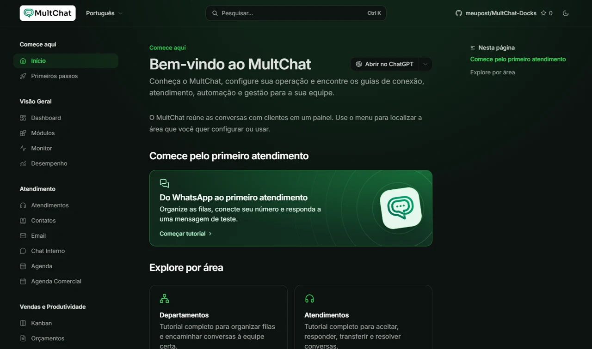
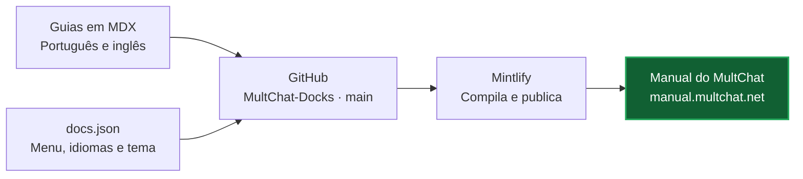

<div align="center">
  <picture>
    <source media="(prefers-color-scheme: dark)" srcset="./logo/multchat-icon.png">
    
  </picture>

  <h1>Manual do MultChat</h1>

  <p>Tutoriais para configurar a operação, atender clientes, automatizar conversas e acompanhar resultados.</p>

  <p>
    <strong><a href="https://manual.multchat.net/">Abrir o manual</a></strong>
    · <a href="https://manual.multchat.net/en">Read in English</a>
    · <a href="#tutoriais">Ver tutoriais</a>
    · <a href="#como-contribuir">Como contribuir</a>
  </p>
</div>

[](https://manual.multchat.net/)

## Tutoriais

Se você está configurando o MultChat pela primeira vez, comece por **Primeiros passos** e **Departamentos**. Se já atende clientes, vá direto a **Atendimentos**. Cada guia está disponível em português e inglês.

| Guia | O que você vai fazer | Acesso |
| --- | --- | --- |
| **Primeiros passos** | Preparar suas filas, conectar um número e testar o primeiro atendimento. | [PT](https://manual.multchat.net/primeiros-passos) · [EN](https://manual.multchat.net/en/primeiros-passos) |
| **Departamentos** | Criar filas, adicionar atendentes e encaminhar conversas para a equipe certa. | [PT](https://manual.multchat.net/organizar-equipe) · [EN](https://manual.multchat.net/en/organizar-equipe) |
| **Atendimentos** | Aceitar, responder, transferir e resolver uma conversa, também no celular. | [PT](https://manual.multchat.net/atender-conversas) · [EN](https://manual.multchat.net/en/atender-conversas) |
| **Construtor de fluxo** | Montar um menu, coletar respostas e simular antes de vincular ao WhatsApp. | [PT](https://manual.multchat.net/flow-builder) · [EN](https://manual.multchat.net/en/flow-builder) |
| **Agentes de IA** | Configurar uma credencial e uma equipe, alimentar a base, testar e ativar no fluxo. | [PT](https://manual.multchat.net/agentes-de-ia) · [EN](https://manual.multchat.net/en/agentes-de-ia) |
| **MultBridge** | Vincular uma sessão ao número da API Oficial e testar as políticas de recebimento e envio. | [PT](https://manual.multchat.net/multbridge) · [EN](https://manual.multchat.net/en/multbridge) |
| **ChatFlow** | Enviar um convite e continuar a conversa na web dentro do mesmo atendimento. | [PT](https://manual.multchat.net/chatflow) · [EN](https://manual.multchat.net/en/chatflow) |
| **Kanban** | Acompanhar negócios por etapa, criar atividades e registrar ganhos e perdas. | [PT](https://manual.multchat.net/kanban) · [EN](https://manual.multchat.net/en/kanban) |
| **Desempenho** | Conferir os indicadores de equipe, avaliações, Score IA e conversão. | [PT](https://manual.multchat.net/desempenho) · [EN](https://manual.multchat.net/en/desempenho) |

O menu do portal acompanha as áreas do MultChat. As páginas marcadas como **em preparação** indicam onde os próximos guias entrarão.

## Do GitHub ao manual



O [Mintlify](https://www.mintlify.com/) acompanha a branch `main`. Uma atualização chega ao domínio público após a compilação e a conclusão do deploy.

## Estrutura do repositório

| Caminho | Conteúdo |
| --- | --- |
| [`docs.json`](./docs.json) | Configuração do portal, navegação por idioma, tema e marca. |
| [`index.mdx`](./index.mdx) | Página inicial em português. Os guias em português ficam na raiz. |
| [`en/`](./en/) | Página inicial e traduções em inglês, com os mesmos nomes de arquivo. |
| [`images/`](./images/) | Imagens dos guias, organizadas por assunto. |
| [`logo/`](./logo/) | Logo e ícone oficiais usados no manual. |
| [`snippets/`](./snippets/) e [`style.css`](./style.css) | Componentes compartilhados e ajustes visuais do portal. |

## Rode a prévia local

Com o Git e o Node.js instalados, clone o repositório e rode a CLI do Mintlify na pasta do projeto.

```sh
git clone https://github.com/meupost/MultChat-Docks.git
cd MultChat-Docks
npx --yes mint@4.3.94 dev
```

Abra o endereço indicado no terminal. Para validar a compilação e conferir os links e âncoras antes de propor mudanças, rode na mesma pasta.

```sh
npx --yes mint@4.3.94 validate
npx --yes mint@4.3.94 broken-links --check-anchors
```

## Como contribuir

1. Confira o passo a passo no MultChat. Use os nomes das telas e indique os módulos, as permissões e os canais necessários.
2. Atualize o guia em português e seu correspondente em inglês. Se for uma página nova, adicione as duas rotas em [`docs.json`](./docs.json).
3. Use dados fictícios em exemplos e imagens. Revise as imagens para retirar chaves, QR Codes ativos e dados de clientes.
4. Confira a prévia em computador e celular, incluindo links, imagens e textos alternativos.
5. Abra um pull request com o guia afetado e uma descrição do que mudou.

Para sugerir uma correção, use **Sugerir edições** no rodapé do guia. Para relatar uma dúvida ou erro de documentação, use **Reportar problema** ou abra uma [issue no GitHub](https://github.com/meupost/MultChat-Docks/issues/new). Inclua o link da página e o passo que precisa de revisão.
