import { PageFeedback } from "/snippets/page-feedback.jsx";

Uma equipe de **Agentes de IA** reúne agentes, conhecimento e regras de atendimento. Neste guia, a **Lia** responde sobre o cardápio da **Doce Pote Confeitaria** e encaminha pedidos que precisam de uma pessoa. O **Téo** entra depois, para cuidar de entregas. Os nomes, preços e imagens são do exemplo fictício do vídeo de treinamento.

## Antes de começar

- Confira se o recurso **Agentes de IA** está disponível para a empresa e se seu perfil pode criar e editar equipes. A configuração do cofre, os testes e a consulta de consumo podem exigir permissões diferentes.
- Tenha uma credencial de um provedor compatível com geração de texto, uma [fila de atendimento](/organizar-equipe) com pessoas disponíveis e uma conexão de teste.
- Separe um cardápio ou tabela de exemplo com dados que o agente pode informar ao cliente. Use dados fictícios para os primeiros testes.

## Cadastre a credencial no Cofre de IA

1. Abra **Administração e Sistema → Configurações → Opções → IA** e encontre **Cofre de credenciais**.
2. Clique em **Adicionar credencial**, selecione o provedor e dê um nome que ajude a identificar o uso, como **IA Doce Pote**.
3. Informe a chave de API do provedor no próprio formulário. Clique em **Testar chave** e salve quando a validação passar.
4. Para o primeiro teste, escolha uma credencial compatível com texto. Configure uma credencial de voz apenas se quiser testar respostas faladas.

<Frame caption="O Cofre de credenciais mostra o provedor, os usos compatíveis e o estado da chave.">
  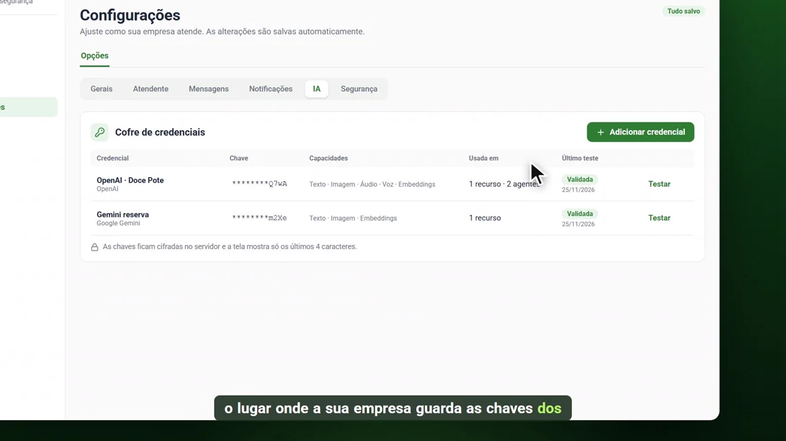
</Frame>

A lista mascara as chaves. Se precisar consultar uma chave salva pela interface, siga a confirmação de senha. Mantenha a chave no cofre e use o nome da credencial para identificá-la nas instruções e nos materiais de suporte.

## Crie a equipe e o primeiro agente

1. Abra **Automação e IA → Agentes de IA → Nova equipe**. Preencha **Atendimento Doce Pote** e clique em **Criar equipe**.
2. Na aba **Agentes**, clique em **Novo agente** e crie **Lia**. Deixe a Lia ativa e configure-a como **agente padrão** para começar as conversas.
3. Em **Modelo de IA**, selecione a credencial cadastrada e um modelo disponível. Para o exemplo, use uma configuração que priorize respostas diretas e consistentes.
4. Nas instruções, diga o que a Lia deve fazer. Um exemplo é “Ajude com sabores e encomendas usando o cardápio. Confirme o valor só quando estiver na tabela. Se o cliente pedir uma pessoa ou faltar informação, ofereça transferência para Vendas.”
5. Em **Configurações → Ferramentas do agente**, selecione **Fila para transferência humana**. Salve a configuração da equipe e confirme que o destino escolhido tem atendentes.

<Frame caption="Na equipe, a aba Agentes lista os agentes e permite criar o primeiro.">
  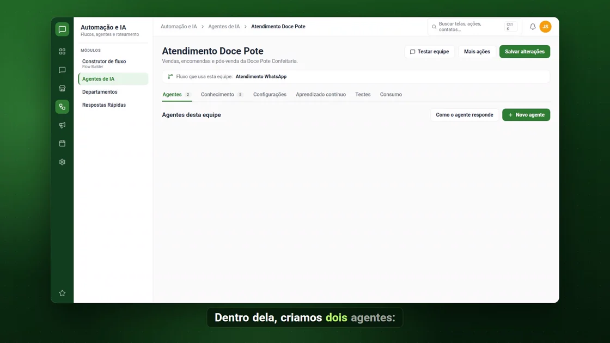
</Frame>

<Frame caption="No agente, escolha a credencial, o modelo e o nível de criatividade das respostas.">
  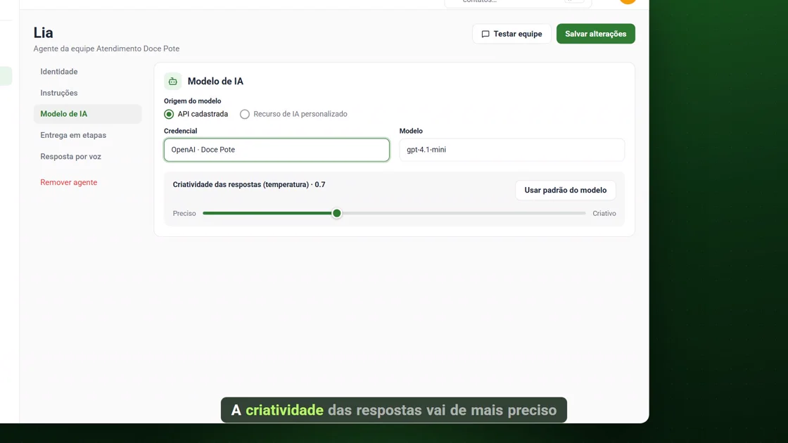
</Frame>

## Ensine o que o agente pode responder

1. Em **Conhecimento**, clique em **Nova seção**. Separe **Cardápio**, **Preços**, **Pagamentos** e **Retirada e entregas** para atualizar cada assunto por conta própria.
2. Inclua regras concretas, como quais sabores estão disponíveis, como calcular o preço e a partir de que momento o pedido pode ser tratado como confirmado. Use informações atuais e sem contradições.
3. Se for útil, adicione arquivos como cardápios em PDF ou imagens. Confira se o conteúdo foi processado antes de depender dele em uma resposta.
4. Salve a equipe. Teste perguntas sobre informações conhecidas e perguntas que a base ainda não cobre. As instruções orientam a resposta, e a conferência no simulador ajuda a detectar respostas incorretas.

Em uma etapa posterior, use **@** nas seções para escolher recursos que aparecem no seletor, como etiquetas, agendas, etapas do Kanban ou elementos de fluxos vinculados. Escreva quando cada ação deve acontecer e confira as permissões e opções do recurso.

<Frame caption="Organize a base por assunto e revise os arquivos associados à seção.">
  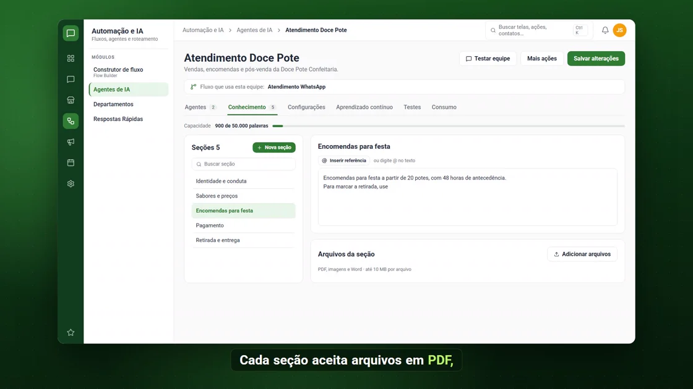
</Frame>

## Teste antes de vincular ao WhatsApp

1. Salve as alterações, confirme que a Lia está ativa e clique em **Testar equipe**. O simulador usa a **versão salva**.
2. Em **Configurar teste**, escolha o agente inicial e o **Canal**. Digite como se fosse o cliente e abra **Bastidores da resposta** para ver o agente, as referências utilizadas e as ações registradas.
3. Use **Reiniciar** para começar outro cenário. Na aba **Testes**, registre os casos que deseja repetir e as expectativas de cada um. Rode-os após alterar instruções, conhecimento, modelo ou ferramentas.

<Warning>
  **Testar equipe** usa modelo e credenciais reais e pode gerar cobrança no provedor. As ações de agenda, Kanban, tags e transferência humana são simuladas. A opção **Gerar voz de verdade** também pode gerar custo quando a resposta usa áudio.
</Warning>

| Pergunte no teste | Confira na resposta |
| --- | --- |
| “Quais sabores vocês têm?” | As opções vêm do cardápio salvo. |
| “Quanto custam 30 potes?” | O cálculo segue a tabela. Se faltar um preço, a resposta pede os dados necessários ou oferece ajuda humana. |
| “Quero falar com uma pessoa.” | O encaminhamento aponta para a fila configurada. |
| “Meu pedido já está confirmado?” | O agente respeita a regra de confirmação definida pela empresa. |

<Frame caption="O simulador mostra a conversa de teste e os bastidores de cada resposta.">
  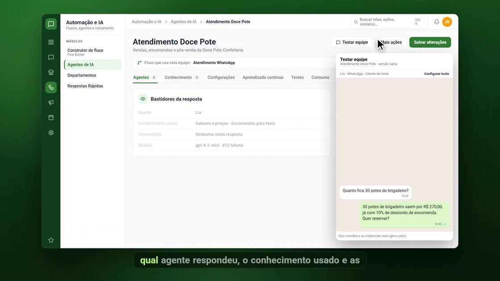
</Frame>

<Frame caption="Guarde casos de teste para verificar depois se o comportamento foi preservado.">
  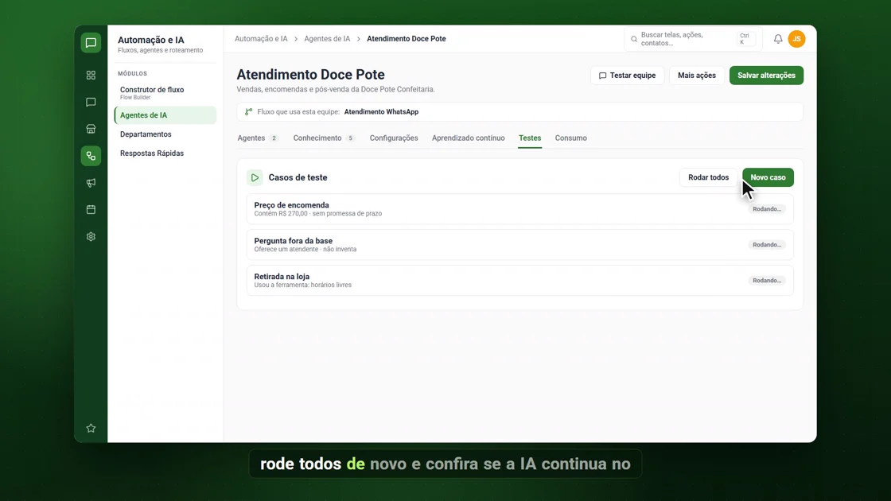
</Frame>

## Ative a equipe em um fluxo e faça um teste no canal

1. No [Construtor de fluxo](/flow-builder), crie ou duplique um fluxo de teste. Adicione o bloco **IA**, ligue **Modo assistente** e selecione **Atendimento Doce Pote** como **Base de conhecimento**. Ligue a entrada do bloco a um caminho que comece em **Início**.
2. Se precisar que o fluxo prossiga após a IA, habilite o encerramento no bloco e configure as saídas correspondentes. Ligue **Concluiu** ao próximo passo e **Transferir** ao caminho humano, conforme as opções habilitadas. Confira também a fila de transferência nas configurações da equipe.
3. Salve o bloco, clique em **Validar** e salve o fluxo na barra superior. Em **Administração e Sistema → Conexões**, abra o WhatsApp de teste e vá a **Chatbot e filas**.
4. Confira o valor atual de **Flow**, selecione o fluxo de teste e salve a conexão.
5. De outro número, teste uma pergunta do cardápio e um pedido de atendimento humano. Confira no MultChat se a conversa chegou à fila e se a IA parou de responder depois que uma pessoa assumiu.
6. Para retirar o fluxo de teste, volte a **Chatbot e filas**, selecione o fluxo anterior ou **Desabilitado** em **Flow** e salve.

<Frame caption="O bloco IA em Modo assistente usa a equipe selecionada para conduzir a conversa.">
  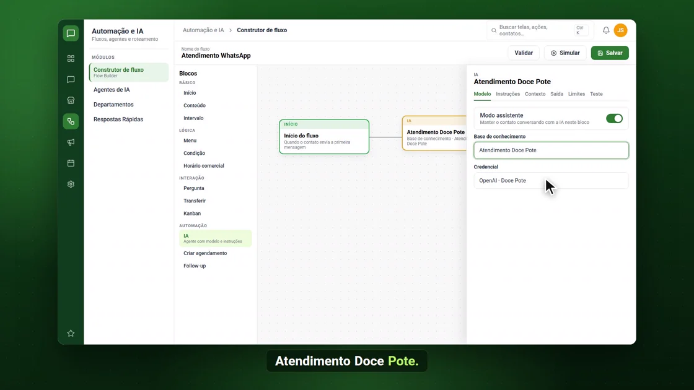
</Frame>

<Frame caption="O campo Flow vincula o fluxo com a equipe de IA à conexão de teste.">
  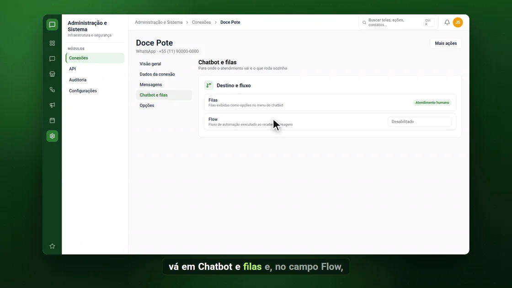
</Frame>

## Amplie a equipe e habilite ferramentas

Depois do primeiro teste, crie **Téo** para entregas e pós-venda. Descreva quando ele deve assumir e escreva a mensagem de transferência entre agentes se quiser avisar o cliente. Teste uma pergunta sobre entrega e confirme nos bastidores quem respondeu. Separe essa troca da transferência para uma pessoa.

| Configuração | O que ajustar |
| --- | --- |
| **Conversa, entrega e voz** | Escolha a espera para reunir mensagens, a entrega em etapas e o modo de resposta por voz, se a empresa usar áudio. Teste o comportamento no canal escolhido. |
| **Horário e follow-up** | Defina quando a equipe pode atender e quais conversas ela pode tentar retomar. O envio depende do canal e das regras de janela de mensagens. |
| **Regras de negócio e segurança** | Defina descontos, promessas que o agente deve evitar, termos e critérios de confirmação. Mantenha os controles de segurança ativos conforme a configuração da equipe. |
| **Ferramentas do agente** | Selecione a fila humana, as agendas permitidas e as ações necessárias, como registrar nota interna, sugerir um desfecho ou consultar catálogo, pedidos e orçamentos. |
| **Pesquisa na web** | Se necessária, configure a credencial e os sites permitidos. Mantenha preço, desconto e condições comerciais na base da empresa. |

A Agenda Comercial citada na base e a agenda interna da equipe têm configurações diferentes. Confira qual está usando antes de testar horários e agendamentos. Para etiquetas e [Kanban](/kanban), revise o quadro, a etapa e a regra de uso. Habilite e teste uma ação por vez. Confira os registros no atendimento de teste. Sugestões comerciais da IA precisam de confirmação para entrar como venda ou perda.

<Frame caption="A página da equipe reúne regras de negócio que orientam as respostas.">
  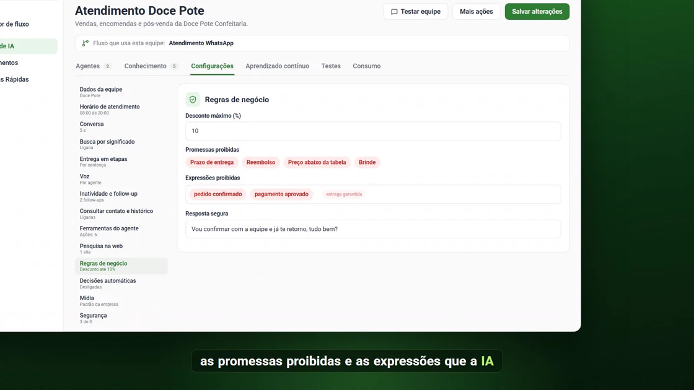
</Frame>

<Frame caption="Em Ferramentas do agente, escolha os destinos e ações que a IA pode usar.">
  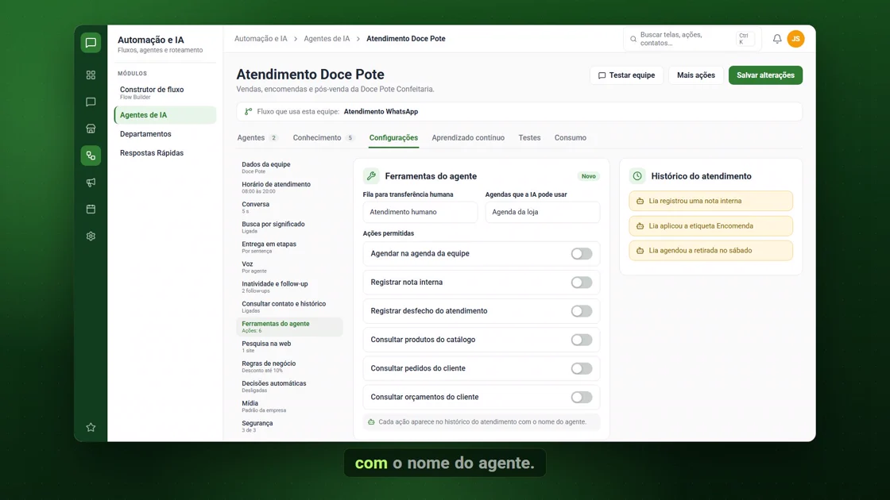
</Frame>

## Revise aprendizados e acompanhe o consumo

- Em **Aprendizado contínuo**, leia a evidência e revise a sugestão antes de aprová-la ou descartá-la. Confira quais aprendizados estão ativos na equipe.
- Em **Consumo**, filtre o período e veja valores e uso registrados por agente, provedor ou modelo, conforme disponíveis. Use a cobrança do provedor para conferir os valores efetivamente faturados.
- Se exportar ou importar uma equipe, use o arquivo **.zip** da opção do MultChat. As credenciais ficam no cofre. Após importar, selecione as credenciais de cada agente e revise os recursos vinculados antes de ativar.

<Frame caption="Revise os aprendizados antes de aprová-los para uso.">
  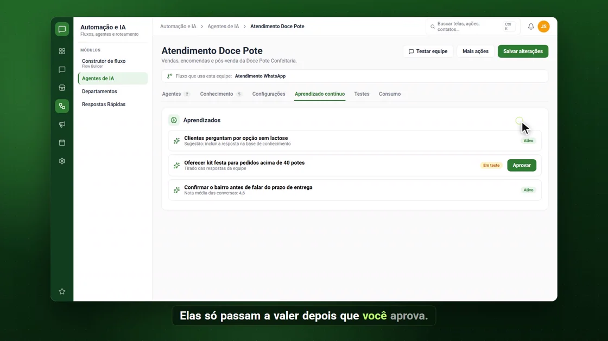
</Frame>

<Frame caption="Consumo mostra como o uso se distribui entre os agentes.">
  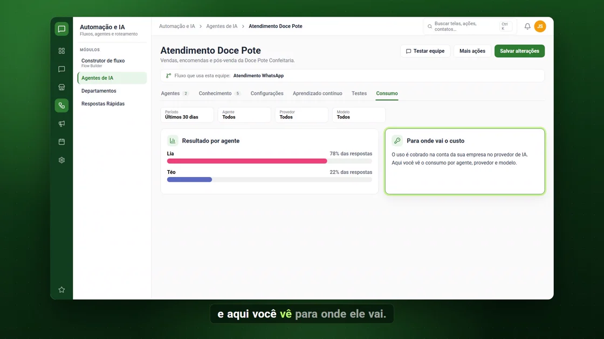
</Frame>

## Resolva problemas comuns

| Se acontecer | Onde conferir |
| --- | --- |
| **Testar equipe** está desabilitado | Salve a equipe e o agente, mantenha ao menos um agente ativo e confira as permissões de teste. |
| A IA respondeu com valor errado ou informação desatualizada | Revise as seções e anexos do assunto, salve e rode novamente os casos de teste. |
| A transferência humana não aconteceu | Confira a fila de destino e as ações permitidas. Se o fluxo tratar a transferência, verifique também a saída ligada no bloco **IA**. |
| Funciona no simulador, mas não no WhatsApp | Confira o fluxo salvo, o campo **Flow** na conexão correta, a situação do canal e se a conversa já está sob atendimento humano. |
| O agente deixou de responder após a troca de provedor | Teste a credencial no cofre e confira se o modelo está disponível para aquela credencial. |

<PageFeedback title="Crie e teste sua primeira equipe de Agentes de IA" path="agentes-de-ia" />
