import { PageFeedback } from "/snippets/page-feedback.jsx";

Na caixa de entrada do MultChat, cada atendimento tem um contato, um canal e, quando atribuídos, uma fila e um responsável. Neste tutorial, Ana atende o pedido de bolo de Marina na **Doce Pote Confeitaria**. Os nomes e as imagens são da demonstração fictícia do vídeo.

## Faça o primeiro atendimento

1. Abra **Atendimento → Atendimentos → Aguardando**. Localize o cartão de Marina pelo nome e confira a fila **Encomendas**.
2. Selecione **Aceitar**. A conversa passa para **Atendendo** e o cartão **Atendimento aceito** registra quem a assumiu, a espera e a conexão.
3. Leia o histórico, digite a resposta e envie. No exemplo, Ana confirma a disponibilidade e usa **+ → Fotos e vídeos** para enviar o cardápio. Marina responde com um áudio.
4. Quando o pedido estiver acertado, selecione **Resolver**. Se a classificação estiver habilitada, registre **Venda realizada**, informe o valor se desejar e confira o bloco **Ao finalizar** antes de confirmar.

Use um perfil com acesso à fila do teste. Se sua equipe ainda precisa configurar o encaminhamento, veja o [tutorial de Departamentos](/organizar-equipe).

<Frame caption="Uma conversa nova na aba Aguardando.">
  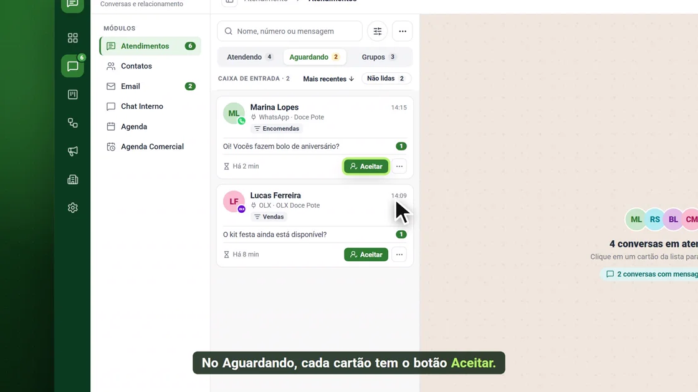
</Frame>

<Frame caption="Conversa aceita com histórico, cardápio e resposta por áudio.">
  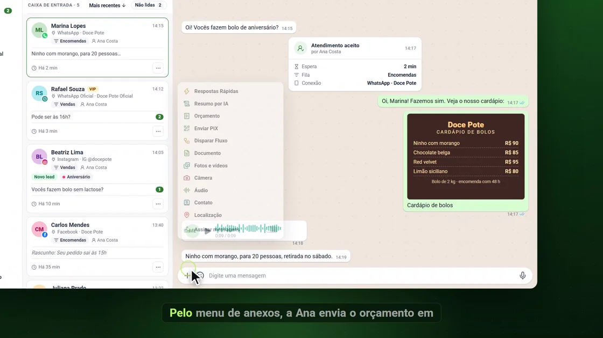
</Frame>

## Encontre conversas na caixa de entrada

No desktop, o menu do módulo fica à esquerda, a lista de atendimentos fica no centro e o histórico da conversa selecionada aparece à direita.

| Aba | O que você encontra |
| --- | --- |
| **Atendendo** | Conversas em andamento que o seu perfil pode consultar. |
| **Aguardando** | Conversas disponíveis para uma pessoa assumir, conforme suas filas e seu acesso. |
| **Grupos** | Grupos de WhatsApp disponíveis para o seu perfil. |

O cartão identifica o contato, o canal, a conexão e, quando houver, a fila e o responsável. Também pode mostrar a última mensagem, o tempo de espera, não lidas, etiquetas, **VIP**, **Novo lead** e o rascunho que você deixou no campo de mensagem.

<Frame caption="O cartão indica canal, fila e responsável.">
  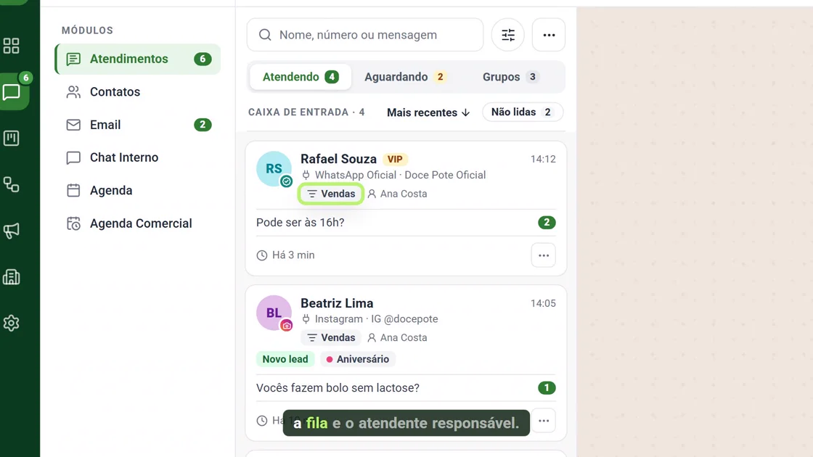
</Frame>

### Busque, filtre e ordene

1. No campo **Nome, número ou mensagem**, digite o que você conhece sobre a conversa.
2. Em **Filtros**, selecione filas ou etiquetas. O filtro por atendentes aparece para quem tem acesso a essa visão. Selecione **Aplicar**.
3. Use **Mais recentes** ou **Mais antigos** para ordenar. **Não lidas** mostra conversas com mensagens não lidas. Uma conversa pode estar lida e continuar esperando resposta.

No menu **⋯** da lista, procure **Novo atendimento**, **Resolvidos**, **Grupos arquivados**, **Busca geral**, **Preferências de visualização** e **Ocultar dados**. **Exibir dados** restaura a exibição no seu navegador.

<Frame caption="Menu da lista com Busca geral, Resolvidos e Preferências de visualização.">
  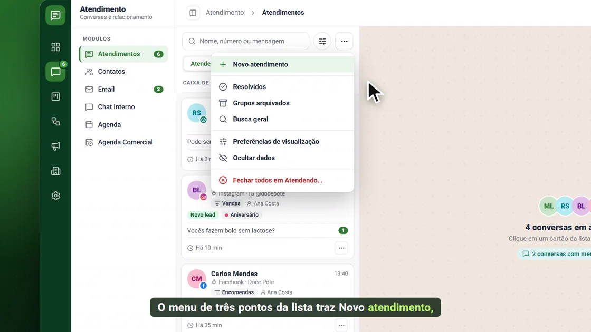
</Frame>

### Confira o alcance do seu perfil

O acesso combina permissões do cargo, filas atribuídas e preferências de visualização. Quem tem acesso apenas aos próprios atendimentos vê as conversas que assumiu. A permissão **Ver atendimentos da própria fila** e os vínculos de departamento definem quais filas aparecem. Em **Preferências de visualização**, cargos autorizados podem consultar um conjunto maior de conversas ou grupos.

O menu **⋯** do cartão oferece ações como **Espionar Conversa**, transferir, fixar, silenciar, bloquear o contato ou encerrar, conforme o perfil, o canal e o estado do atendimento. Nos grupos, arquivar, fixar, silenciar e marcar como lido são ações da sua visão. Use **Grupos arquivados → Desarquivar** para voltar a exibir o grupo na lista.

<Warning>
**Fechar todos** é uma ação em lote para perfis autorizados. Ela usa a aba, a preferência **Meus/Todos** e as filas selecionadas. A busca e os filtros de etiquetas e atendentes não reduzem esse alcance. A confirmação é liberada após cinco segundos.
</Warning>

## Use as ações do cabeçalho

O cabeçalho mostra o contato, o número do atendimento, a conexão, a fila e o responsável. Use **Adicionar tags** para etiquetar a conversa e a lupa para pesquisar dentro do histórico aberto.

Em **⋯**, você pode encontrar **Devolver à fila**, **Agendar mensagem**, **Aceitar áudio do contato** e **Excluir atendimento**, conforme suas permissões. **Devolver à fila** retira a conversa da sua lista em andamento e a leva de volta a **Aguardando**. Se o painel pedir para desafixar a conversa antes de transferir ou devolver, remova a fixação primeiro.

### Transfira para outra pessoa ou fila

1. Abra a ação das setas **Transferir Atendimento**.
2. Escolha um **Usuário de Destino** e, se necessário, a **Fila de Atendimento**. Para deixar a fila assumir depois, selecione **Sem atendente** e escolha a fila.
3. A opção **Conexão** depende da permissão de transferir entre conexões e de um canal compatível. Facebook, Instagram e WebChat continuam na conexão de origem.
4. Selecione **Transferir**. Com um destinatário, o atendimento vai para a pessoa escolhida; com **Sem atendente**, ele volta para **Aguardando**. O histórico fica na conversa e o cartão **Atendimento transferido** registra a mudança.

<Frame caption="Campos de destino da transferência.">
  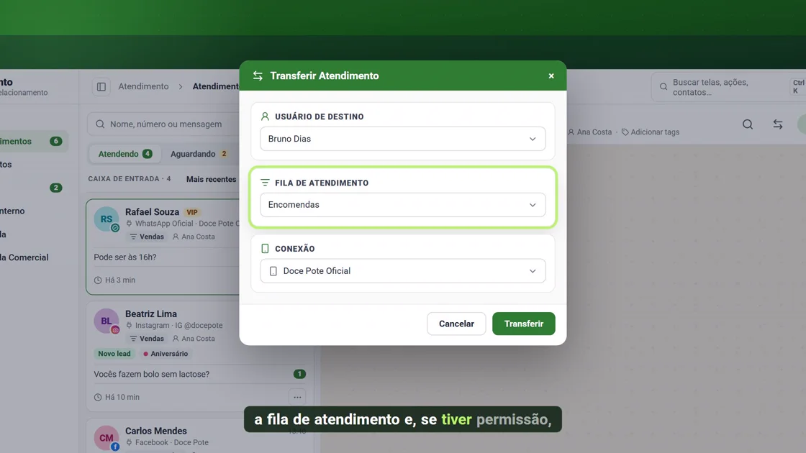
</Frame>

<Frame caption="Registro da transferência no histórico.">
  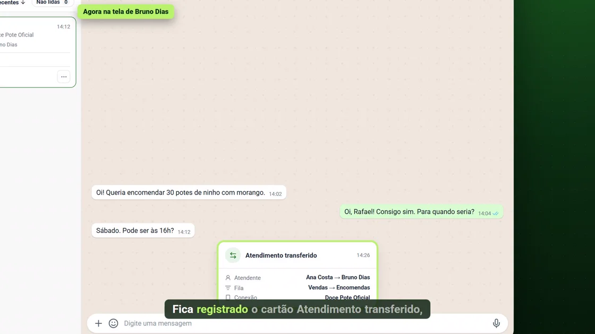
</Frame>

## Envie mensagens e anexos

- Digite no campo de mensagem. **Assinar mensagens**, quando disponível, inclui o nome do atendente no texto enviado.
- Em **+**, escolha **Documento**, **Fotos e vídeos**, **Câmera**, **Áudio**, **Contato** ou **Localização**, conforme o canal. Revise a prévia antes de enviar.
- O mesmo menu pode oferecer **Respostas Rápidas**, **Resumo por IA**, **Orçamento**, **Enviar PIX** e **Disparar Fluxo**. Esses itens dependem dos módulos e das permissões. No exemplo, Ana usa as opções disponíveis para enviar o PDF do orçamento, os dados do sinal e a localização da retirada.
- O seletor de mídia do campo pode oferecer emojis, GIFs e figurinhas. Para gravar áudio, use o microfone. Pause ou ouça a gravação antes de enviar.
- Para abrir um PDF protegido na prévia, informe a senha do arquivo quando o painel solicitar.

Ao abrir o menu de uma mensagem, você pode encontrar ações como responder citando, reagir, copiar, encaminhar, editar, baixar, transcrever ou apagar. O canal e o tipo de mensagem determinam quais aparecem.

<Frame caption="Menu de anexos e recursos no campo de mensagem.">
  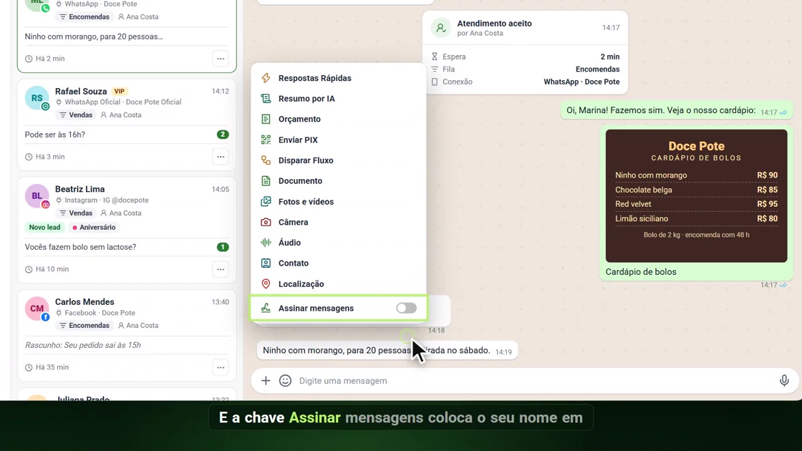
</Frame>

### Confira as regras do canal

| Canal | O que observar no atendimento |
| --- | --- |
| **WhatsApp por QR Code** | Quando disponíveis, use mídia, áudios, figurinhas, reações e recursos de grupo. |
| **WhatsApp Oficial** | Confira o contador de **janela de 24 horas** no cabeçalho. Se o campo bloquear texto livre, use um **modelo aprovado** para retomar o contato. |
| **Instagram e Facebook** | O painel também mostra a janela de mensagens da Meta. Revise o aviso de bloqueio no campo de mensagem antes de responder. |
| **WebChat** | A conversa ocorre no site e não usa o contador de 24 horas da Meta. |
| **OLX** | Responda por texto. O chat da OLX não aceita anexos ou áudios no MultChat. |

<Frame caption="Indicador de tempo restante no WhatsApp Oficial.">
  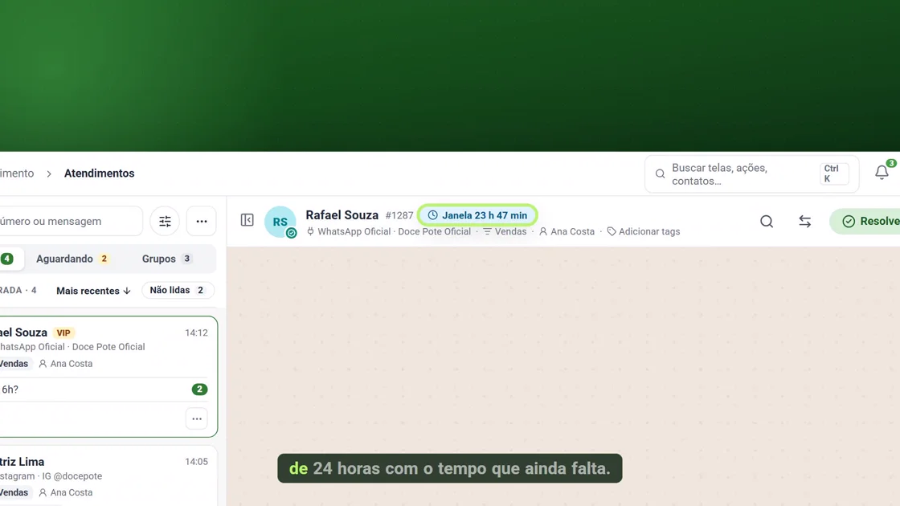
</Frame>

## Consulte os dados do contato

Selecione o nome do cliente no cabeçalho para abrir **Dados do contato**. O painel pode mostrar identificação, telefone, conexão, fila, responsável, etiquetas e ações como **Buscar**, **Ligar** e **Editar**.

Use as seções **Mídia, links e docs**, anotações, valor do cliente e histórico para recuperar informações úteis. Em **Preferências do contato**, revise os controles de áudio, atendimento automático, VIP e bloqueio que o seu perfil e o canal disponibilizam.

<Frame caption="Painel lateral do contato e histórico relacionado.">
  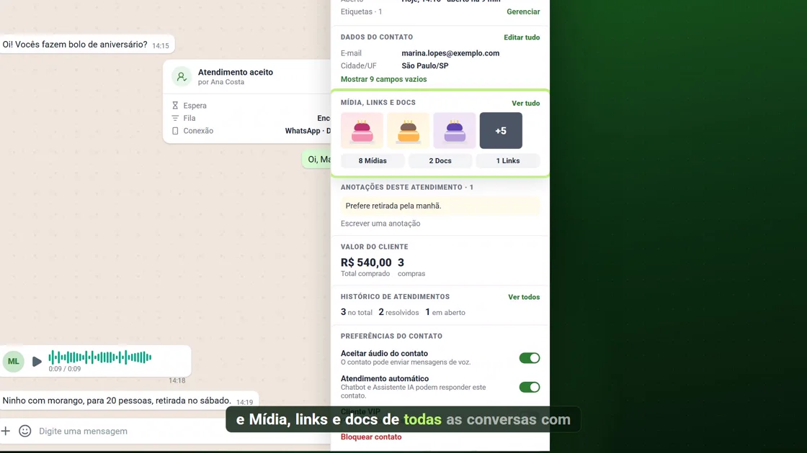
</Frame>

## Resolva e classifique o resultado

1. Selecione **Resolver** no cabeçalho.
2. Se a regra da conexão pedir um resultado, escolha o que aconteceu. Entre as opções estão **Venda realizada**, **Cliente desistiu**, **Sem resposta do cliente**, **Aguardando pagamento**, **Agendamento realizado**, **Não é venda** e **Não identificado**. Os rótulos comerciais podem variar conforme o segmento da empresa.
3. Informe o **Valor** quando aplicável. Em **Cliente desistiu**, selecione o motivo se o painel pedir. Quando a classificação é facultativa, **Pular** preserva um resultado anterior ou deixa um atendimento sem resultado como **Pendente de classificação**.
4. Revise **Ao finalizar** para ver se a conexão enviará despedida ou solicitará pesquisa. Se houver opções facultativas, confira sua seleção. Clique em **Finalizar**.

O resultado registrado alimenta **Desempenho → Perdas e conversões**. Para voltar a uma conversa encerrada, abra **⋯ → Resolvidos**, localize o atendimento e use **Reabrir atendimento**, se o seu cargo permitir.

<Frame caption="Exemplo de classificação e prévia das mensagens de encerramento.">
  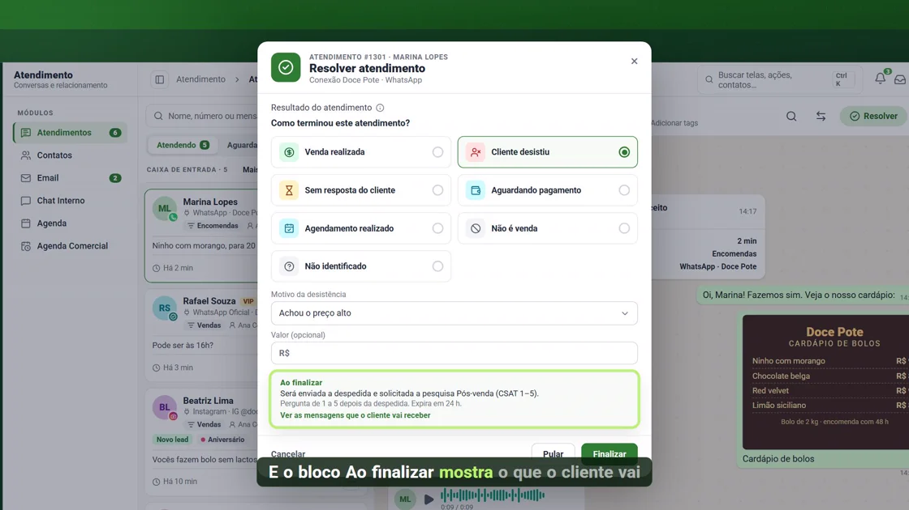
</Frame>

## Use Atendimentos no celular

1. Abra **Atendimentos**, selecione a aba e toque no cartão. A conversa abre em tela cheia; use a seta de voltar para rever a lista.
2. Toque em **+** para abrir **Anexar e enviar**. Abra as opções da mensagem para encontrar as ações e reações disponíveis.
3. Use o botão compacto **Resolver** ou o menu da conversa para acessar as ações, transferir ou finalizar conforme suas permissões.

<Frame caption="Caixa de entrada no celular.">
  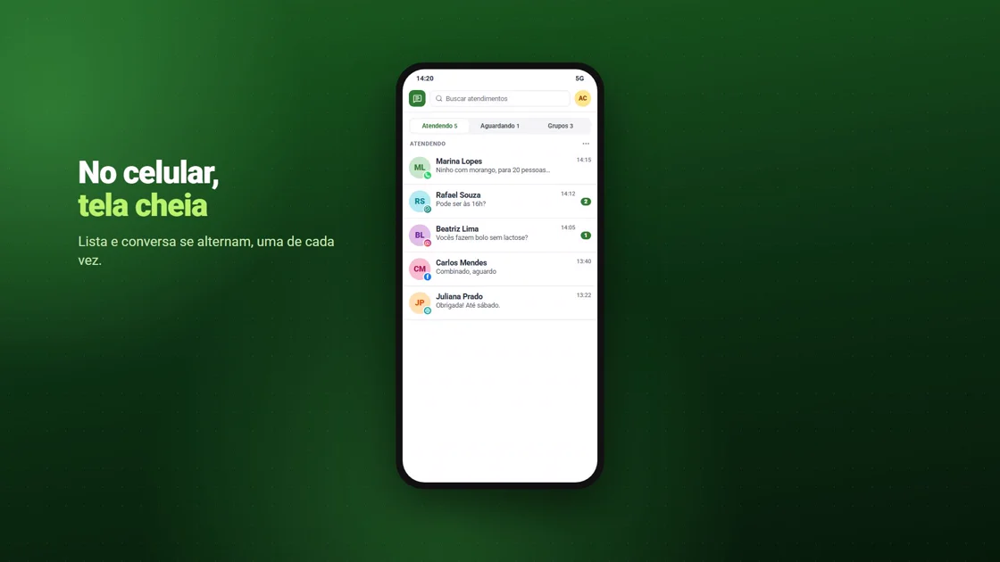
</Frame>

## Resolva situações comuns

<AccordionGroup>
  <Accordion title="A conversa saiu da lista">
    Confira as abas **Atendendo** e **Aguardando** e limpe os filtros. Se a conversa foi transferida, devolvida ou aceita por outra pessoa, a visibilidade pode mudar. Use **Busca geral** ou **Resolvidos**, conforme seu acesso.
  </Accordion>
  <Accordion title="Uma ação de transferência, resolução ou anexo não aparece">
    Confira o estado da conversa, seu cargo e o canal. Algumas ações exigem um módulo ativo, uma conversa em andamento ou uma conexão compatível.
  </Accordion>
  <Accordion title="O WhatsApp Oficial bloqueou o texto livre">
    Confira a janela no cabeçalho. Se ela estiver encerrada, abra a opção de modelos e selecione um modelo aprovado para a conexão.
  </Accordion>
  <Accordion title="Usei Ocultar dados. O que o cliente vê?">
    A opção desfoca informações na sua tela. A conversa no canal do cliente e a visão da equipe continuam como estavam.
  </Accordion>
</AccordionGroup>

<PageFeedback title="Atendimentos" path="atender-conversas" />
