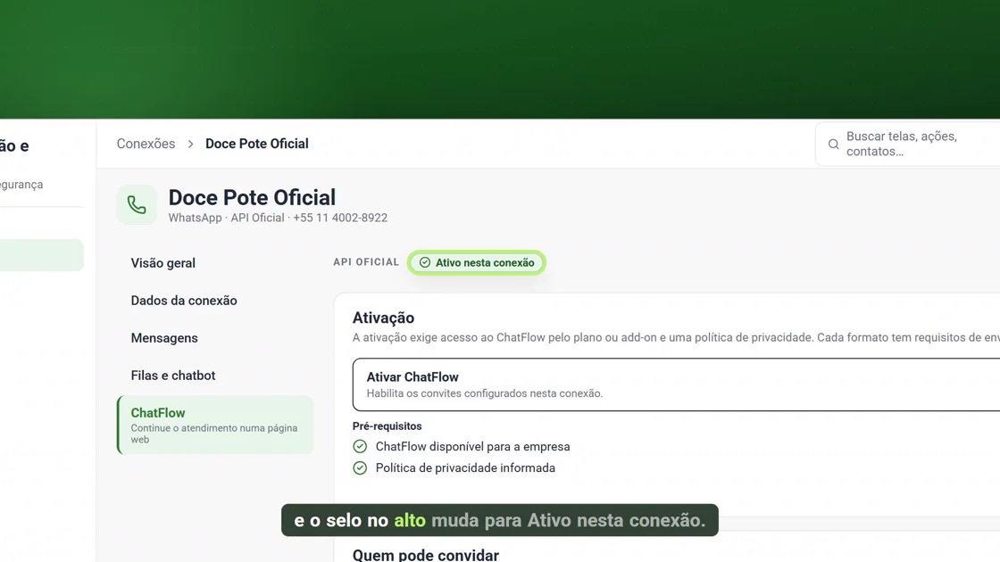
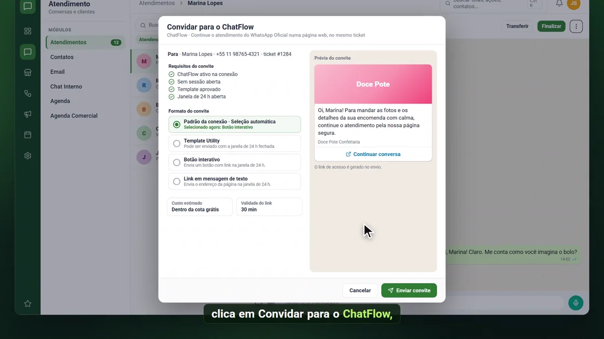
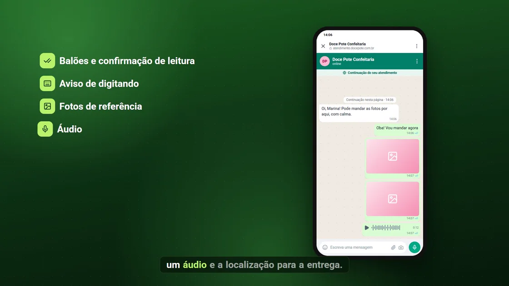
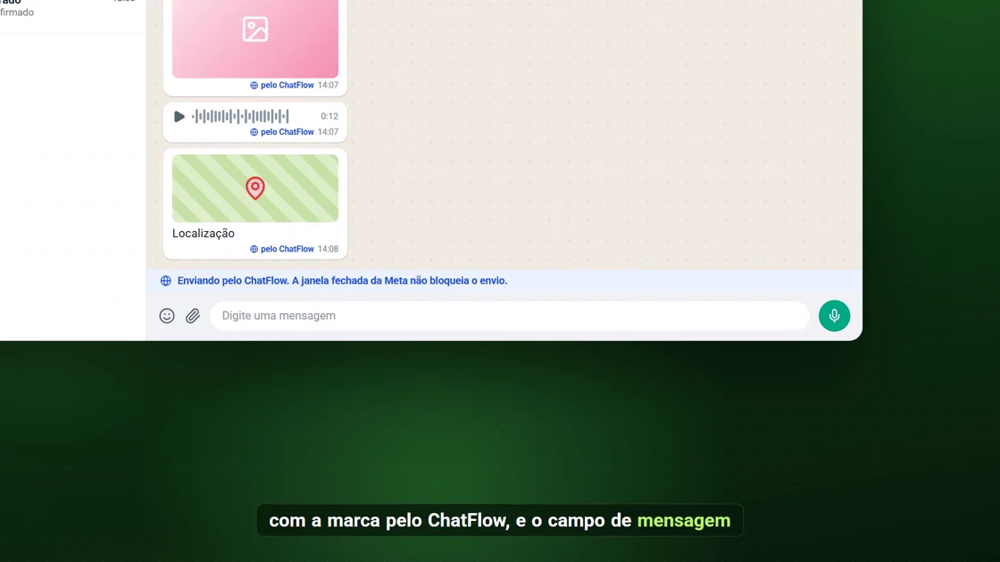
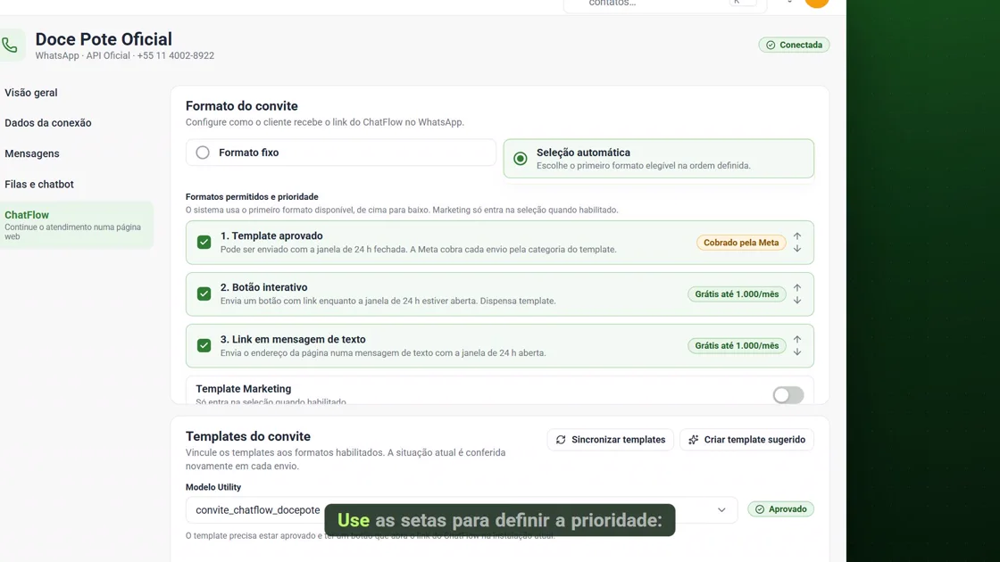
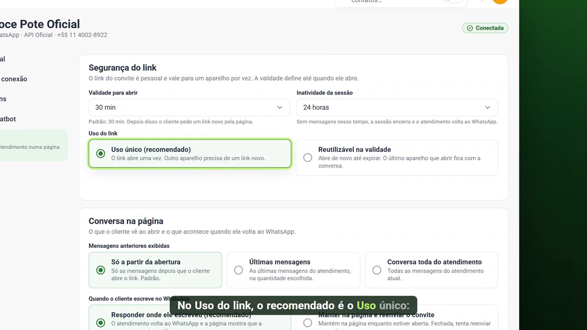
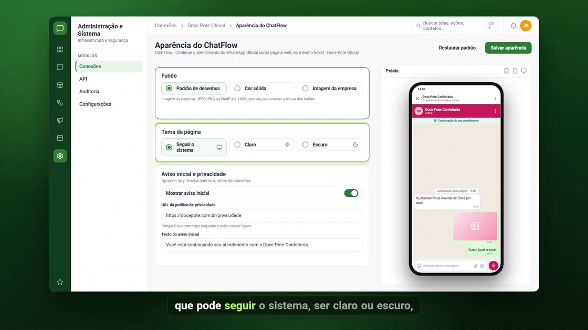
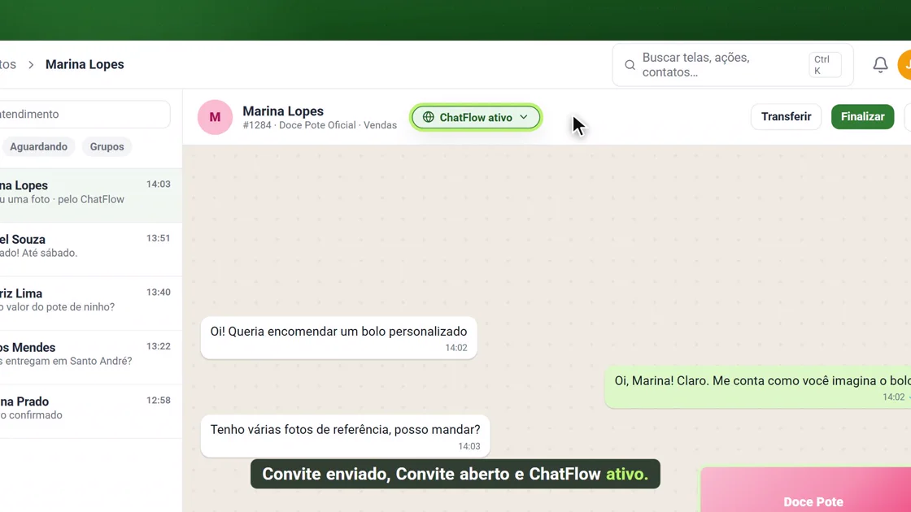
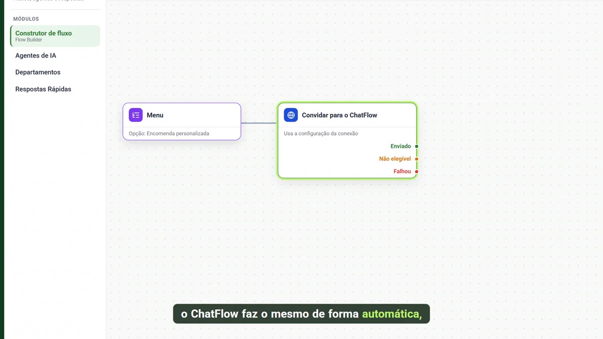

import { PageFeedback } from "/snippets/page-feedback.jsx";

O **ChatFlow** envia pelo WhatsApp um convite pessoal para continuar a conversa no navegador. O cliente abre a página e envia mensagens por lá. Para a equipe, a conversa continua no mesmo atendimento do MultChat, com o histórico já registrado. As imagens vêm do vídeo de treinamento da **Doce Pote Confeitaria**, uma empresa fictícia.

## Antes de começar

- Use uma conexão ativa da **API Oficial do WhatsApp**. Confira se o plano ou add-on dá acesso ao **ChatFlow** e se ele está ligado em **Módulos**.
- Para configurar, use um perfil com permissão para editar conexões. Para convidar manualmente, o atendente precisa da permissão do ChatFlow.
- Tenha a URL pública, com **HTTPS**, da política de privacidade da empresa. Separe um segundo número para testar uma conversa individual antes de enviar convites a clientes.

## Ative o ChatFlow na conexão

1. Abra **Administração e Sistema → Conexões**, entre na conexão oficial e selecione **ChatFlow**. Em **Ativação**, confira as pendências.
2. Em **Aparência**, clique em **Editar aparência**. No **Aviso inicial**, preencha a URL da política de privacidade e clique em **Salvar aparência**. Volte à aba **ChatFlow**.
3. Ligue **Ativar ChatFlow**. Em **Quem pode convidar**, habilite **Atendente** para o teste manual. Habilite **Fluxo do FlowBuilder** se também quiser enviar convites pelo construtor.
4. Em **Formato do convite**, selecione **Botão interativo** para o primeiro teste com uma mensagem recente do cliente. Para usar template ou mais de um formato, veja [como escolher o formato](#escolha-o-formato-do-convite).
5. Clique em **Salvar ChatFlow** e confira o selo **Ativo nesta conexão**. O ChatFlow tem seu próprio salvamento na aba.

<Frame caption="A ativação mostra se a empresa tem acesso e se a política de privacidade foi informada.">
  
</Frame>

## Envie um convite de teste

1. Do número de teste, envie uma mensagem para a conexão oficial. No MultChat, abra o atendimento individual.
2. No menu de ações do atendimento, clique em **Convidar para o ChatFlow**. Confira o contato, os requisitos, o formato, a validade, a prévia e o custo estimado quando disponível. Clique em **Enviar convite**.
3. No WhatsApp do número de teste, abra o link ou o botão **Continuar conversa**. Leia o aviso inicial e toque em **Continuar** se ele aparecer.
4. Envie um texto ou uma foto pela página. No MultChat, confira se a mensagem aparece no mesmo atendimento com a indicação do ChatFlow.
5. No painel, confirme **Enviando pelo ChatFlow** antes de responder. Envie uma resposta de teste e confira se ela aparece na página aberta no celular.
6. No celular, use **Voltar ao WhatsApp** e mande uma mensagem pelo WhatsApp. Com **Responder onde ele escreveu** configurado, confira que a equipe volta a responder por lá.

<Frame caption="O atendente revisa o formato e a prévia antes de enviar o convite.">
  
</Frame>

<Frame caption="A página abre no navegador do cliente e permite enviar mensagens e anexos.">
  
</Frame>

<Frame caption="O campo de mensagem indica quando a próxima resposta será enviada pelo ChatFlow.">
  
</Frame>

## Escolha o formato do convite

A janela de 24 horas da API Oficial é contada a partir da última mensagem do cliente no WhatsApp. Ela determina quais formatos podem sair pelo WhatsApp. A conversa na página pode continuar enquanto a sessão do ChatFlow estiver ativa.

| Formato | Quando usar |
| --- | --- |
| **Botão interativo** | Com a janela aberta, envia um botão que abre a página. Em **Mensagem com botão**, ajuste o texto, o rodapé, o rótulo do botão e, se desejar, a imagem de cabeçalho. |
| **Link em mensagem de texto** | Com a janela aberta, envia texto simples. Em **Mensagem de texto**, ajuste o convite. O ChatFlow acrescenta o link ao final. |
| **Template aprovado** | Pode ser usado com a janela fechada. A conexão precisa ter acesso ao envio de templates, e o modelo deve estar aprovado e ter um botão compatível com o link do ChatFlow. |

Você pode fixar um formato ou escolher **Seleção automática**. Nesse caso, use as setas para ordenar os formatos permitidos. O ChatFlow tenta usar o primeiro elegível da lista, de cima para baixo. A opção **Template Marketing** só entra se for habilitada e se o contato atender aos requisitos de consentimento.

Em **Templates do convite**, selecione um template compatível. Se precisar, use **Criar template sugerido** com um perfil autorizado a gerenciar templates. Aguarde a aprovação da Meta e clique em **Sincronizar templates** para atualizar os estados. O MultChat verifica a elegibilidade do template ao enviar.

<Frame caption="Na seleção automática, a ordem define qual formato elegível será usado primeiro.">
  
</Frame>

A prévia do convite mostra o custo estimado quando o MultChat tem tarifa cadastrada. Convites, avisos e outras mensagens pelo WhatsApp seguem as regras da Meta aplicáveis ao formato. As mensagens trocadas na página do ChatFlow ficam fora do envio pela API Oficial. Consulte as tarifas vigentes se precisar estimar o custo. [Preços da Plataforma do WhatsApp Business](https://developers.facebook.com/documentation/business-messaging/whatsapp/pricing)

## Configure o acesso e o retorno ao WhatsApp

Em **Segurança do link**, revise estas opções.

| Opção | O que muda |
| --- | --- |
| **Validade para abrir** | Define até quando o cliente pode abrir o convite. O padrão é **30 minutos**. **Sem prazo** só está disponível com **Uso único**. |
| **Uso único** | O convite serve para uma abertura. Para usar outro aparelho, é necessário um novo link. |
| **Reutilizável na validade** | Permite abrir de novo até expirar. O último aparelho que abrir fica com a conversa. |
| **Inatividade da sessão** | Encerra a sessão quando ninguém envia mensagens durante o prazo configurado e devolve o atendimento ao WhatsApp. |

Em **Conversa na página**, escolha quais mensagens anteriores ficam visíveis. O padrão é **Só a partir da abertura**. Você também pode mostrar **Últimas mensagens** ou a **Conversa toda do atendimento**.

<Warning>
  Trate o convite como pessoal. Quem receber o link encaminhado antes da primeira abertura pode acessar a página e ver o histórico que você configurou. Para o primeiro teste, mantenha **Uso único**, uma validade limitada e **Só a partir da abertura**.
</Warning>

<Frame caption="Validade do convite, uso do link e inatividade da sessão são ajustes diferentes.">
  
</Frame>

Em **Quando o cliente escreve no WhatsApp**, **Responder onde ele escreveu** devolve o atendimento ao WhatsApp quando o cliente escreve por lá. **Manter na página e reenviar o convite** mantém a conversa na página enquanto ela estiver aberta e tenta reenviar o convite se estiver fechada. Se o reenvio estiver indisponível, a próxima resposta segue pelo WhatsApp.

Na mesma seção, você pode habilitar **Avisar pelo WhatsApp com a página fechada**, configurar o atraso, o intervalo e o máximo de avisos, ou restringir convites em atendimentos iniciados por anúncio. Salve em **Salvar ChatFlow**.

## Personalize a página do cliente

Abra **Aparência → Editar aparência**. Escolha **Estilo WhatsApp**, **Marca da empresa** ou **Personalizado**. Ajuste nome, logo, avatar, cores, fundo e tema. Revise a URL da política de privacidade e, se usado, o conteúdo do **Aviso inicial**. Use a prévia para conferir a leitura no celular e corrija avisos de contraste antes de clicar em **Salvar aparência**.

<Frame caption="A prévia mostra a página que o cliente verá no celular.">
  
</Frame>

## Acompanhe e encerre a sessão

O selo no cabeçalho mostra estados como **Convite enviado**, **Convite aberto** e **ChatFlow ativo**. Abra o selo para ver a situação e as ações disponíveis. Enquanto o convite estiver pendente, você pode reenviar, quando elegível, ou **Cancelar convite**. Com uma sessão ativa, use **Encerrar sessão do ChatFlow** para cessar o atendimento pela página. Se finalizar o atendimento inteiro, a página pode mostrar a avaliação de acordo com as configurações da empresa.

Na conexão, **Uso e custo** reúne convites, aberturas, sessões ativas, volume de mensagens na página e estimativa dos convites no período mostrado.

<Frame caption="O selo do ChatFlow mostra o estado da sessão diretamente no atendimento.">
  
</Frame>

## Automatize o convite no FlowBuilder

1. Em **ChatFlow → Quem pode convidar**, habilite **Fluxo do FlowBuilder** e salve.
2. No [Construtor de fluxo](/flow-builder), procure o bloco **Convite ChatFlow**. Ele aparece no exemplo do vídeo como **Convidar para o ChatFlow**.
3. Ligue **Enviou**, **Não elegível** e **Falhou** aos caminhos correspondentes. Para um cliente não elegível ou um erro de envio, planeje como o atendimento continua.
4. Valide e simule o fluxo. Depois, teste o envio em uma conexão de teste da API Oficial para conferir a entrega do convite e a abertura da página.

<Frame caption="No Construtor de fluxo, trate as três saídas do bloco de convite.">
  
</Frame>

## Resolva problemas comuns

| Se acontecer | O que fazer |
| --- | --- |
| **Ativar ChatFlow** está bloqueado | Confira o plano, **Módulos**, o tipo de conexão, as permissões e a URL HTTPS da política de privacidade. |
| O atendimento não pode receber convite | Abra o diálogo e leia o motivo. Confira se é um atendimento individual elegível, se a origem do convite está habilitada e se existe um formato disponível para a janela atual. |
| O link expirou | Se a página oferecer **Receber novo link no WhatsApp**, o cliente pode pedir por ali. O atendente também pode verificar a opção de reenvio no selo. |
| O cliente abriu em outro aparelho | No modo reutilizável, a última abertura assume a sessão. Em **Uso único**, envie um novo convite quando for necessário trocar de aparelho. |
| O cliente respondeu no WhatsApp enquanto usava a página | Confira a regra em **Conversa na página** e a indicação acima do campo de resposta no atendimento. |

<PageFeedback title="Continue um atendimento na web com o ChatFlow" path="chatflow" />
