import { PageFeedback } from "/snippets/page-feedback.jsx";

Em **Visão Geral → Desempenho**, você acompanha o que aconteceu nos atendimentos, como os clientes avaliaram a experiência e quais negócios foram ganhos ou perdidos. As imagens deste guia são do vídeo de treinamento da **Doce Pote Confeitaria**, uma empresa fictícia. Use o exemplo para descobrir de onde vem cada indicador.

## Comece com uma semana de teste

1. Em [Atendimentos](/atender-conversas#resolva-e-classifique-o-resultado), aceite e responda a uma conversa de teste. No vídeo, Ana fecha um bolo de **R$ 180**. Ela usa **Resolver**, escolhe **Venda realizada**, informa o valor e confere **Ao finalizar** antes de confirmar.
2. Em outro atendimento de teste, registre **Cliente desistiu**, selecione o motivo **Preço** e informe **R$ 240** como valor potencial, se o campo estiver disponível. Esse valor aparece como potencial perdido.
3. Em uma conexão com pesquisa configurada, peça ao contato de teste para responder à avaliação recebida depois da finalização. No exemplo, Marina dá nota **5**.
4. Abra **Desempenho**, selecione o intervalo dos testes e veja **Equipe** para os atendimentos finalizados, **Avaliações** para a nota e **Perdas e conversões** para os resultados registrados.
5. Se você também testar um agente de IA, confira a sugestão de desfecho e confirme só depois de verificar a conversa. No vídeo, Duda sugere uma venda e a equipe confirma no dia seguinte.

<Frame caption="O resultado comercial nasce no atendimento quando a equipe confirma a classificação.">
  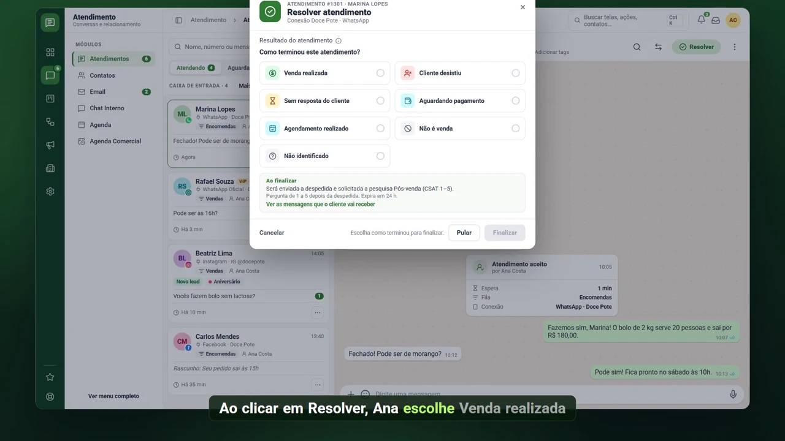
</Frame>

Nesse exemplo, com **uma venda e uma perda confirmadas** no mesmo recorte, a conversão é **50%**. Dois resultados ainda formam uma **amostra pequena**. Uma nota 5 também é só uma resposta. Use os registros para conferir se a operação está alimentando a tela antes de comparar desempenho.

## Defina o período e os filtros

1. Escolha **Hoje**, **7 dias**, **Este mês** ou **Personalizado**. Confira no cabeçalho da aba o intervalo selecionado e as datas do período anterior usado na comparação.
2. Abra **Filtros**, selecione **Fila** e **Tag** conforme o objetivo e clique em **Aplicar**. Leia os avisos dos cartões. Alguns indicadores usam fontes que não aceitam o mesmo filtro.
3. No menu **⋯**, use **Atualizar dados** para pedir uma atualização. Confira a indicação de quando os dados foram calculados se o sistema mantiver o último resultado carregado.
4. Use **Exportar** quando estiver disponível para baixar os dados da aba atual com o recorte aplicado.

<Frame caption="Confira o intervalo e aplique os filtros antes de comparar os números.">
  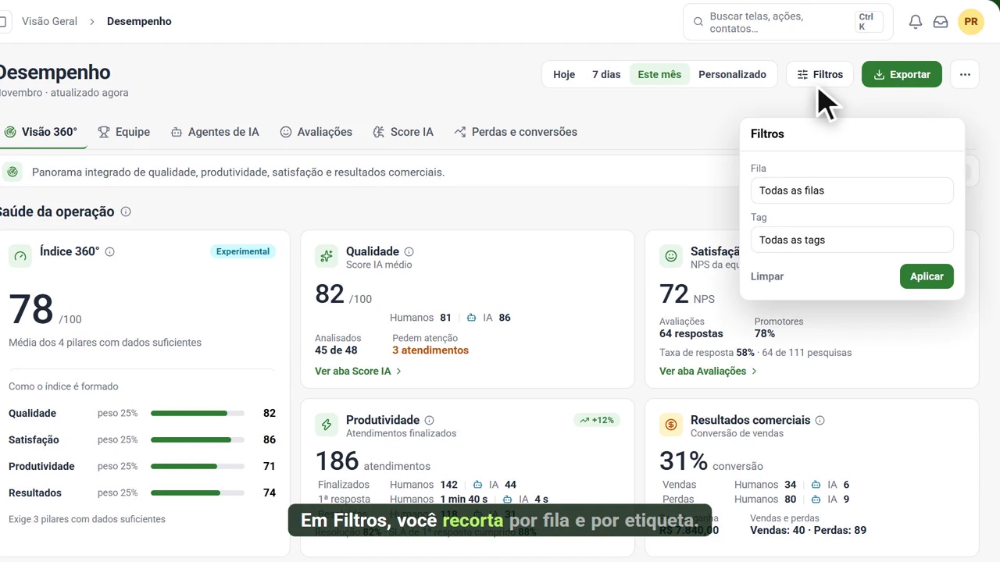
</Frame>

| O que aparece | Como interpretar |
| --- | --- |
| **0** | A métrica pôde ser calculada e teve resultado zero. |
| **Amostra pequena** | Há registros, mas a quantidade ainda limita comparações, rankings ou alertas. |
| **Ainda sem dados** | Faltam registros para o indicador no recorte, como respostas à pesquisa ou resultados classificados. |
| **Falta configurar** | A fonte precisa de uma configuração, como meta de primeira resposta ou um quadro medido. |
| **Sem permissão** | Seu perfil não tem acesso a algum dado. A disponibilidade das abas também depende dos módulos ativos. |

## Leia a Visão 360°

A primeira aba reúne **Qualidade** a partir do Score IA, **Satisfação** a partir das avaliações, **Produtividade** a partir dos atendimentos e seus tempos e **Resultados** a partir das vendas e perdas confirmadas. Use a separação entre pessoas e agentes de IA onde a tela oferecer esse recorte.

O **Índice 360°** é experimental e vai de **0 a 100**. Com os quatro pilares válidos, cada um tem peso de **25%**. Quando só três têm dados suficientes, o peso é redistribuído entre eles. Com menos de três, o índice fica indisponível. Abra os indicadores de origem antes de tirar conclusões sobre a equipe.

Veja a evolução semanal e as metas, use **Destaques e pontos de atenção** para investigar mudanças e abra **Equipe em 360°** para conferir os indicadores por pessoa conforme seu acesso.

<Frame caption="O Índice 360° aparece ao lado dos quatro pilares e da evolução semanal.">
  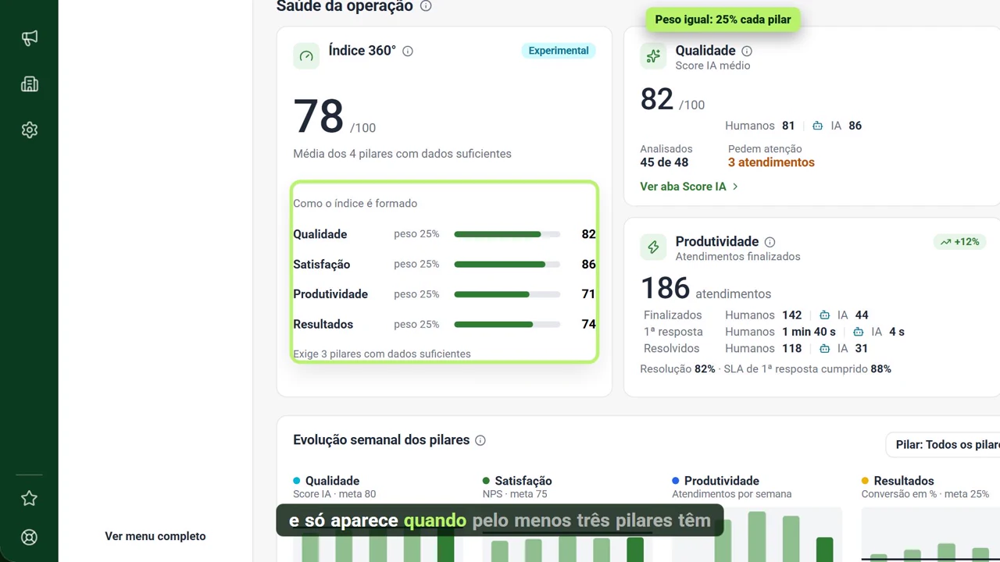
</Frame>

## Acompanhe a equipe e abra o Perfil 360°

| Indicador | O que mede |
| --- | --- |
| **Finalizados** | Atendimentos concluídos no período selecionado. |
| **TMR médio** | Tempo médio desde a entrada do atendimento até a primeira resposta humana, nos casos com esse registro. |
| **TMA médio** | Tempo médio do início do atendimento humano até a finalização ou o início da etapa de avaliação, quando registrada. |
| **Taxa de resolução** | Proporção de atendimentos elegíveis que ficaram sem reabertura por sete dias. Os encerramentos recentes aguardam o fim desse prazo. |
| **Agora** | Situação atual da operação, incluindo atendimentos ativos e o maior tempo de espera. |

Em **Ranking da equipe**, mude o indicador de ordenação e use a carga de trabalho para comparar o volume com a média. Selecione uma pessoa para abrir seu **Perfil 360°**. O radar compara produtividade, agilidade, satisfação, qualidade, conversão e resolução com a média da equipe. Confira também o SLA individual, o histórico e as taxas de transferência e reabertura.

A visão individual depende do acesso aos atendimentos. Quem só pode ver os próprios registros consulta a própria linha e os totais coletivos disponíveis.

<Frame caption="Equipe reúne volume, tempos, resolução e ranking.">
  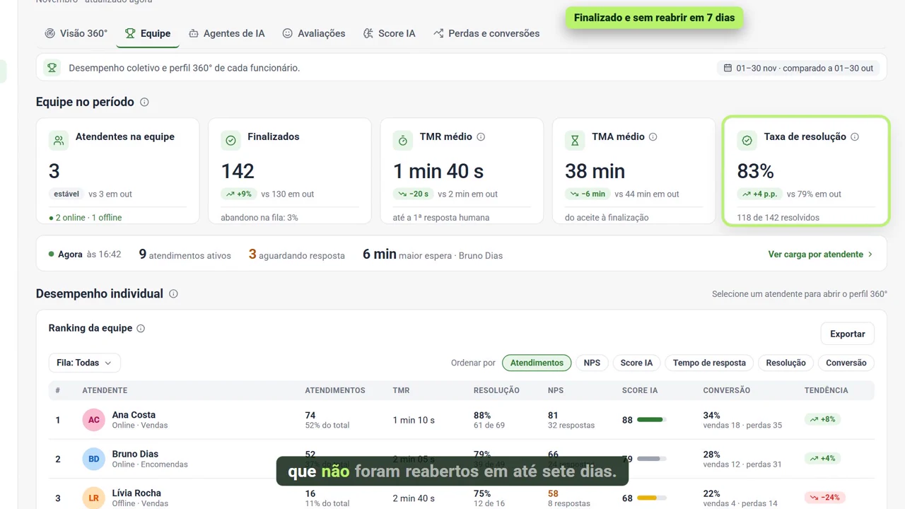
</Frame>

<Frame caption="O Perfil 360° compara os seis eixos com a média da equipe.">
  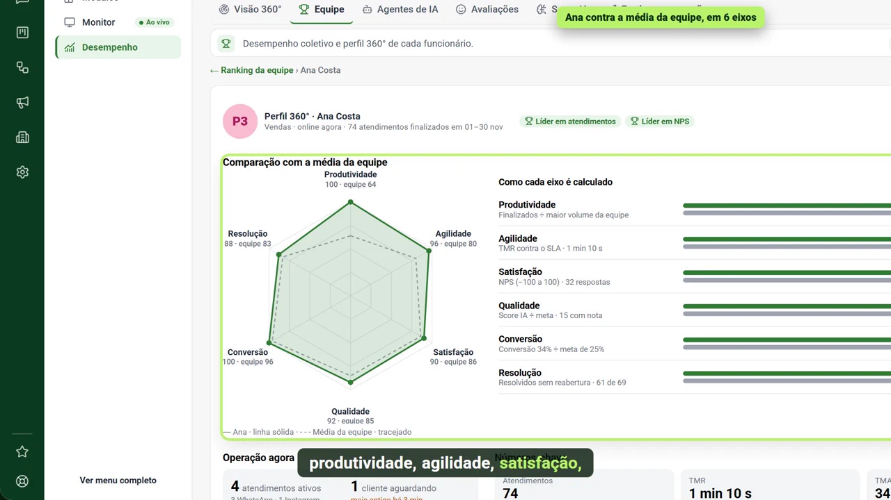
</Frame>

## Veja o que os Agentes de IA fizeram

1. Em **Automação e IA → Agentes de IA**, configure uma equipe de IA com a base de conhecimento e as regras do seu negócio.
2. No [Construtor de fluxo](/flow-builder), adicione o bloco **IA**, selecione a equipe, prepare o caminho de transferência para uma pessoa e valide. Salve e vincule o fluxo à conexão de teste.
3. Faça uma conversa de teste. Abra **Desempenho → Agentes de IA** e confira atendimentos, resolvidos pela IA, transferidos para humano, primeira resposta e consumo de tokens.
4. Se a IA sugeriu um resultado comercial, revise o atendimento antes de confirmar ou descartar. Só resultados confirmados entram como vendas ou perdas.

Os agentes aparecem em uma categoria própria, agrupados por equipe de IA. Abra um agente para ver o diagnóstico e investigar, quando houver registro, falhas, demora do modelo, respostas de segurança, violações de regras e transferências anunciadas que não foram realizadas.

<Frame caption="A aba separa resoluções da IA, transferências e resultados comerciais confirmados.">
  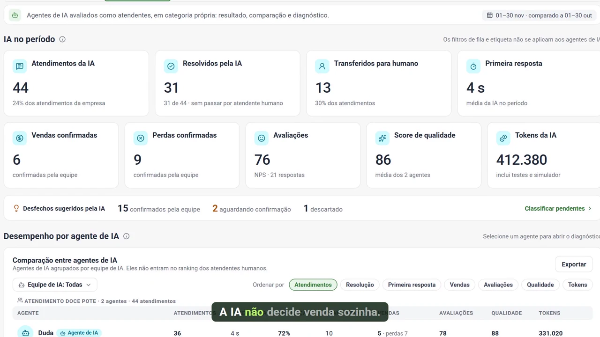
</Frame>

## Leia as Avaliações dos clientes

1. Use uma pesquisa ativa na jornada de avaliação aplicada à conexão e confirme a opção de pesquisa em **Ao finalizar**. O prazo de resposta segue a configuração da pesquisa.
2. Abra **Avaliações** e confira **Enviadas**, **Respondidas** e a taxa de resposta por canal. A taxa compara respostas com envios no recorte mostrado.
3. Compare pesquisas na escala exibida. O **CSAT** mostra satisfação conforme a escala da jornada, como **1 a 5**. O **NPS** usa a escala **0 a 10** e subtrai a porcentagem de detratores da porcentagem de promotores.
4. Abra **Voz do cliente** para ler as respostas registradas. Use **Perguntar o motivo** quando quiser acrescentar uma pergunta sobre notas baixas à pesquisa escolhida e tiver permissão para editá-la.

No NPS, notas **9–10** são de promotores, **7–8** de neutros e **0–6** de detratores. Com menos de **30 respostas**, o NPS é indicativo. Em painéis que consolidam NPS, avaliações compatíveis de 1 a 5 podem ser convertidas para a escala de 0 a 10. Abra a pesquisa de origem para conferir a escala da resposta recebida.

<Frame caption="Avaliações reúne resultados por jornada, taxa de resposta por canal e evolução.">
  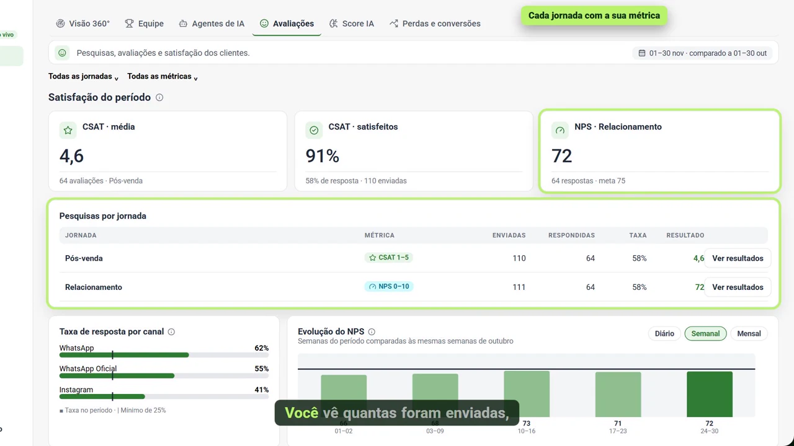
</Frame>

## Configure e gere o Score IA

1. Confirme se o plano inclui **Score IA** e se o seu perfil pode visualizar, configurar ou gerar avaliações. Em **Administração e Sistema → Configurações → Opções → IA**, configure o provedor e o modelo para **Score IA**.
2. Em **Desempenho → Score IA → Configurar avaliação**, escolha a quantidade por atendente, entre **3 e 50**. Revise a temperatura e, se quiser avaliar **Aderência ao protocolo**, informe os critérios de atendimento da empresa. Salve.
3. Selecione **Gerar nova avaliação**, confira as opções e aguarde o resultado. Veja a cobertura para saber quantos atendimentos da amostra foram lidos.
4. Revise as categorias **Cordialidade**, **Clareza**, **Proatividade**, **Rapidez**, **Aderência ao protocolo** e **Resolução**, quando disponíveis. Abra a análise e confira as conversas marcadas para revisão.

<Frame caption="A configuração define a amostra e os critérios usados na geração.">
  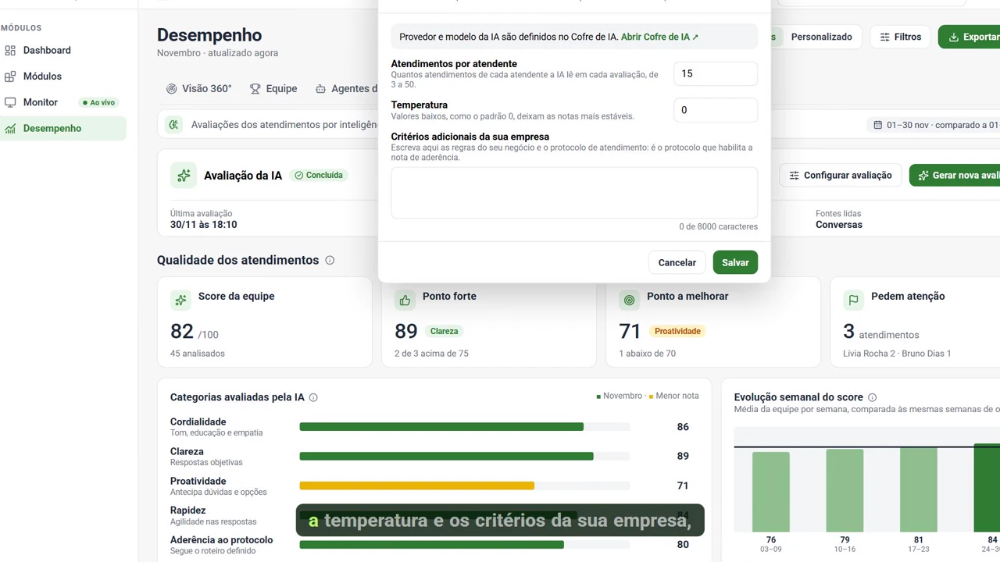
</Frame>

<Frame caption="Use os cartões do Score IA para investigar pontos fortes e pontos de melhoria.">
  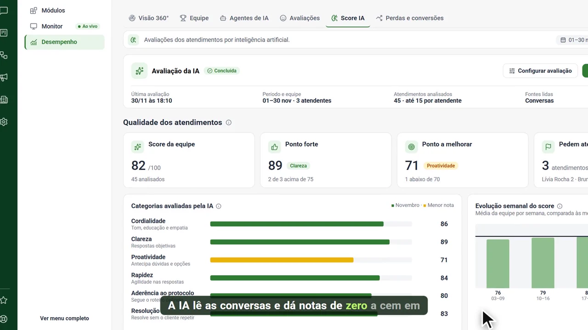
</Frame>

<Note>
  O Score IA ajuda a orientar treinamento a partir de uma amostra. Leia as conversas e confira o contexto antes de usar o resultado para orientar uma pessoa.
</Note>

## Corrija pendências e acompanhe vendas e perdas

Em **Perdas e conversões**, a taxa de conversão divide **vendas confirmadas** pela soma de **vendas e perdas confirmadas**. Consulte a **Receita ganha** e o **Valor potencial perdido** para conferir os valores registrados. Orçamentos recusados, cancelamentos da Agenda e abandonos na fila têm indicadores próprios.

- Se um atendimento elegível terminou sem resultado, abra **Pendentes de classificação**, clique em **Classificar**, escolha o resultado e salve. Revise também as sugestões comerciais da IA que estiverem pendentes.
- Use **Motivos de perda**, **Conversão por atendente** e **Vendas perdidas recentes** para investigar os registros. Quando houver **Oportunidades recuperáveis**, abra a conversa para conferir a próxima ação sugerida.

<Frame caption="Os cartões mostram o que foi ganho e o valor registrado nas perdas.">
  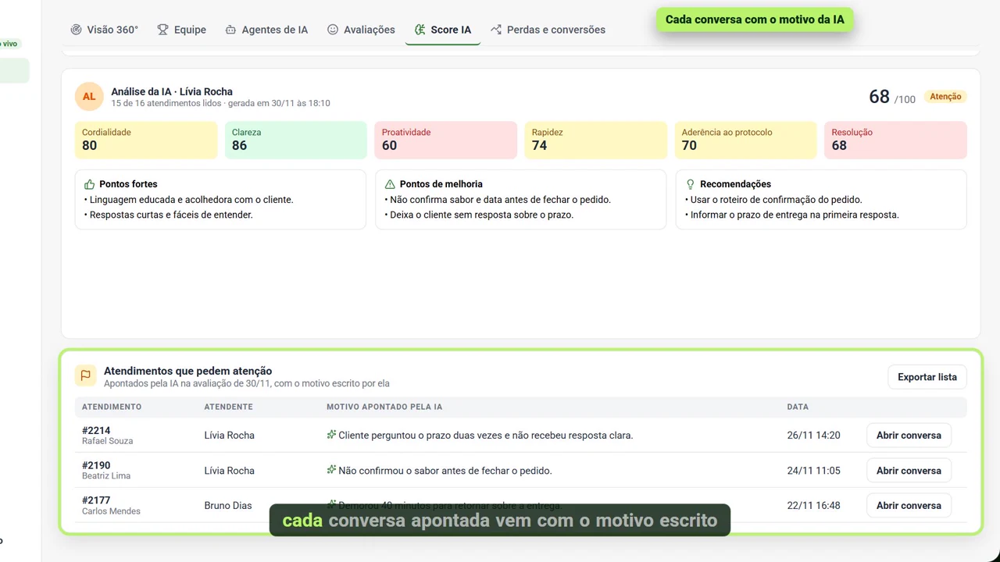
</Frame>

<Frame caption="Classifique um atendimento encerrado sem resultado para atualizar os indicadores correspondentes.">
  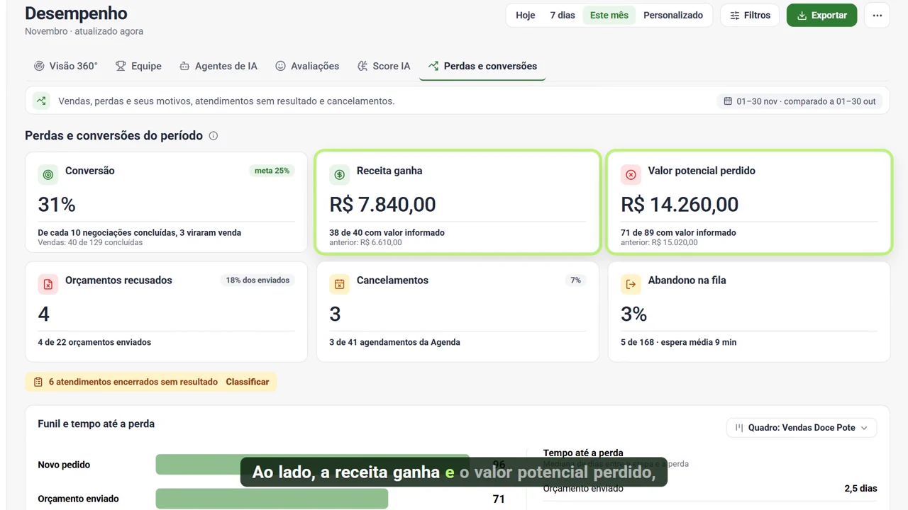
</Frame>

### Meça um quadro do Kanban

1. Em **Perdas e conversões**, clique em **Medir um quadro** e escolha o quadro comercial. Para ligar a medição, seu perfil precisa poder editar quadros. Se a empresa já mede quadros, selecione o quadro que deseja consultar no funil.
2. Configure a **Etapa de ganho** e a **Etapa de perda**. Confira quais conexões alimentam o quadro. Se nenhuma estiver vinculada, revise as conexões antes de esperar novos cartões.
3. Depois de salvar, confira as etapas e os volumes no funil. Nos quadros medidos, movimentos elegíveis para ganho ou perda podem registrar o resultado comercial. Revise a origem e o resultado antes de registrar novamente o mesmo atendimento.

<Frame caption="Configure quais etapas do quadro representam ganho e perda.">
  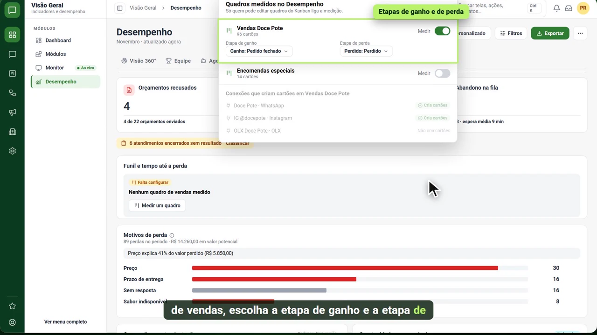
</Frame>

## Ajuste as metas da operação

No menu **⋯ → Metas do Desempenho**, revise **Meta de NPS**, **Meta do Score IA**, **Meta de conversão** e **Meta de 1ª resposta (SLA)**. Campos de NPS, Score IA e conversão sem valor usam os padrões do sistema. Se o SLA estiver vazio, o indicador fica sem meta.

Quando disponível, abra as metas da equipe de IA para configurar valores próprios, como a meta de **resolvidos pela IA** e o **limite de transferências para humano**.

<Frame caption="As metas da empresa ficam reunidas no menu de Desempenho.">
  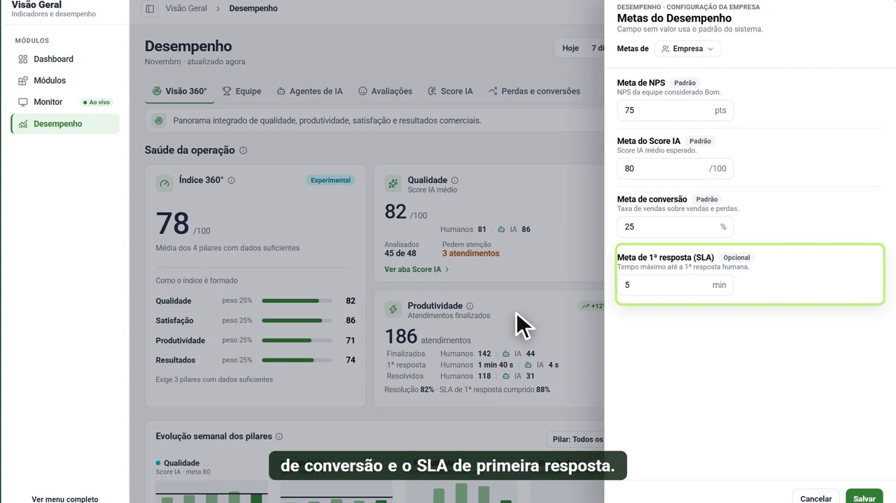
</Frame>

## Resolva problemas comuns

| Se acontecer | Onde conferir |
| --- | --- |
| A venda do teste ficou fora da conversão | Confira o período, a fila e a tag. Se o atendimento ficou sem resultado, classifique-o. Uma sugestão da IA precisa ser confirmada. |
| O Índice 360° ficou vazio | Abra os quatro pilares e veja quais têm dados suficientes. O índice exige pelo menos três. |
| A taxa de resolução parece baixa ou vazia nesta semana | Confira quantos encerramentos já completaram a janela de sete dias e quantos foram reabertos. |
| A pesquisa foi enviada e não há nota | Veja **Enviadas** e **Respondidas**. Confira se o cliente respondeu no prazo da jornada. |
| Score IA ou Agentes de IA não aparece | Confira a disponibilidade no plano, os módulos ativos e as permissões. Para gerar Score IA, confira também o modelo no Cofre de IA. |

<PageFeedback title="Acompanhe o desempenho da sua operação" path="desempenho" />
