import { PageFeedback } from "/snippets/page-feedback.jsx";

An **AI agent team** brings together agents, knowledge, and conversation rules. In this guide, **Lia** answers questions about the menu at **Doce Pote Confeitaria** and hands requests to a person when needed. **Téo** joins later to handle deliveries. The screenshots, names, and prices come from the fictional example in the Portuguese training video.

## Before you start

- Confirm that **AI agents** is available to your company and that your role can create and edit teams. Managing credentials, running tests, and viewing usage can require separate permissions.
- Have a credential for a provider that supports text generation, a staffed [support queue](/en/organizar-equipe), and a test connection.
- Prepare a sample menu or price list that the agent can share with customers. Use fictional data for your first tests.

## Add a credential to the AI Vault

1. Open **Settings → Options → AI** (**Configurações → Opções → IA**) under **Administração e Sistema** and find the **Credential vault** (**Cofre de credenciais**).
2. Select **Add credential** (**Adicionar credencial**), pick the provider, and give it a name you can recognize, such as **Doce Pote AI**.
3. Enter the provider's API key in the form. Select **Test key** (**Testar chave**) and save once it passes.
4. For the first test, choose a credential that supports text. Add a voice credential when you want to test spoken replies.

<Frame caption="The credential vault shows the provider, supported uses, and key status.">
  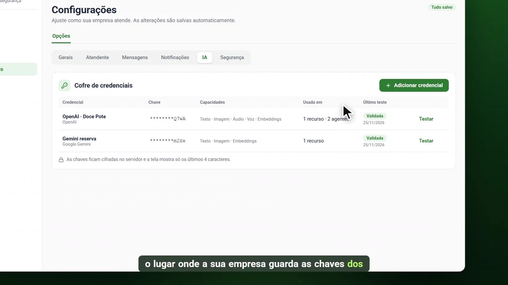
</Frame>

The list masks saved keys. To view a saved key in the interface, follow the password confirmation prompt. Keep keys in the vault and use the credential name in instructions and support materials.

## Create the team and first agent

1. Open **Automation and AI → AI agents → New team** (**Automação e IA → Agentes de IA → Nova equipe**). Name it **Doce Pote Support** and create the team.
2. On the **Agents** tab, select **New agent** (**Novo agente**) and create **Lia**. Keep Lia enabled and select her as the default agent to start conversations.
3. In **AI model** (**Modelo de IA**), choose the saved credential and an available model. For this example, favor direct and consistent replies.
4. In the instructions, describe what Lia should do. For example, “Help with flavors and orders using the menu. Confirm a price only when it is in the price list. Offer a handoff to Sales when a customer asks for a person or information is missing.”
5. Under **Settings → Agent tools** (**Configurações → Ferramentas do agente**), select the queue for human handoffs. Save the team settings and confirm that the queue is staffed.

<Frame caption="The team's Agents tab lets you create the first agent.">
  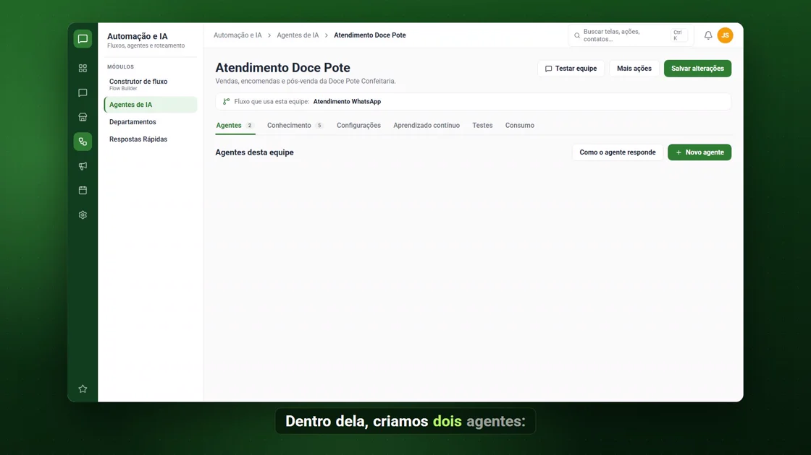
</Frame>

<Frame caption="Choose the agent's credential, model, and response creativity.">
  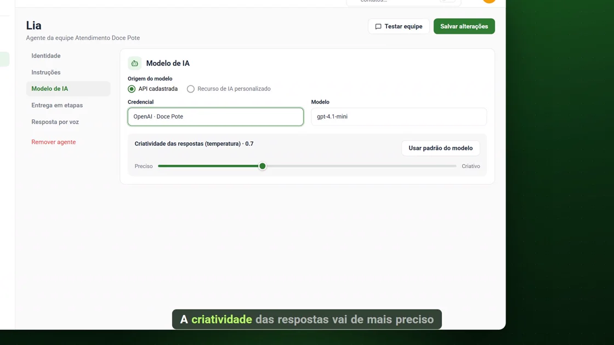
</Frame>

## Teach the agent what it can answer

1. In **Knowledge** (**Conhecimento**), select **New section** (**Nova seção**). Separate the menu, pricing, payment, and pickup or delivery policies so each can be updated independently.
2. Include concrete rules, such as available flavors, how to calculate a price, and when an order can be confirmed. Keep the information current and consistent.
3. Add files such as PDF menus or images when helpful. Check that the content is processed before relying on it in a reply.
4. Save the team. Test both questions covered by the knowledge base and questions it cannot answer. The instructions guide the answer, and the simulator helps you catch inaccuracies.

Later, use **@** in a section to select resources the picker offers, such as tags, calendars, Kanban stages, or elements of linked flows. Explain when each action applies and check the resource's settings and permissions.

<Frame caption="Organize knowledge by topic and review the files attached to each section.">
  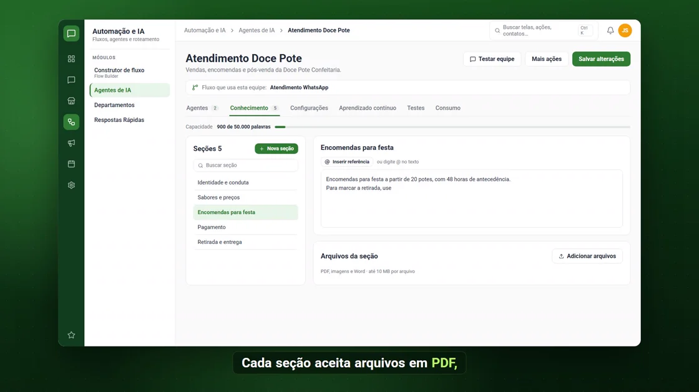
</Frame>

## Test before linking to WhatsApp

1. Save changes, confirm Lia is active, and select **Test team** (**Testar equipe**). The simulator uses the **saved version**.
2. In **Test settings** (**Configurar teste**), choose the starting agent and channel. Type as the customer and open the response trace to see which agent replied, what it used, and which actions it recorded.
3. Select **Restart** for another scenario. On the **Tests** tab, save scenarios and expectations. Rerun them after changing instructions, knowledge, models, or tools.

<Warning>
  **Test team** uses real models and credentials and can incur provider costs. Calendar, Kanban, tag, and human handoff actions are simulated. Generating actual voice audio can also incur a cost.
</Warning>

| Test question | What to check |
| --- | --- |
| “What flavors do you have?” | The options come from the saved menu. |
| “How much are 30 jars?” | The calculation uses the price list. If a price is missing, the reply asks for what it needs or offers human help. |
| “I'd like to speak to a person.” | The handoff points to the configured queue. |
| “Is my order already confirmed?” | The agent follows the company's confirmation rule. |

<Frame caption="The simulator shows the test conversation and a trace for each reply.">
  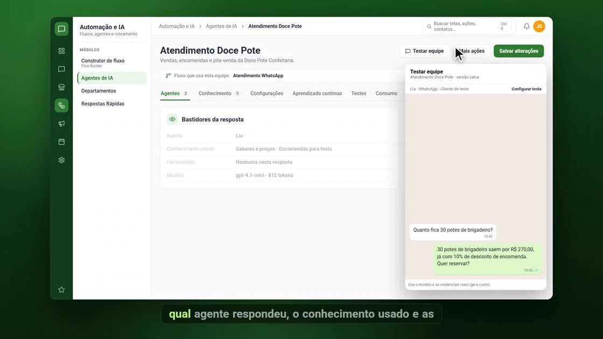
</Frame>

<Frame caption="Save test cases to verify that changes preserve the expected behavior.">
  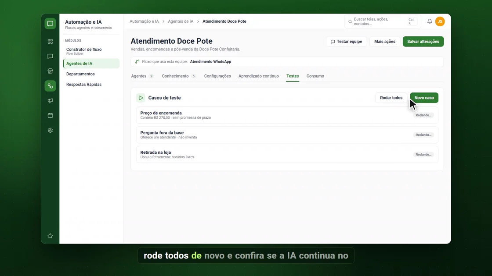
</Frame>

## Enable the team in a flow and test the channel

1. In [Flow Builder](/en/flow-builder), create or duplicate a test flow. Add the **AI** block, enable **Assistant mode** (**Modo assistente**), and select **Doce Pote Support** as the knowledge base. Connect the block to a path that starts at **Start**.
2. To continue the flow after the AI, enable the corresponding exit options. Connect the completion output to the next step and the transfer output to the human path. Check the team's handoff queue too.
3. Save the block, validate, and save the entire flow. Under **Administração e Sistema → Conexões**, open the WhatsApp test connection and go to **Chatbot and queues** (**Chatbot e filas**).
4. Check the current **Flow** value. Select the test flow and save the connection.
5. From a second number, ask a menu question and request a person. In MultChat, check that the conversation reached the queue and that the AI stopped replying after a person took over.
6. To remove the test flow, return to **Chatbot and queues**, restore the previous flow or select **Disabled** (**Desabilitado**) in **Flow**, and save.

<Frame caption="The AI block in Assistant mode uses the selected team for the conversation.">
  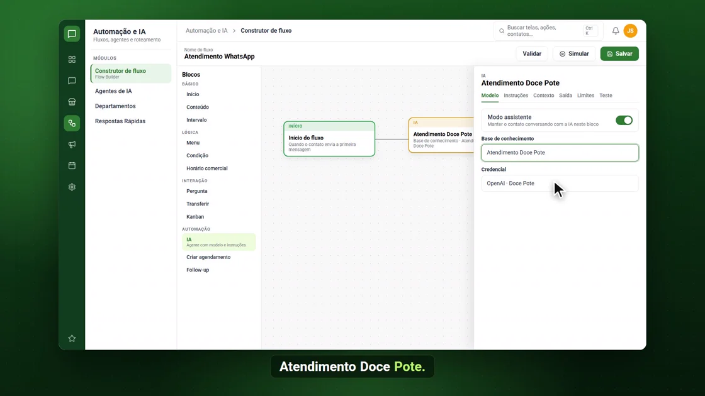
</Frame>

<Frame caption="The Flow field links the flow with the AI team to the test connection.">
  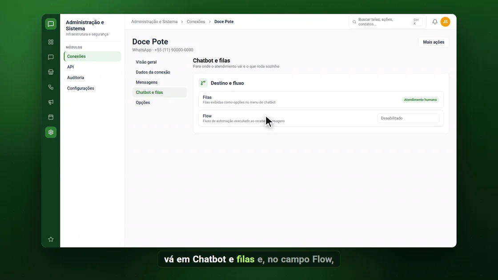
</Frame>

## Expand the team and enable tools

After the first test, add **Téo** for deliveries and post-sale support. Describe when he should take over and add a transfer message if you want to notify the customer. Ask a delivery question and use the response trace to confirm which agent replied. Test a handoff to a person separately.

| Setting | What to adjust |
| --- | --- |
| **Conversation, delivery, and voice** | Choose how long to wait for successive messages, how to split replies, and when to use voice. Test on the intended channel. |
| **Schedule and follow-up** | Set when the team handles conversations and when it can try following up. Delivery depends on the channel and its messaging window. |
| **Business rules and security** | Define discounts, promises to avoid, wording, and confirmation criteria. Keep the team's security controls enabled as configured. |
| **Agent tools** | Pick the human queue, allowed calendars, and required actions such as writing an internal note, suggesting an outcome, or reading catalog, order, and quote data. |
| **Web search** | If needed, set the credential and allowed sites. Keep prices, discounts, and commercial terms in your company's knowledge base. |

The Commercial Calendar referenced in knowledge and the team's internal calendar use different settings. Check which one you are using before testing availability or booking. For tags and [Kanban](/en/kanban), confirm the board, stage, and when the action should run. Enable and test one action at a time. Check the records in a test conversation. AI suggestions count as sales or losses after confirmation.

<Frame caption="Team settings include business rules that guide agent replies.">
  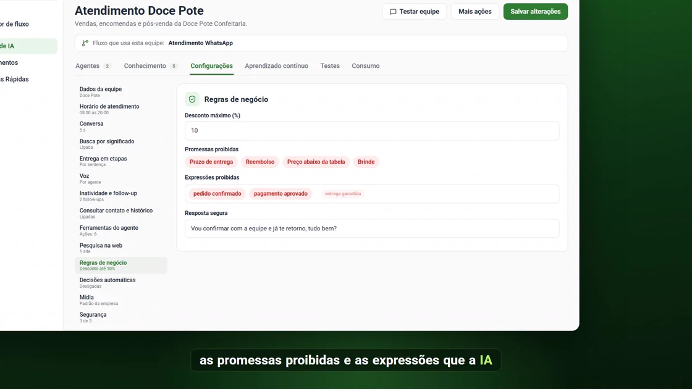
</Frame>

<Frame caption="Agent tools lists the destinations and actions the AI can use.">
  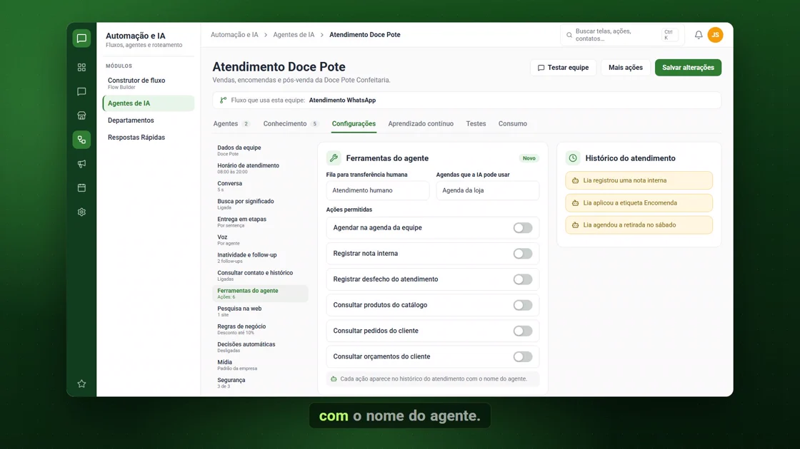
</Frame>

## Review learning and track usage

- In **Continuous learning** (**Aprendizado contínuo**), review the evidence behind a suggestion before approving or dismissing it. Check which learnings are active for the team.
- In **Usage** (**Consumo**), filter the date range and review recorded usage and costs by agent, provider, or model when available. Check provider billing for actual charges.
- When exporting or importing a team, use the MultChat **.zip** file. Credentials stay in the vault. After importing, select credentials for the agents and review the linked resources before activation.

<Frame caption="Review learning suggestions before approving them for use.">
  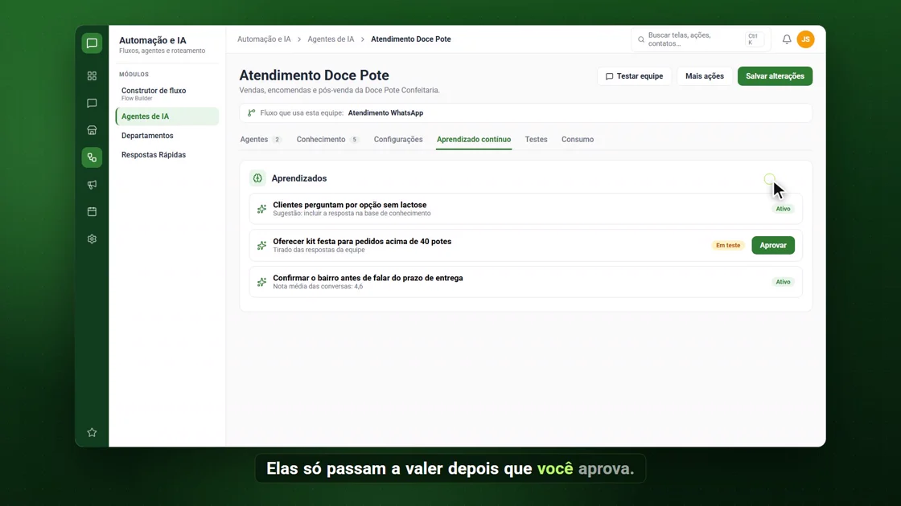
</Frame>

<Frame caption="Usage shows how activity is distributed across agents.">
  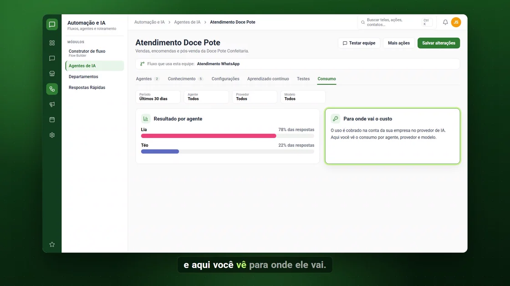
</Frame>

## Troubleshoot common problems

| If this happens | Where to check |
| --- | --- |
| **Test team** is disabled | Save the team and agent, keep at least one agent active, and check your testing permissions. |
| The AI replies with a wrong price or old information | Review the relevant knowledge sections and files, save, and rerun the test cases. |
| The human handoff did not happen | Check the destination queue and allowed actions. If the flow handles transfers, check the connected output in the **AI** block. |
| The simulator works but WhatsApp stays silent | Check the saved flow, **Flow** on the right connection, channel status, and whether a person already owns the conversation. |
| The agent stopped replying after changing provider | Test the credential in the vault and confirm that the chosen model is available with it. |

<PageFeedback title="Build and test your first AI agent team" path="en/agentes-de-ia" language="en" />
