import { PageFeedback } from "/snippets/page-feedback.jsx";

Every conversation in the MultChat inbox has a contact and a channel. It can also have an assigned queue and agent. This walkthrough shows Ana handling Marina's cake order at **Doce Pote Confeitaria**. The screenshots are from the fictional training video, and the instructions retain its Portuguese interface labels.

## Handle your first conversation

1. Open **Atendimento → Atendimentos → Aguardando**. Find Marina's card and check that it is in **Encomendas** (Orders).
2. Select **Aceitar**. The conversation moves to **Atendendo**. The **Atendimento aceito** card records who accepted it, the customer's wait, and the connection.
3. Read the history, write your reply, and send it. In the example, Ana uses **+ → Fotos e vídeos** to send the menu after confirming availability. Marina replies with a voice message.
4. Once the order is settled, select **Resolver**. If classification is enabled, select **Venda realizada**, enter the value if applicable, and review **Ao finalizar** before confirming.

Use a role with access to the test queue. To set up routing, follow the [Departments tutorial](/en/organizar-equipe).

<Frame caption="A new conversation waiting for an agent.">
  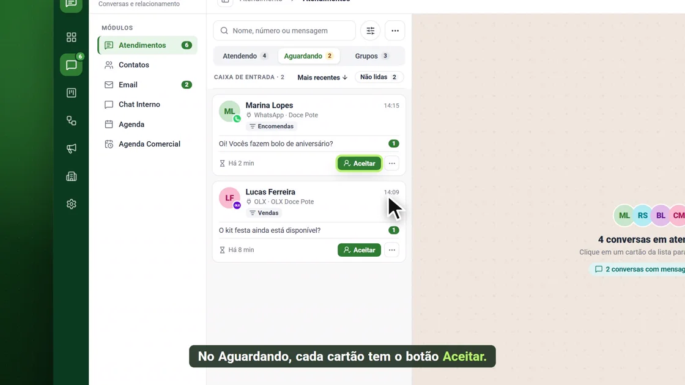
</Frame>

<Frame caption="An accepted conversation with its history, cake menu, and voice reply.">
  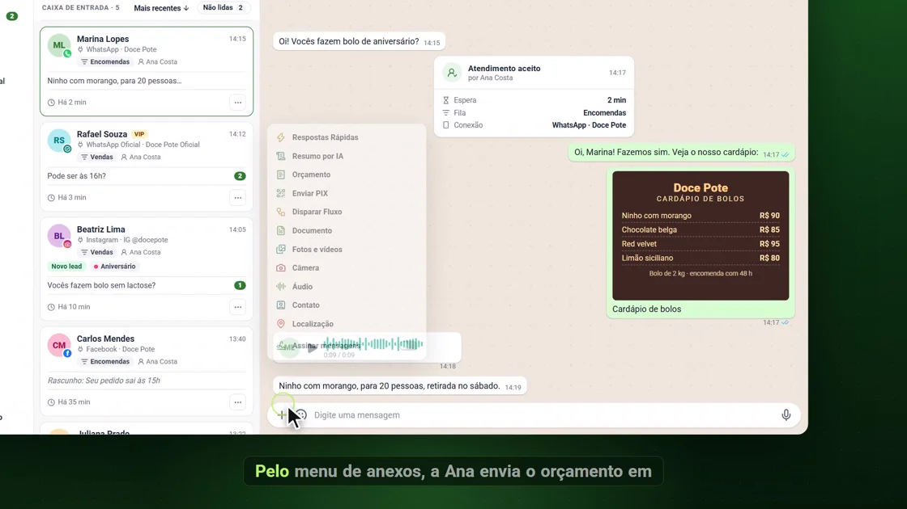
</Frame>

## Find conversations in the inbox

On desktop, the module menu is on the left, the conversation list is in the middle, and the selected conversation opens on the right.

| Tab | What you can find |
| --- | --- |
| **Atendendo** | In-progress conversations available to your role. |
| **Aguardando** | Conversations someone can take, according to your queues and access. |
| **Grupos** | WhatsApp groups available to your role. |

Each conversation card identifies the contact, channel, connection, queue, and agent when assigned. It can also show the last message, wait time, unread count, tags, a **VIP** or **Novo lead** badge, and your unsent draft.

<Frame caption="Conversation cards show the channel, queue, and assigned agent.">
  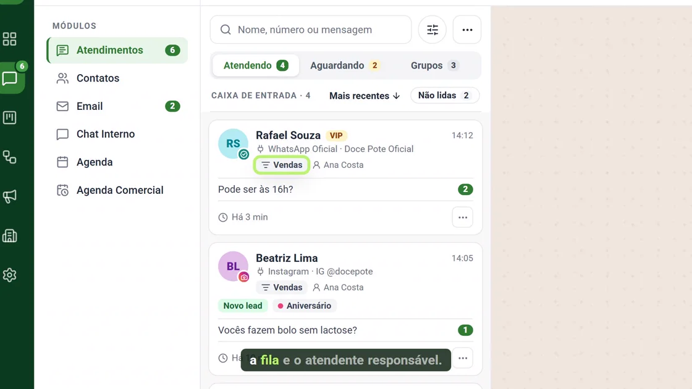
</Frame>

### Search, filter, and sort

1. Search by name, number, or message in **Nome, número ou mensagem**.
2. Under **Filtros**, choose queues or tags. The agent filter appears for roles with access to that view. Select **Aplicar**.
3. Use **Mais recentes** or **Mais antigos** to sort. **Não lidas** shows conversations with unread messages. A conversation can be read and still be waiting for a reply.

The list's **⋯** menu may show **Novo atendimento**, **Resolvidos**, **Grupos arquivados**, **Busca geral**, **Preferências de visualização**, and **Ocultar dados**. **Exibir dados** restores the display in your browser.

<Frame caption="Inbox menu with general search and resolved conversations.">
  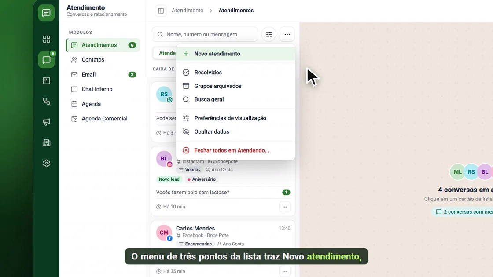
</Frame>

### Check what your role can see

Access depends on permissions, queue membership, and viewing preferences. A role restricted to its own conversations sees those assigned to the signed-in agent. **Ver atendimentos da própria fila** and department assignments determine which queues are available. Authorized roles can widen their view in **Preferências de visualização**.

A card's **⋯** menu can offer **Espionar Conversa**, transfer, pin, mute, block, or close, depending on the role, channel, and conversation status. For groups, archiving, pinning, muting, and marking read affect your view. To show a group again, use **Grupos arquivados → Desarquivar**.

<Warning>
**Fechar todos** closes conversations in bulk for authorized roles. Its scope follows the active tab, **Meus/Todos**, and selected queues. Search, tags, and agent filters do not narrow it. Confirmation becomes available after five seconds.
</Warning>

## Use the conversation header

The header shows the contact, conversation number, connection, queue, and agent. Use **Adicionar tags** to label the conversation and the magnifier to search its message history.

The **⋯** menu may include **Devolver à fila**, **Agendar mensagem**, **Aceitar áudio do contato**, and **Excluir atendimento**, depending on permissions. **Devolver à fila** removes the conversation from your in-progress list and returns it to **Aguardando**. Unpin it first if the interface asks you to do so before transferring or returning it.

### Transfer to another agent or queue

1. Select the **Transferir Atendimento** arrows.
2. Choose a **Usuário de Destino** and, if needed, the **Fila de Atendimento**. To leave the conversation waiting for an agent, select **Sem atendente** and choose the queue.
3. **Conexão** requires permission to transfer between connections and a supported channel. Facebook, Instagram, and WebChat remain on their original connection.
4. Select **Transferir**. An assigned conversation goes to the selected agent. With **Sem atendente**, it returns to **Aguardando**. The conversation keeps its history, and **Atendimento transferido** records the change.

<Frame caption="Transfer destination fields.">
  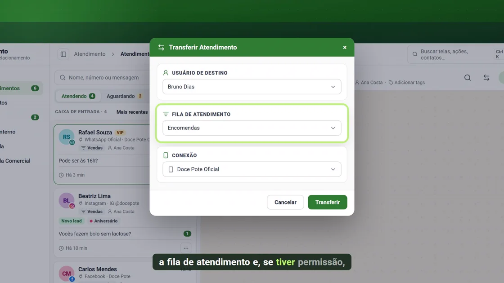
</Frame>

<Frame caption="Transfer event in the conversation history.">
  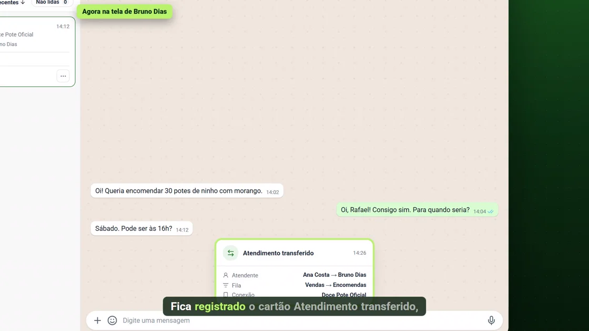
</Frame>

## Send messages and attachments

- Write your reply in the composer. When available, **Assinar mensagens** adds the agent's name to the outgoing message.
- Use **+** to choose a document, photos or videos, camera, audio, a contact, or a location, depending on the channel. Review the preview before sending.
- The same menu can offer **Respostas Rápidas**, **Resumo por IA**, **Orçamento**, **Enviar PIX**, and **Disparar Fluxo**, subject to enabled modules and permissions. In the example, Ana sends a quote PDF, Brazilian Pix deposit details, and the pickup location.
- The media picker can offer emoji, GIFs, and stickers. Use the microphone for a voice message, and pause or listen before sending.
- To preview a password-protected PDF, enter its password when prompted.

A message's menu may offer quote reply, reactions, copy, forward, edit, download, transcription, or deletion, depending on the channel and message type.

<Frame caption="Attachments and additional actions in the composer.">
  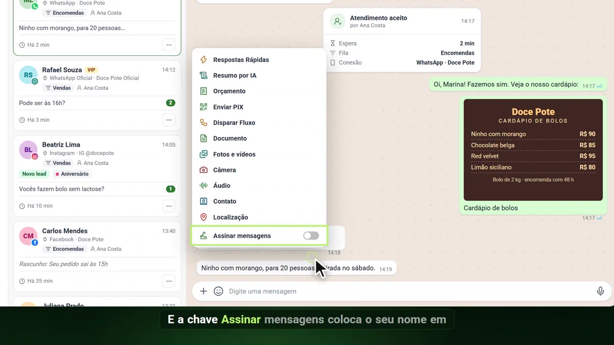
</Frame>

### Transcribe a voice message

1. Find the recording. On a computer, hover over the message and click the down arrow to open the options. On a phone, press and hold the message.
2. Select **Transcribe** (**Transcrever**) and wait for the text. It appears alongside the audio and stays in the conversation history. Select **Transcript** (**Transcrição**) to collapse or open it again.
3. Listen to the recording to verify any names, addresses, times, or prices you will use in your reply. To respond to the customer, use the composer.

If **Transcribe** is missing, check that you opened the menu for an audio message and ask an administrator to check that the feature is enabled.

If transcription fails, check that the recording still plays and contains audible speech. Select **Try again**. If it keeps failing, ask an administrator to check the feature settings.

### Set up audio transcription

Use an administrator account to enable transcription for your team.

1. Open **Settings → Options → AI**. Under **AI features** (**Recursos de IA**), find **Audio transcription** (**Transcrição de áudio**) and choose **Configure** or **Edit**.
2. Under **Attempt order** (**Ordem de tentativa**), choose the source and model. Use the local library if available or a credential that supports transcription. The local library supports Portuguese audio up to one minute long.
3. Turn on **Enable feature** (**Ativar recurso**) and save your changes. Return to **Conversations** and test with a voice message.

### Check the channel rules

| Channel | What to check |
| --- | --- |
| **WhatsApp by QR code** | Use media, audio, stickers, reactions, and group features when available. |
| **Official WhatsApp** | Check the **24-hour window** in the header. If free-text replies are blocked, use an **approved template** to resume contact. |
| **Instagram and Facebook** | The panel also shows Meta's messaging window. Check the composer for a restriction before replying. |
| **WebChat** | The conversation takes place on the website and does not use Meta's 24-hour timer. |
| **OLX** | Reply in text. OLX chat in MultChat does not support attachments or voice messages. |

<Frame caption="Time remaining in the Official WhatsApp messaging window.">
  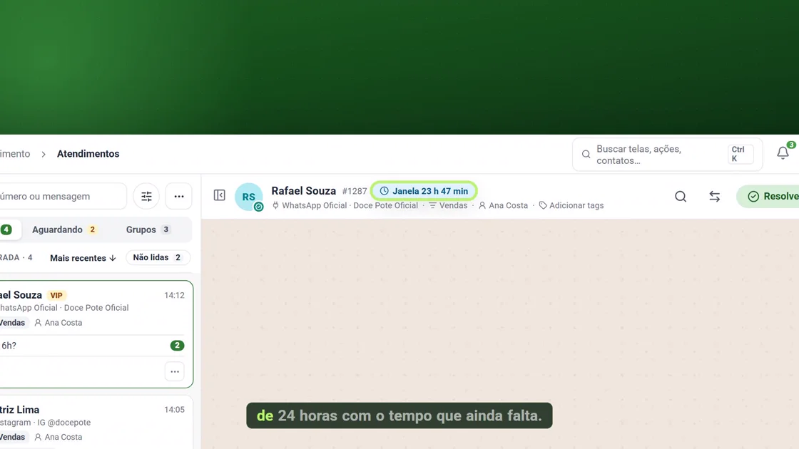
</Frame>

## Check the contact details

Select the customer's name in the header to open **Dados do contato**. Depending on access, you can see identity details, phone number, connection, queue, agent, tags, and actions such as **Buscar**, **Ligar**, and **Editar**.

Use the media, link, and document section, notes, customer value, and conversation history to find related information. Under contact preferences, check which audio, automated support, VIP, and blocking options your role and channel support.

<Frame caption="Contact panel with related history.">
  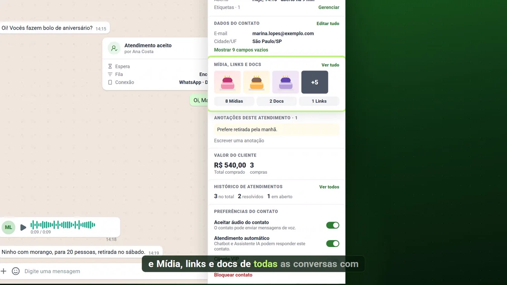
</Frame>

## Resolve and classify the outcome

1. Select **Resolver** in the header.
2. If the connection asks for an outcome, choose what happened. Options include completed sale, customer backed out, no customer response, awaiting payment, appointment scheduled, not a sale, and unidentified. Commercial labels can vary by company segment.
3. Enter **Valor** when applicable. For **Cliente desistiu**, select a reason if prompted. If classification is optional, **Pular** keeps a previous outcome or leaves the conversation pending classification when no outcome exists.
4. Check **Ao finalizar** to see whether the connection will send a farewell or request a survey. Review any optional selections and select **Finalizar**.

Recorded outcomes feed **Desempenho → Perdas e conversões**. To resume a closed conversation, open **⋯ → Resolvidos**, find it, and select **Reabrir atendimento** if your role allows it.

<Frame caption="Outcome selection and the closing-message preview.">
  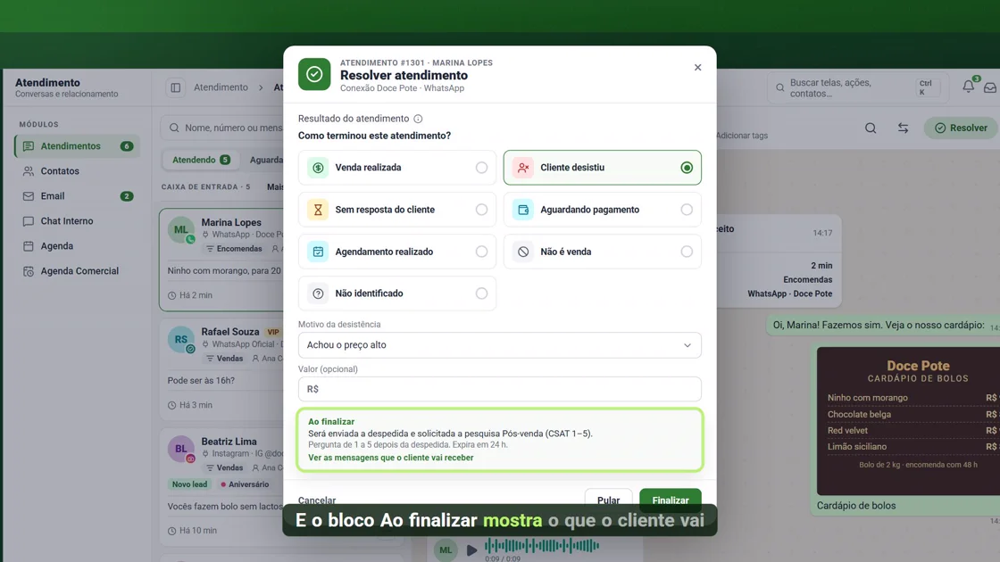
</Frame>

## Use the inbox on mobile

1. Open **Atendimentos**, choose a tab, and tap a card. The conversation opens full-screen. Use the back arrow to return to the list.
2. Tap **+** to open **Anexar e enviar**. Open a message's options to find its actions and reactions.
3. Use the compact **Resolver** button or the conversation menu to transfer or close, subject to your permissions.

<Frame caption="The conversation list on mobile.">
  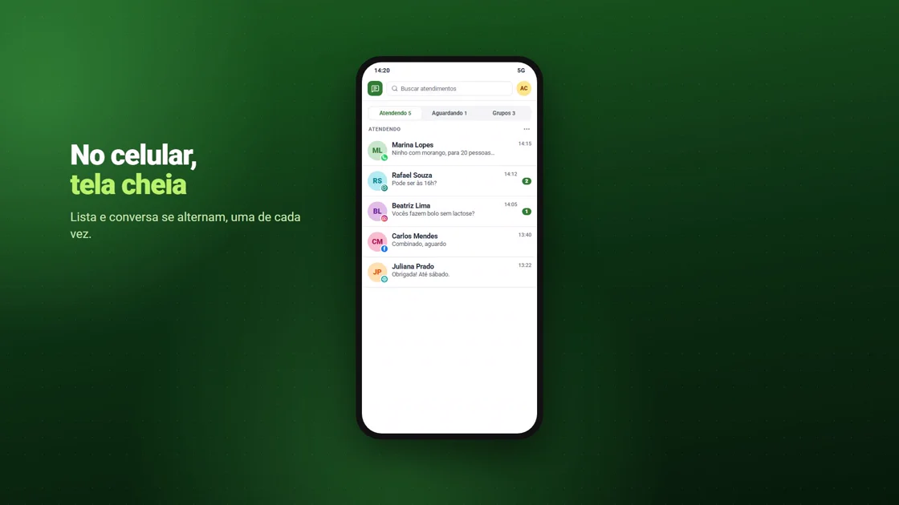
</Frame>

## Troubleshoot common situations

<AccordionGroup>
  <Accordion title="A conversation disappeared from my list">
    Check **Atendendo** and **Aguardando** and clear the filters. A transfer, a return to queue, or another agent accepting the conversation can change what you see. Use **Busca geral** or **Resolvidos**, depending on your access.
  </Accordion>
  <Accordion title="A transfer, close, or attachment option is missing">
    Check the conversation state, your role, and the channel. Certain actions require an enabled module, an in-progress conversation, or a compatible connection.
  </Accordion>
  <Accordion title="Official WhatsApp blocked free-text replies">
    Check the window in the header. If it has closed, open the templates option and select one approved for the connection.
  </Accordion>
  <Accordion title="What does the customer see after I hide data?">
    **Ocultar dados** blurs information on your screen. It leaves the conversation in the customer's channel and the team's view as they were.
  </Accordion>
</AccordionGroup>

<PageFeedback title="Conversations" path="en/atender-conversas" language="en" />
