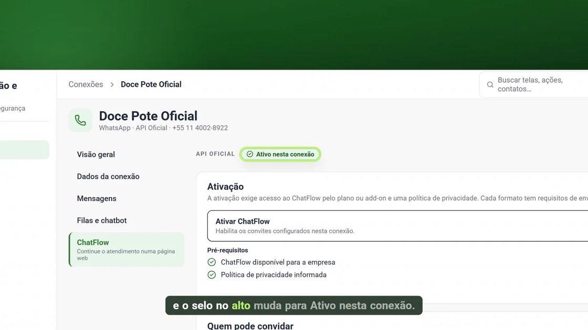
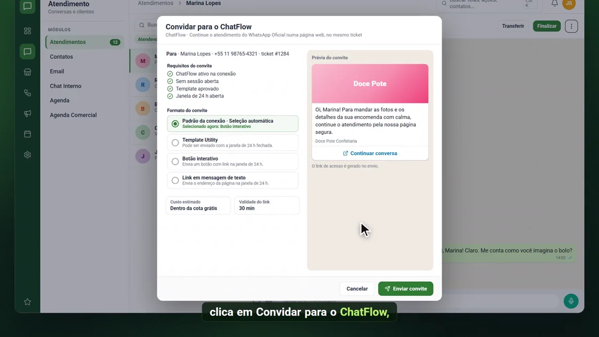
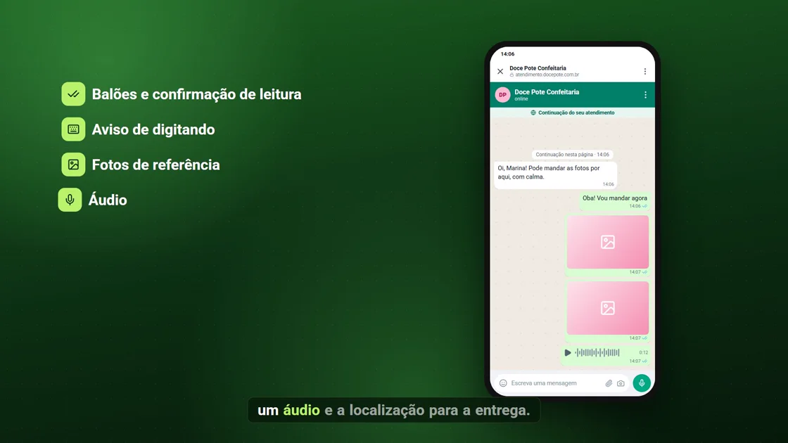
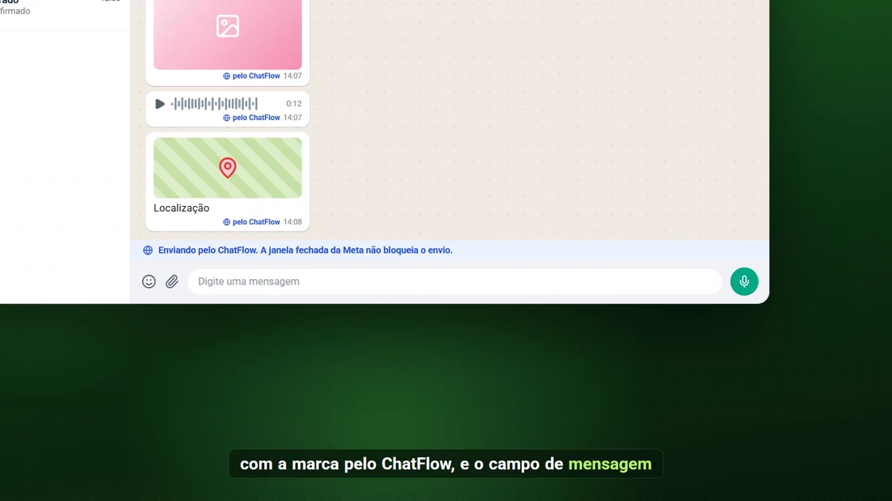
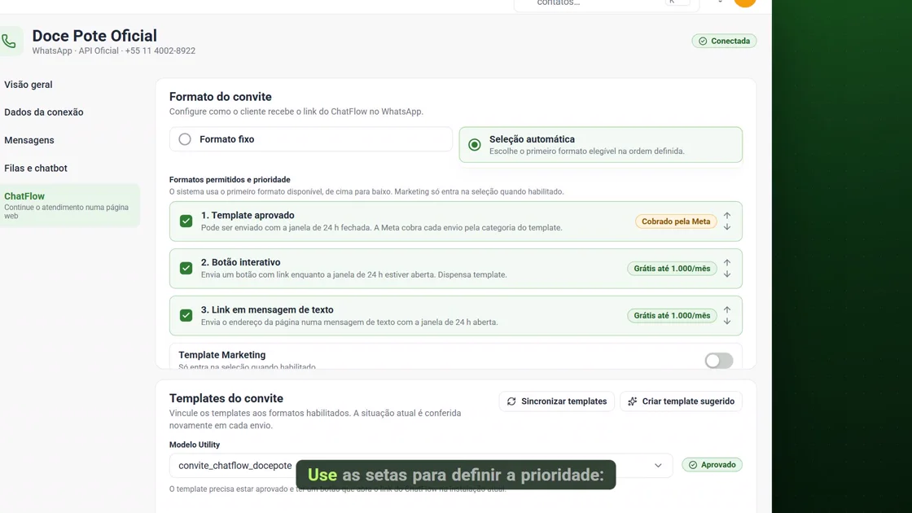
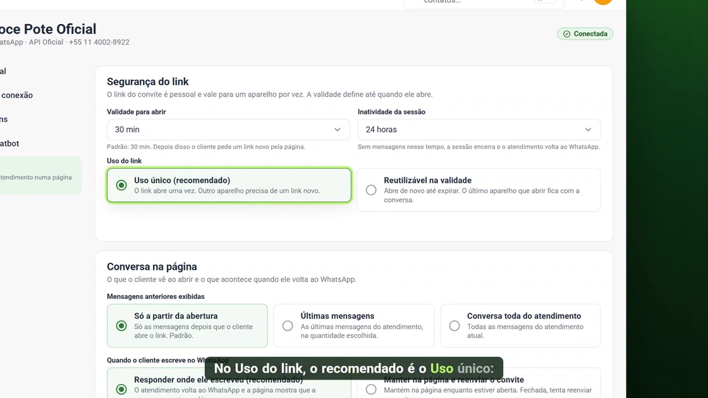
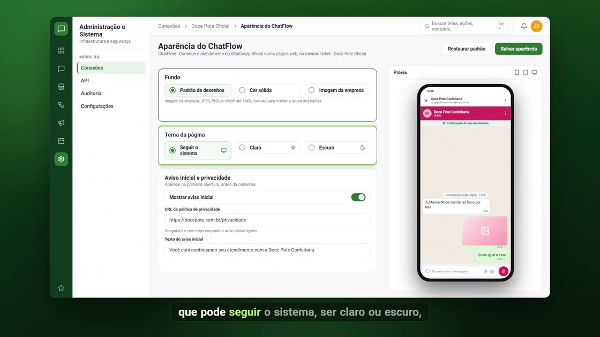
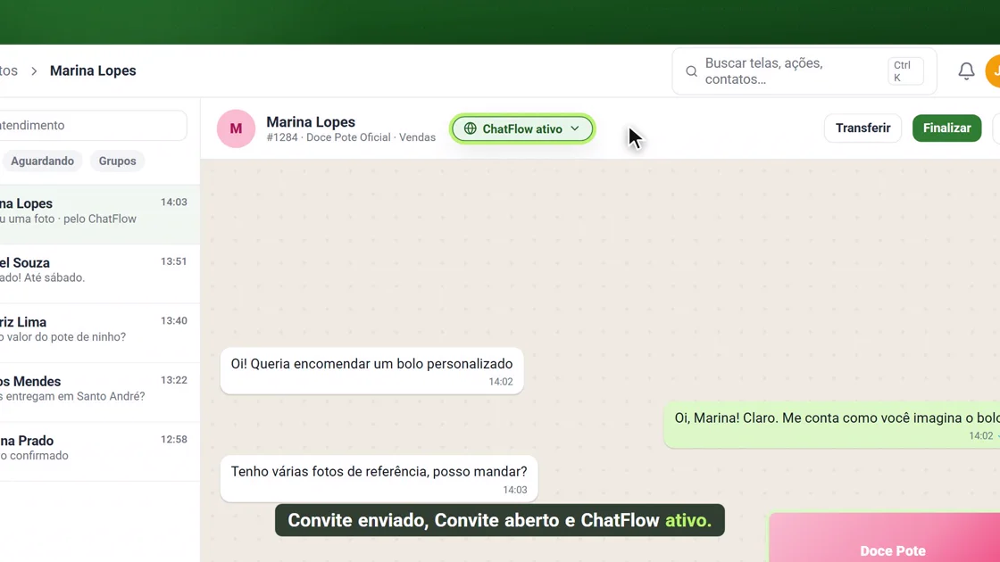
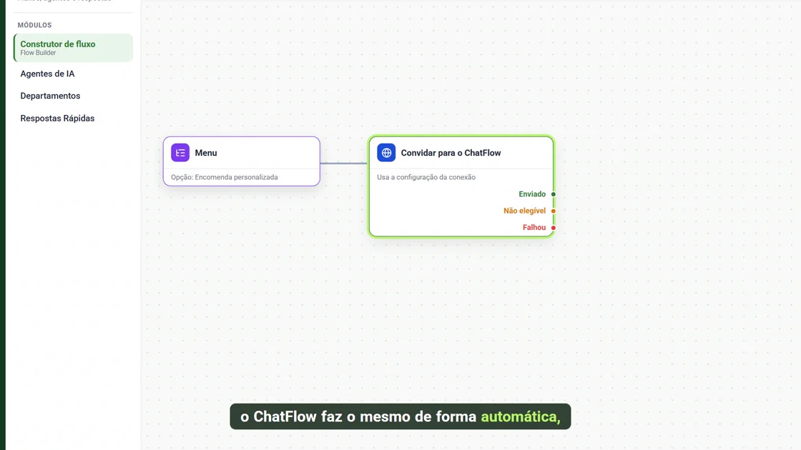

import { PageFeedback } from "/snippets/page-feedback.jsx";

**ChatFlow** sends a personal invite over WhatsApp to continue a conversation in the browser. The customer opens the page and sends messages there. Agents continue in the same MultChat conversation with the existing history. Screenshots show the fictional **Doce Pote Confeitaria** from the Portuguese training video.

## Before you start

- Use an active **Official WhatsApp API** connection. Confirm that the plan or add-on includes **ChatFlow** and that it is enabled in **Modules** (**Módulos**).
- Use an account allowed to edit connections. Agents also need ChatFlow permission to send invites manually.
- Have your company's public **HTTPS** privacy policy URL and a second phone number for testing an individual conversation before inviting customers.

## Enable ChatFlow on the connection

1. Open **Connections** (**Conexões**) under **Administração e Sistema**. Open the official connection, select **ChatFlow**, and check the requirements under **Activation**.
2. Under **Appearance** (**Aparência**), open **Edit appearance** (**Editar aparência**). Enter the privacy policy URL in the initial notice settings, select **Save appearance** (**Salvar aparência**), and return to the **ChatFlow** tab.
3. Turn on **Enable ChatFlow** (**Ativar ChatFlow**). Under **Who can invite** (**Quem pode convidar**), enable **Agent** for the manual test and **FlowBuilder flow** if you also want flows to invite customers.
4. Under **Invite format**, pick **Interactive button** for a first test after a recent message from the customer. See [choose the invite format](#choose-the-invite-format) to use a template or allow multiple formats.
5. Select **Save ChatFlow** (**Salvar ChatFlow**) and check for the active status. ChatFlow has its own save action on the tab.

<Frame caption="The Activation section shows whether the company has access and the privacy policy is set.">
  
</Frame>

## Send a test invite

1. From the test number, send a message to the Official API number. Open the individual conversation in MultChat.
2. In the conversation's actions, select **Invite to ChatFlow** (**Convidar para o ChatFlow**). Check the recipient, requirements, format, expiration, preview, and estimated cost when available. Send the invite.
3. In WhatsApp on the test phone, open the link or select **Continue conversation** (**Continuar conversa**). Read the initial notice and select **Continue** if prompted.
4. Send a text or photo through the page. In MultChat, check that it appears in the same conversation marked as coming from ChatFlow.
5. In MultChat, check for **Sending via ChatFlow** (**Enviando pelo ChatFlow**) above the reply box. Send a test reply and confirm it arrives on the page.
6. On the phone, select **Back to WhatsApp** (**Voltar ao WhatsApp**) and send a WhatsApp message. With the setting to reply where the customer wrote enabled, confirm that the agent's reply route returns to WhatsApp.

<Frame caption="The agent reviews the format and preview before sending the invite.">
  
</Frame>

<Frame caption="The page opens in the customer's browser and accepts messages and attachments.">
  
</Frame>

<Frame caption="The reply box shows when the next message will be sent through ChatFlow.">
  
</Frame>

## Choose the invite format

The Official API's 24-hour messaging window starts with the customer's latest WhatsApp message. The window determines which invite formats can be sent via WhatsApp. The web conversation can continue while the ChatFlow session is active.

| Format | When to use it |
| --- | --- |
| **Interactive button** | With the window open, sends a button that opens the page. In the button message settings, customize the text, footer, button label, and optional header image. |
| **Link in a text message** | With the window open, sends plain text. Customize it in the text message settings. ChatFlow adds the link at the end. |
| **Approved template** | Can be sent with the window closed. The connection needs template access, and the template must be approved and have a link button compatible with ChatFlow. |

Pick a fixed format or use **Automatic selection** (**Seleção automática**). Use the arrows to rank allowed formats. ChatFlow uses the first eligible format from top to bottom. Marketing templates are considered when enabled and when the customer meets the consent requirements.

Under **Invite templates** (**Templates do convite**), select a compatible template. An authorized user can **Create suggested template** (**Criar template sugerido**). Wait for Meta's approval and select **Sync templates** (**Sincronizar templates**) to refresh the list. MultChat checks template eligibility when sending.

<Frame caption="The priority order determines which eligible format automatic selection uses first.">
  
</Frame>

The invite preview shows an estimate when MultChat has a rate configured. Invites, reminders, and other WhatsApp messages follow Meta's rules for their format. Messages sent on the ChatFlow page do not go through the Official WhatsApp API. Check current rates when estimating costs. [WhatsApp Business Platform pricing](https://developers.facebook.com/documentation/business-messaging/whatsapp/pricing)

## Configure access and the return to WhatsApp

Review these options in **Link security** (**Segurança do link**).

| Option | What it controls |
| --- | --- |
| **Time to open** (**Validade para abrir**) | How long the customer has to open the invite. The default is **30 minutes**. An invite with no deadline requires single use. |
| **Single use** (**Uso único**) | The invite can be opened once. A different device needs a new link. |
| **Reusable until expiry** (**Reutilizável na validade**) | The link can be reopened until it expires. The last device to open it takes over the conversation. |
| **Session inactivity** (**Inatividade da sessão**) | Ends the session after the configured period without messages and returns the conversation to WhatsApp. |

Under **Conversation on the page** (**Conversa na página**), choose which earlier messages the customer can see. By default, the page shows messages from when the customer opened the link onward. You can show the latest messages or the entire current conversation.

<Warning>
  Treat the invite as personal. Anyone who receives a forwarded link before the first opening could access the page and see the history you configured. For the first test, keep single use, a limited expiration time, and the default history setting.
</Warning>

<Frame caption="The invite expiration, link reuse, and session inactivity are separate settings.">
  
</Frame>

For messages the customer sends in WhatsApp, **Reply where they wrote** returns the conversation to WhatsApp. **Keep on the page and resend the invite** keeps the conversation on the page while open and tries to resend the invite if the page is closed. If resending is unavailable, the next reply goes through WhatsApp.

In the same section, you can enable WhatsApp reminders when the page is closed, set the delay, interval, and maximum, or restrict invites for conversations started from a WhatsApp ad. Select **Save ChatFlow**.

## Customize the customer's page

Open **Appearance → Edit appearance**. Choose the WhatsApp style, company branding, or a custom design. Set the display name, logo, avatar, colors, background, and theme. Review the privacy policy URL and any initial notice. Use the mobile preview to check readability, fix contrast warnings, and select **Save appearance**.

<Frame caption="The preview shows how the customer's page will appear on a phone.">
  
</Frame>

## Monitor and end a session

The badge in the conversation header shows states such as **Invite sent**, **Invite opened**, and **ChatFlow active**. Open it to see the status and available actions. While an invite is pending, you can resend it when eligible or cancel it. Use **End ChatFlow session** to stop replies through the page. If the entire conversation is closed, the web page can show a survey based on your company's settings.

On the connection, **Usage and cost** (**Uso e custo**) shows invites, opens, active sessions, web message volume, and estimated invite costs over the displayed period.

<Frame caption="The ChatFlow badge shows the session status within the conversation.">
  
</Frame>

## Automate invites in FlowBuilder

1. Under **ChatFlow → Who can invite**, enable **FlowBuilder flow** and save.
2. In [Flow Builder](/en/flow-builder), look for the **ChatFlow invite** block. The Portuguese video shows it as **Convidar para o ChatFlow**.
3. Connect the outputs for **Sent**, **Ineligible**, and **Failed**. Decide how the conversation should continue when it is ineligible or an invite fails.
4. Validate and simulate the flow. Then test it on an Official API test connection to confirm that the invite arrives and the page opens.

<Frame caption="Handle all three outputs of the invitation block in Flow Builder.">
  
</Frame>

## Troubleshoot common problems

| If this happens | What to check |
| --- | --- |
| The activation switch is disabled | Check the plan, **Modules**, connection type, your permissions, and the HTTPS privacy policy URL. |
| The conversation can't receive an invite | Read the reason in the invite dialog. Check that it is an eligible individual conversation, the invite source is enabled, and a format is available for the current window. |
| The link expired | If the page offers a new link through WhatsApp, the customer can request it there. The agent can also check the resend action in the badge. |
| The customer opened the invite on another device | In reusable mode, the last device to open the link takes over. With single use, send a new invite if the customer needs to switch devices. |
| The customer replied in WhatsApp while using the page | Check the setting under **Conversation on the page** and the route shown above the reply box. |

<PageFeedback title="Continue a conversation on the web with ChatFlow" path="en/chatflow" language="en" />
