import { PageFeedback } from "/snippets/page-feedback.jsx";

Under **Overview → Performance** (**Visão Geral → Desempenho**), you can see what happened in conversations, how customers rated the experience, and which deals were won or lost. The screenshots come from the Portuguese training video for **Doce Pote Confeitaria**, a fictional bakery. Follow the example to see where each metric gets its data.

## Start with a test week

1. In [Conversations](/en/atender-conversas#resolve-and-classify-the-outcome), accept and reply to a test conversation. In the video, Ana closes a **R$180** cake sale. She selects **Resolve** (**Resolver**), records the sale and amount, and checks the closing actions before confirming.
2. In another test conversation, record that the customer dropped out, select **Price** as the reason, and enter **R$240** as the potential value if the field is available. This amount appears as potential lost value.
3. On a connection with a survey configured, ask the test contact to respond after the conversation closes. Marina gives a score of **5** in the example.
4. Open **Performance**, select the test dates, and check **Team** for completed conversations, **Ratings** for the score, and **Losses and conversions** for the recorded outcomes.
5. If you also test an AI agent, review the suggested outcome and confirm it after checking the conversation. Duda suggests a sale in the video, and the team confirms it the next day.

<Frame caption="The deal outcome is recorded when the team confirms the classification.">
  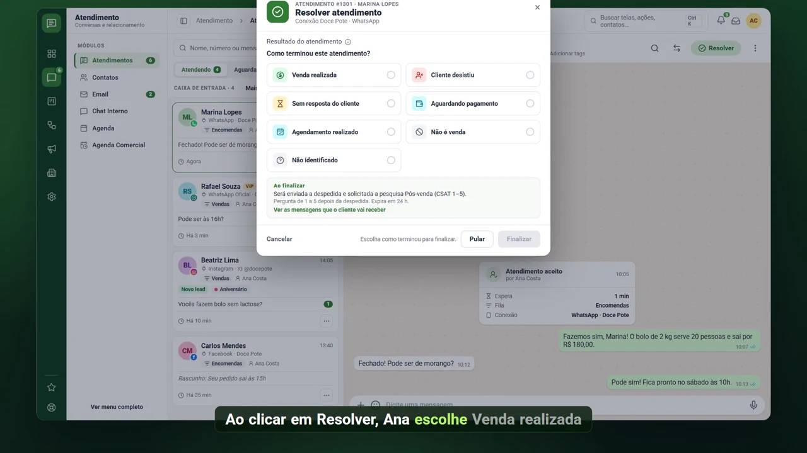
</Frame>

With **one confirmed sale and one confirmed loss** in the same period, conversion is **50%**. Two outcomes still make a **small sample**, and a score of 5 is one response. Use these records to check that your activity is reaching the dashboard before comparing performance.

## Set the date range and filters

1. Choose **Today**, **7 days**, **This month**, or **Custom**. Check the selected dates and the previous comparison period at the top of the tab.
2. Open **Filters** (**Filtros**), choose the queue and tag, and apply. Read any notices on the cards. Some metrics use sources that do not support the same filter.
3. Under **⋯**, select **Refresh data** (**Atualizar dados**). Check when the data was calculated if the page keeps the last result while it refreshes.
4. Use **Export** when available to download data for the current tab and selection.

<Frame caption="Check the date range and apply filters before comparing metrics.">
  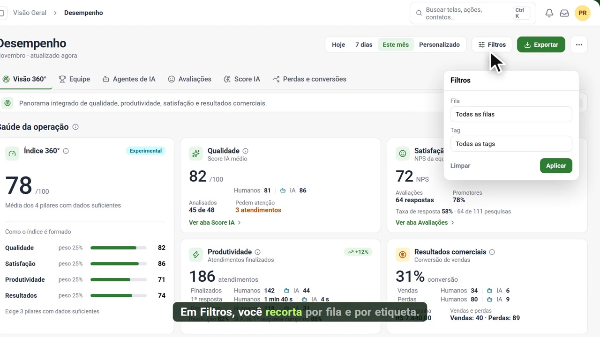
</Frame>

| What appears | How to read it |
| --- | --- |
| **0** | The metric could be calculated, and its value is zero. |
| **Small sample** | Records exist, but the volume limits comparisons, rankings, or alerts. |
| **No data yet** | The metric lacks records for the current selection, such as survey responses or classified outcomes. |
| **Needs configuration** | The source needs a setting, such as a first-response goal or a measured board. |
| **No permission** | Your role cannot access some data. Tab availability also depends on the active modules. |

## Read the 360° overview

The first tab opens four areas. **Quality** comes from AI Score, **Satisfaction** from customer ratings, **Productivity** from conversation activity and timing, and **Results** from confirmed wins and losses. Use the breakdown by people and AI agents where available.

The **360° Index** is experimental and ranges from **0 to 100**. With four valid areas, each carries **25%** of the weight. If only three have enough data, the weight is redistributed. The index is unavailable with fewer than three. Open the source metrics before drawing conclusions about the team.

Check weekly trends against goals, use highlights to investigate changes, and open the team view to see individual metrics within the scope of your access.

<Frame caption="The 360° Index appears alongside the four areas and weekly trends.">
  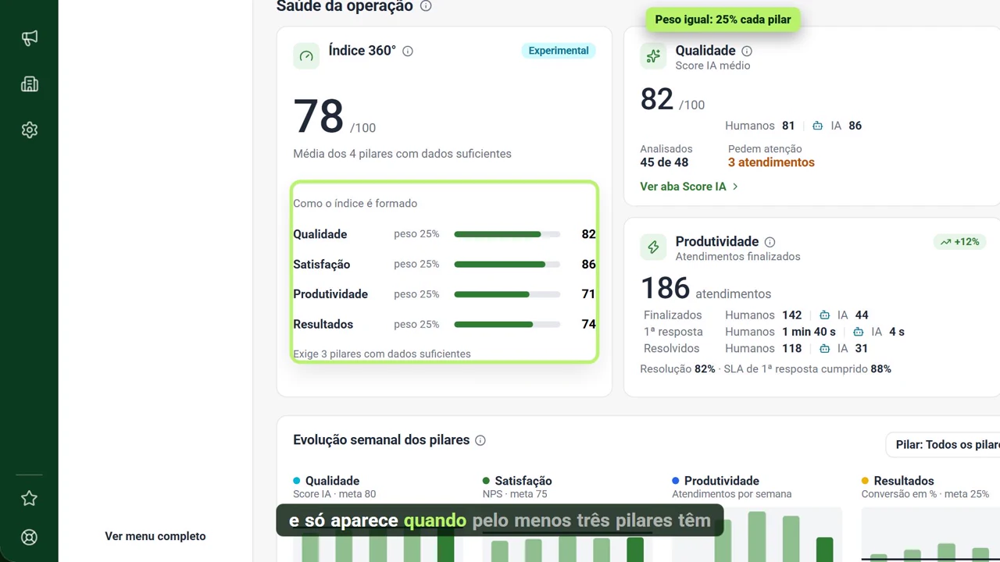
</Frame>

## Monitor the team and open an agent profile

| Metric | What it measures |
| --- | --- |
| **Completed** | Conversations finished during the selected period. |
| **Average first response time (TMR)** | Average time from the conversation entering support to the first human reply, for cases where that reply was tracked. |
| **Average handling time (TMA)** | Average time from the start of human handling to closing or the start of the rating stage, where recorded. |
| **Resolution rate** | Share of eligible completed conversations that went seven days without reopening. Recent closings wait until the window ends. |
| **Now** | Current activity, including active conversations and the longest wait. |

In the team ranking, switch the sort metric and compare each person's workload with the average. Select a person to open their **360° Profile** (**Perfil 360°**). The radar chart compares productivity, speed, satisfaction, quality, conversion, and resolution against the team average. Check their SLA, history, transfer rate, and reopening rate.

Individual views depend on access to conversations. An agent who can see only their own records sees their row and available team totals.

<Frame caption="The Team tab shows volume, timing, resolution, and ranking.">
  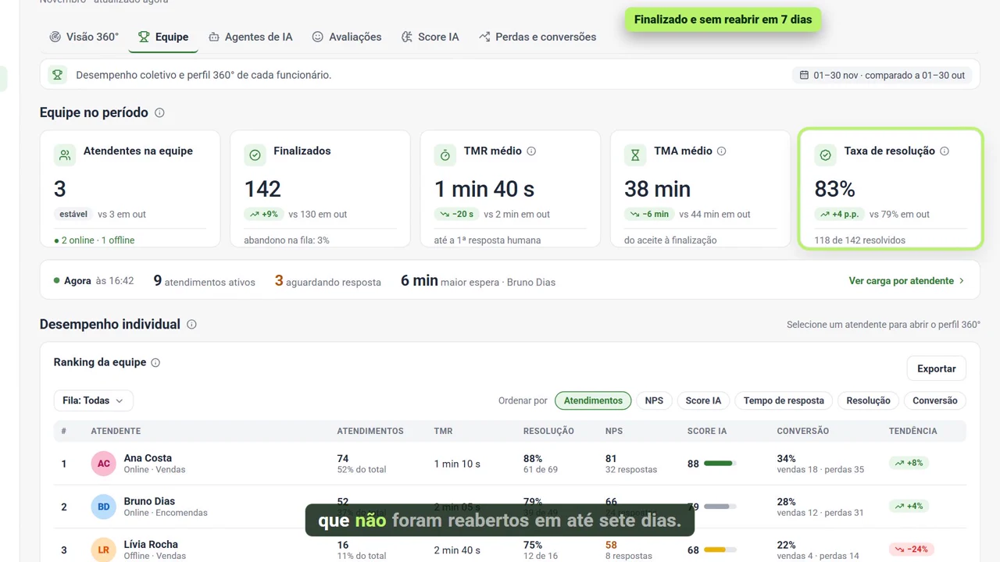
</Frame>

<Frame caption="The 360° Profile compares six measures with the team average.">
  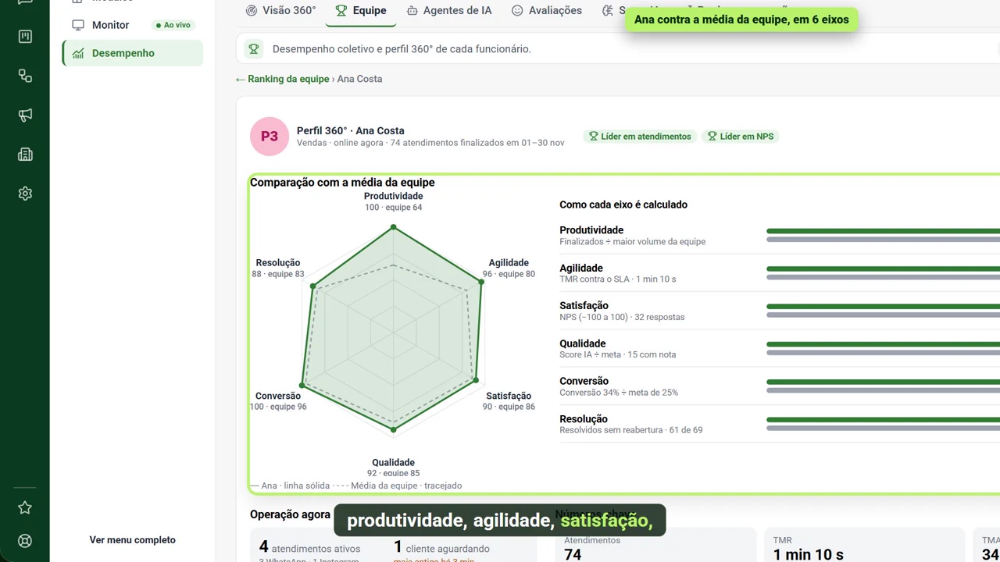
</Frame>

## See what AI agents handled

1. Under **Automation and AI → AI Agents** (**Automação e IA → Agentes de IA**), set up an AI team with your company's knowledge and rules.
2. In [Flow Builder](/en/flow-builder), add the **AI** block, select the team, configure a handoff to a human, and validate. Save and attach the flow to the test connection.
3. Run a test conversation. Open **Performance → AI Agents** to review conversations handled by AI, resolutions without a human, handoffs, first response time, and token use.
4. If the AI suggested a deal outcome, review the conversation before confirming or dismissing it. Confirmed outcomes count as sales or losses.

AI agents are grouped by team in their own category. Open an agent to see its diagnostics and investigate recorded model errors, delays, safety responses, rule violations, or announced handoffs that were never completed.

<Frame caption="The AI Agents tab separates AI resolutions, human handoffs, and confirmed outcomes.">
  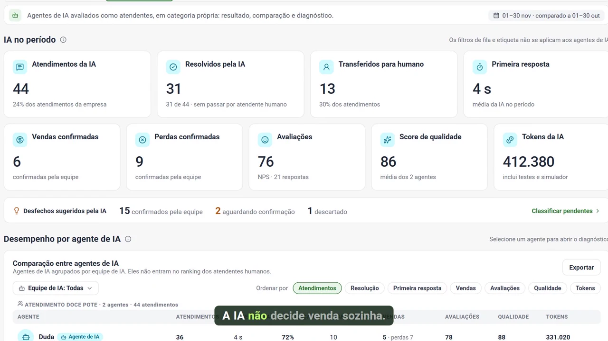
</Frame>

## Read customer ratings

1. Use an active survey in the rating journey that applies to the connection. Check that it will be sent in the closing actions. The response deadline follows the survey settings.
2. In **Ratings** (**Avaliações**), review sent and answered surveys and response rates by channel. Response rate compares answers with sends for the displayed selection.
3. Compare surveys on the scale shown. **CSAT** measures satisfaction on the survey's scale, such as **1 to 5**. **NPS** uses a **0 to 10** scale and subtracts the percentage of detractors from the percentage of promoters.
4. Open **Voice of the customer** (**Voz do cliente**) to read submitted answers. With permission to edit the survey, use **Ask for the reason** (**Perguntar o motivo**) to add a follow-up question for low ratings.

NPS scores of **9–10** are promoters, **7–8** are passives, and **0–6** are detractors. With fewer than **30 responses**, treat the NPS as indicative. Aggregate NPS panels can convert compatible 1-to-5 ratings to the 0-to-10 scale. Open the source survey to see the customer's original scale.

<Frame caption="Ratings shows results by survey journey, response rates by channel, and trends.">
  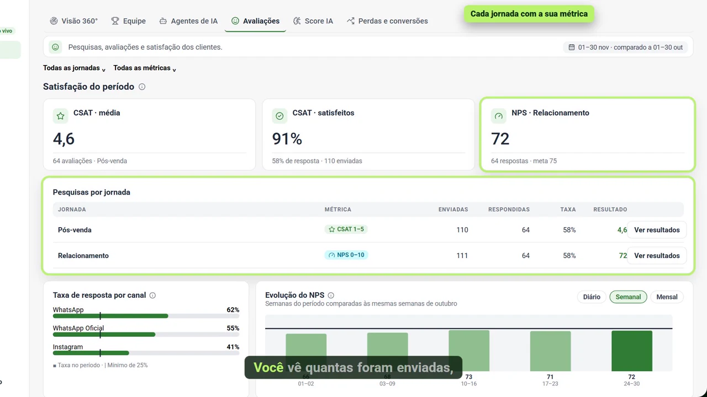
</Frame>

## Configure and generate AI Score

1. Confirm your plan includes **AI Score** (**Score IA**) and that your role can view, configure, or generate evaluations. Open **Settings → Options → AI** (**Configurações → Opções → IA**) under **Administração e Sistema** and set the provider and model for **Score IA**.
2. In **Performance → AI Score → Configure evaluation** (**Configurar avaliação**), choose **3 to 50** conversations per agent. Review the temperature and enter your company's guidelines if you want to measure protocol adherence. Save.
3. Select **Generate new evaluation** (**Gerar nova avaliação**), review the options, and wait for the results. Check coverage to see how many sampled conversations the evaluation read.
4. Review the available categories for courtesy, clarity, proactivity, speed, protocol adherence, and resolution. Open the analysis and check the conversations flagged for review.

<Frame caption="Settings define the sample and any guidelines used to generate an evaluation.">
  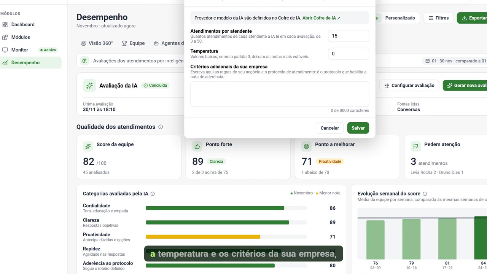
</Frame>

<Frame caption="Use the scorecards to investigate strengths and areas for improvement.">
  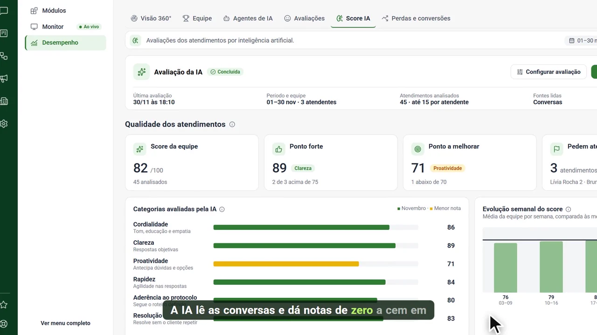
</Frame>

<Note>
  AI Score uses a sample to guide coaching. Read the conversations and check their context before using the results to give individual feedback.
</Note>

## Classify outcomes and review sales and losses

Under **Losses and conversions** (**Perdas e conversões**), conversion divides **confirmed sales** by the sum of **confirmed sales and losses**. Check **Revenue won** and **Potential lost value** to see the recorded amounts. Rejected quotes, calendar cancellations, and queue abandonment have their own indicators.

- If an eligible conversation closed without an outcome, open **Pending classification** (**Pendentes de classificação**), select **Classify**, choose the outcome, and save. Review pending AI suggestions as well.
- Use loss reasons, conversion by agent, and recent lost deals to investigate records. When recoverable opportunities appear, open the conversation and review the suggested next action.

<Frame caption="The cards show revenue won and the amount recorded in losses.">
  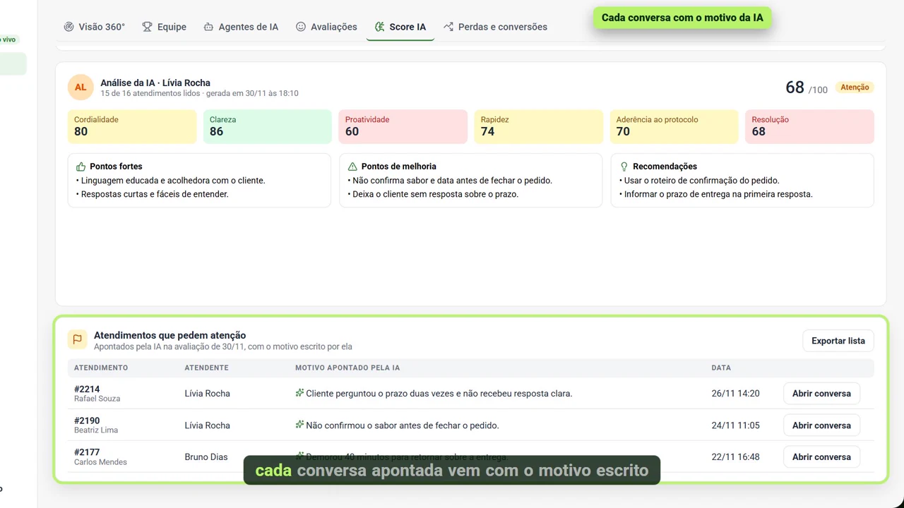
</Frame>

<Frame caption="Classify a closed conversation to update its outcome metrics.">
  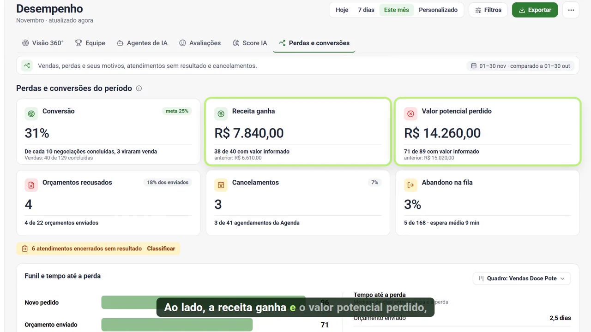
</Frame>

### Measure a Kanban board

1. Under **Losses and conversions**, select **Measure a board** (**Medir um quadro**) and choose the sales board. Your role needs permission to edit Kanban boards to enable measurement. If the company already measures boards, select the one to inspect in the funnel.
2. Set the **Won stage** and **Lost stage**. Check which connections feed the board. If none are linked, review the connection settings before expecting new cards.
3. Save and check the stages and volumes in the funnel. Eligible moves into a won or lost stage on a measured board can record a deal outcome. Check the source and outcome before recording the same conversation again.

<Frame caption="Choose the stages that represent won and lost deals.">
  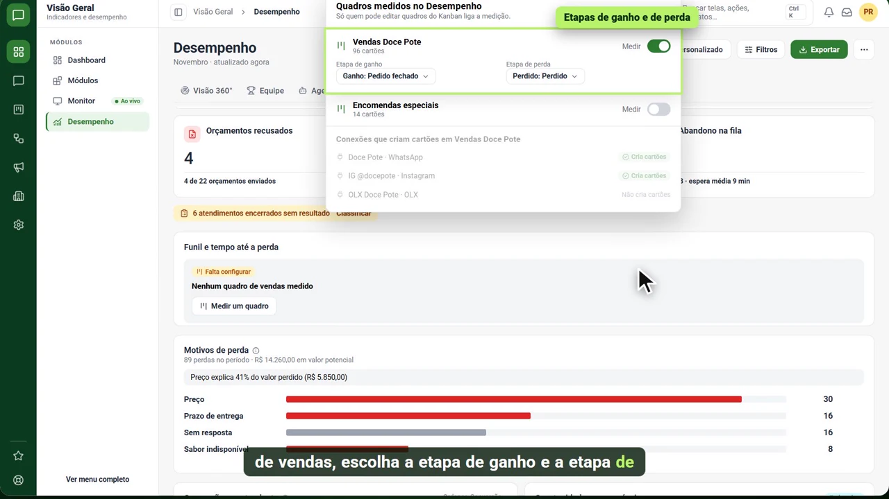
</Frame>

## Set performance goals

Under **⋯ → Performance goals** (**Metas do Desempenho**), review the goals for **NPS**, **AI Score**, **conversion**, and the **first-response SLA**. Blank NPS, AI Score, and conversion fields use system defaults. An empty SLA field leaves the metric without a goal.

When available, open the AI team's goals to set its own targets, such as the share of AI resolutions and the maximum share of human handoffs.

<Frame caption="Company-wide goals are in the Performance menu.">
  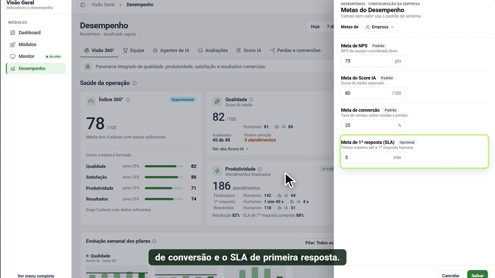
</Frame>

## Troubleshoot common problems

| If this happens | Where to check |
| --- | --- |
| The test sale is missing from conversion | Check the dates, queue, and tag. Classify the conversation if it has no outcome. Confirm any AI suggestion before it can count. |
| The 360° Index is blank | Check which areas have enough data. At least three are required. |
| Resolution rate looks low or blank this week | Check how many completed conversations have reached the end of their seven-day window and how many reopened. |
| A survey was sent but no score appears | Check sent and answered surveys and whether the customer replied before the journey's deadline. |
| AI Score or AI Agents is missing | Check the plan, active modules, and permissions. To generate AI Score, also check the model configured in the AI Vault. |

<PageFeedback title="Track your operation's performance" path="en/desempenho" language="en" />
