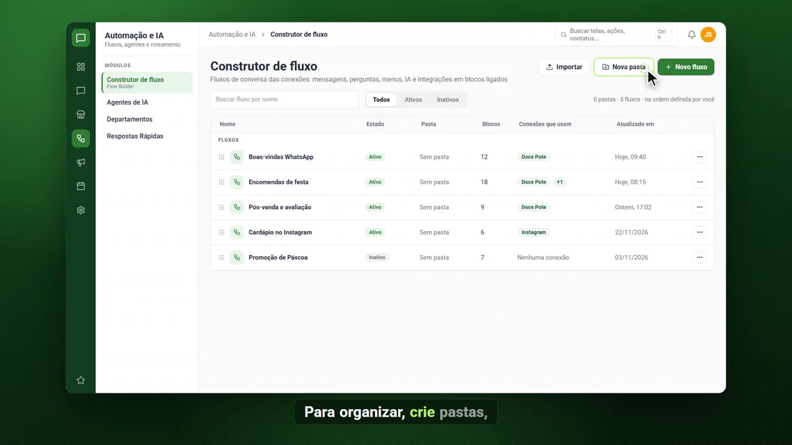
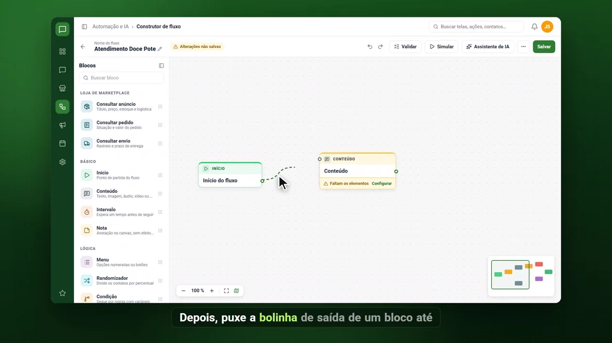
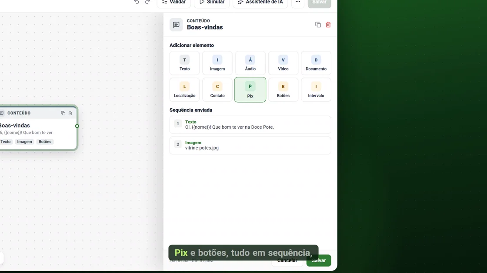
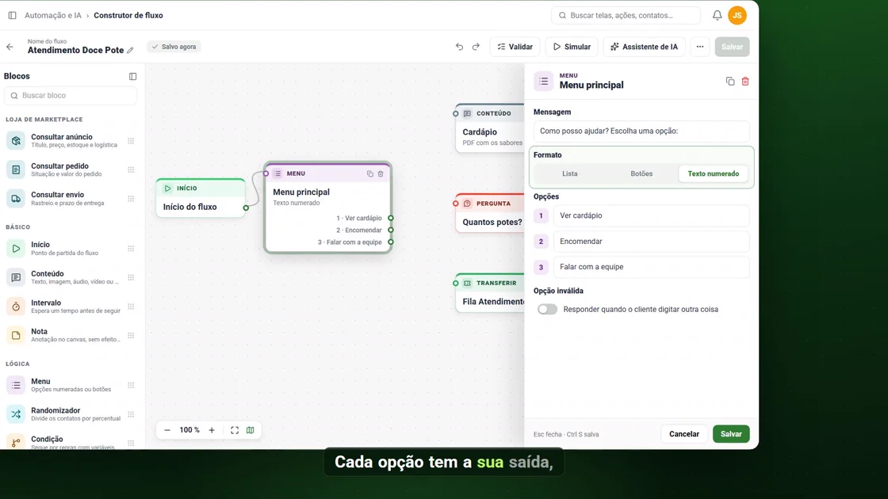
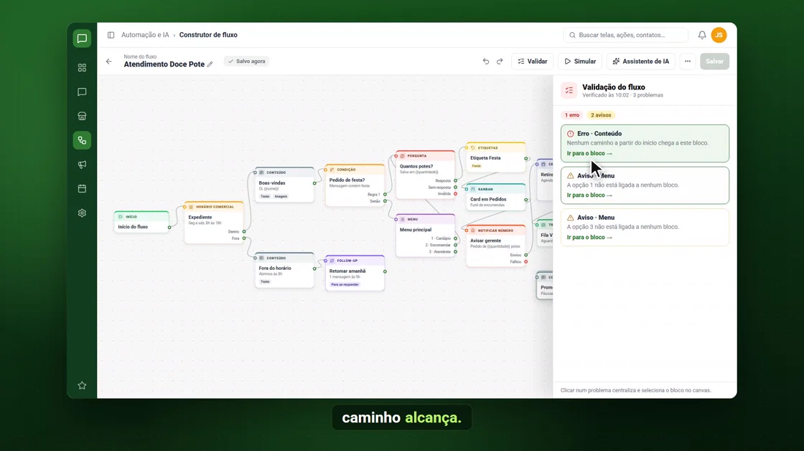
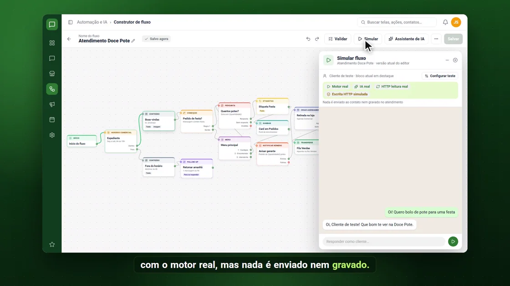
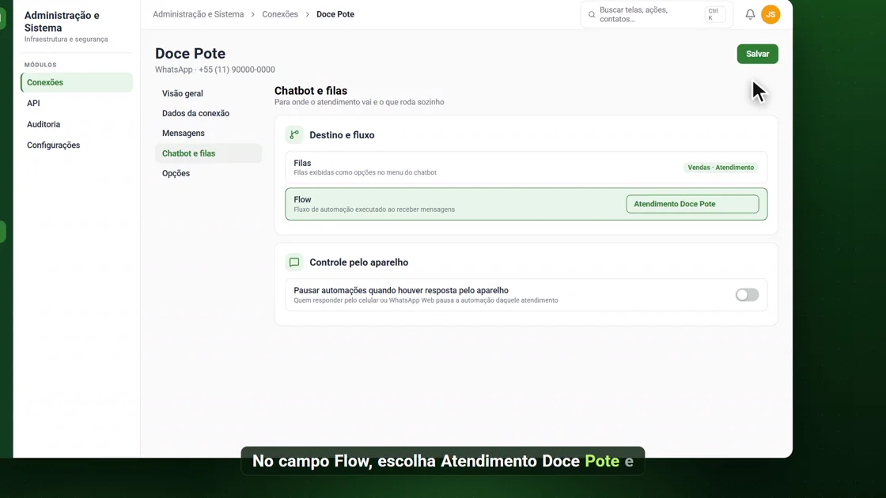
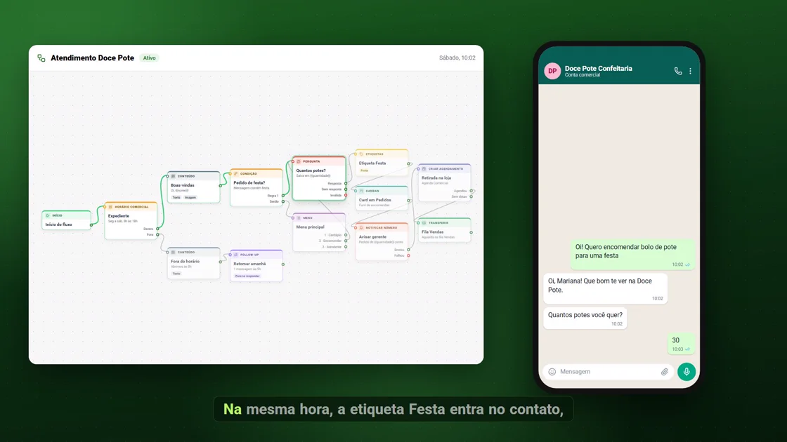
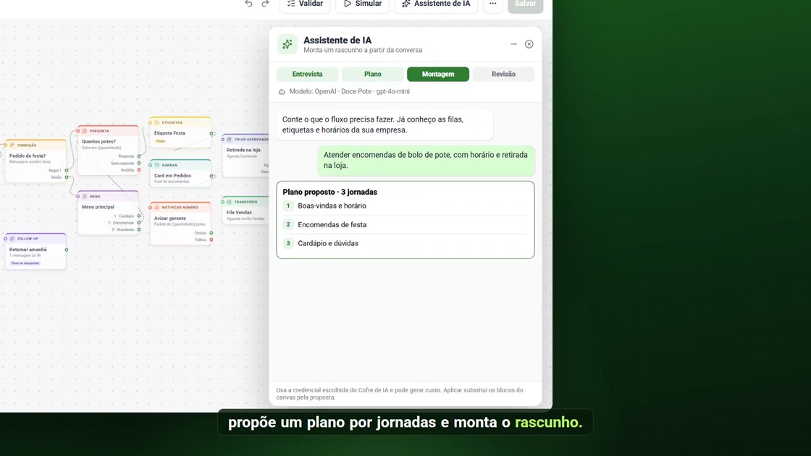

import { PageFeedback } from "/snippets/page-feedback.jsx";

The **Flow Builder** automates part of a conversation. In this tutorial, you'll build a menu that shows a product list or hands an order to **Sales** with the quantity the customer entered. The screenshots come from a Portuguese training video about **Doce Pote Confeitaria**, a fictional bakery. Some show the expanded version of the flow. Portuguese labels are included where they help you find a control shown in the video.

## Before you start

- Use a computer to add and connect blocks. On smaller screens, you can view the flow, edit existing blocks, and simulate it.
- Use an account with permission to create and edit flows. You'll also need permission to edit the connection for the last step.
- Have a [test connection](/en/primeiros-passos), a second phone number to send messages from, and a staffed [department](/en/organizar-equipe) such as **Sales**.

## Create the flow

1. Open **Automation and AI → Flow Builder** (**Automação e IA → Construtor de fluxo**). The list shows each flow's status and which connections use it.
2. Select **New flow** (**Novo fluxo**), name it **Doce Pote Support**, and confirm. Open it from the list if the editor hasn't opened yet.
3. Find **Start** (**Início**) on the canvas, the **Blocks** panel on the left, and **Validate**, **Simulate**, and **Save** at the top.

<Frame caption="The flow list shows search, filters, folders, and connections that use each flow.">
  
</Frame>

To connect two blocks, drag the output handle of the first block to the input of the second. For a block with multiple outputs such as **Menu**, connect each option to its destination. Open a block on the canvas and select **Save** in its panel to apply its settings. Select **Save** in the top bar to save the entire flow and check for the saved status before leaving.

<Frame caption="Connecting the Start block to Content.">
  
</Frame>

## Build the conversation

### Greet the customer and offer choices

1. Add **Content** (**Conteúdo**). Name it **Welcome** and add a text element such as “Hi! Welcome to Doce Pote.” Save the block and connect **Start → Welcome**.
2. Add **Menu**. Enter “How can we help?” and add **View products**, **Place an order**, and **Talk to our team**. Use numbered text options for this test. Save and connect **Welcome → Menu**.
3. Add another **Content** block with the product list and connect the **View products** output to it. To return to the menu or hand the conversation to your team, connect that **Content** block's output to the next block.

<Frame caption="The Content block sends its elements in the listed order.">
  
</Frame>

<Frame caption="Each menu option has its own output on the canvas.">
  
</Frame>

### Ask for a quantity and transfer to Sales

1. Add **Question** (**Pergunta**) in **Ask** mode. Enter “How many jars would you like?” and set the variable name to `quantity`.
2. Under answer validation, accept **Text**. Use the optional regular expression `^[0-9]+$` to accept digits only, such as `30`. Enable retries, set the maximum to `2`, and add a prompt such as “Enter the quantity as a number, for example 30.”
3. Enable handling for unanswered questions and set a timeout. Connect **Place an order → Question**. Connect the invalid-answer and timeout outputs to a **Content** block with the instruction you want to send, such as “I'll put you in touch with our team.”
4. Add **Transfer** (**Transferir**) and select the **Sales** queue. Connect the **Question** answer, the **Talk to our team** menu option, and the output of the fallback **Content** block to **Transfer**.
5. Save the blocks you've edited and select **Save** in the top bar.

## Validate and simulate

1. Select **Validate** (**Validar**). Open the issues in the panel and fix required fields, missing destinations, and blocks that should be reachable from **Start**. Run validation again.
2. Open **Simulate** (**Simular**). It uses the current version in the editor. In the test settings (**Configurar teste**), choose the test channel, confirm that **Simulate write requests** (**Simular requisições de escrita**) is on, and apply the settings to restart.
3. Type responses as a customer. Open the simulation variables (**Variáveis da simulação**) to check the captured answer. Restart the simulation between scenarios.

<Warning>
  The simulator uses the real engine without sending messages to the contact or recording them in the conversation. It can still make real AI calls and HTTP reads. With **Simulate write requests** on, POST, PUT, PATCH, and DELETE receive simulated responses. Turning the option off allows those requests to change data in the external system.
</Warning>

| Scenario | What to check in the simulator |
| --- | --- |
| **View products** | The customer receives the content configured for that option. |
| **Place an order**, then enter `30` | The variable `quantity` holds `30` and the conversation reaches the transfer to **Sales**. |
| **Place an order**, then enter “thirty” | The flow prompts for another answer. After the retry limit, it takes the invalid-answer output. |
| **Place an order**, then wait | Advance the simulation clock and check the timeout output. |
| **Talk to our team** | The flow transfers to **Sales** without asking for a quantity. |

<Frame caption="The validation panel identifies problems and helps you find their blocks.">
  
</Frame>

<Frame caption="Simulate the customer's responses before using the flow on a connection.">
  
</Frame>

## Link the flow and test on WhatsApp

1. After validating and simulating, select **Save** in the editor and check the confirmation.
2. Open **Connections** (**Conexões**) under **Administração e Sistema**, edit the test connection, and open **Chatbot and queues** (**Chatbot e filas**).
3. Check the current value of **Flow** before changing it. Choose **Doce Pote Support** and save the connection. The connection now uses that flow for automation.
4. Start a test conversation from another number and select **Place an order**. Reply `30`. In MultChat, check the messages and confirm the conversation reaches **Sales**. Repeat the other paths you simulated.
5. To remove the flow, go back to **Chatbot and queues**, set **Flow** to **Disabled** (**Desabilitado**), and save. If you replaced an existing flow, select it again to restore the previous link.

<Frame caption="The Flow field links the automation to the selected connection.">
  
</Frame>

If your team also replies from WhatsApp Business, WhatsApp Web, or another linked device, review the setting to pause automations when a reply comes from the device. When enabled, the connection's rules determine when automation pauses for that conversation and how it resumes.

## Expand the flow

In the video, Doce Pote uses **Business hours** to split conversations during and outside opening hours. A **Condition** checks whether the customer mentioned “festa” (party). After collecting the quantity, the flow can apply the **Festa** tag, create an item on the **Kanban** board, and hand off to **Sales**. When reproducing it, check where the condition gets its variable and test the path where the condition isn't met.

<Frame caption="The expanded flow and an example conversation with the fictional customer Mariana.">
  
</Frame>

| Category | Blocks and when to use them |
| --- | --- |
| **Basics** | **Content** sends messages and media in sequence. **Interval** waits before continuing. **Note** adds an annotation to the canvas. |
| **Logic** | **Menu** branches by option. **Condition** checks data already available in the flow. **Business hours** branches based on opening hours. **Randomizer** splits paths by percentages that add up to 100%. **Set variable** stores a value for later. **Switch flow** continues in another flow. |
| **Interaction** | **Question** asks for or captures an answer in a variable. **Update contact** changes the contact record. **Transfer** hands off to a queue or agent. **Close conversation** ends the conversation. **Follow-up** schedules a follow-up. |
| **Automation** | **AI** uses a model and instructions within the conversation. **Tags**, **Kanban**, and **Create appointment** act on MultChat resources. **HTTP request**, **Notify number**, **WhatsApp template**, **Send email**, and **ChatFlow invite** depend on the configured channels and resources. |
| **Marketplace** | Listing, order, and shipment lookups use the Mercado Livre integration. |

### Use the editor's AI Assistant

Open **AI Assistant** (**Assistente de IA**) and describe the goal, messages, branches, and desired handoff. Review the plan and draft before applying it. Check queues, calendars, and other references, then validate, simulate, and save. The assistant helps build the flow. The **AI** block runs as part of the conversation.

<Frame caption="The AI Assistant proposes a plan and a draft you can review.">
  
</Frame>

## Organize, import, and restore flows

- In the list, use **New folder**, search, and the status filters. Use **Move to folder** from a row's menu or drag the flow by its reorder handle. Check which connections use a flow before editing it.
- To experiment with a flow that's in use, choose **Duplicate** and verify you're editing the copy before saving.
- To move a flow to another company, **Export** it and **Import** it in the destination company. Choose the `.zip` file or a legacy `.json`, then choose whether to create a new flow or replace the current one. In the editor, these actions are under **More actions** (**Mais ações**).
- During import, map queues, tags, calendars, boards, and other resources to their equivalents in the destination company. Unmapped references are removed from blocks. Review media and credential notices, validate, and simulate before linking.
- Importing to replace a flow creates a restore point before the change. To recover an available version, open **More actions → Restore points** (**Mais ações → Pontos de restauração**), choose the point, and review the result. Consider the impact before restoring a flow already linked to a connection.

## Troubleshoot common problems

| If this happens | Where to check |
| --- | --- |
| A block is skipped | Follow the connections from **Start**. For a menu, check the output for the selected option. Use **Validate** to find the block. |
| The flow works in the simulator but stays silent on WhatsApp | Check that the flow is saved, **Flow** points to it on the right connection, the connection is working, and automation is active for that conversation. Try a fresh conversation. |
| The transfer reaches the wrong destination | Open the **Transfer** block and check the queue or agent. If the flow was imported from another company, review the resource mapping. |
| A block or button is unavailable | Check the window size, your permissions, and whether the feature is available for the plan and channel. |

<PageFeedback title="Build and test your first flow" path="en/flow-builder" language="en" />
