import { PageFeedback } from "/snippets/page-feedback.jsx";

**Kanban** organizes sales, support, billing, and other processes into stages. In this guide, you'll build the **Doce Pote Sales** board and track a test order until it is won. The screenshots come from the Portuguese training video for **Doce Pote Confeitaria**, a fictional bakery.

## Open Processes and create a funnel

1. Under **Sales and productivity → Kanban** (**Vendas e Produtividade → Kanban**), open **Processes** (**Processos**). Funnel cards show stages, open items, values, and alerts. **My agenda** lists your upcoming activities.
2. Select **New funnel** (**Novo funil**). Name it **Doce Pote Sales**, choose a color, and set the currency to **BRL**. Under board access, choose whether all departments or selected departments can use it.
3. In the funnel settings, select **Sales** as the process type and **Manual** for item entry. Start with this mode to test the board. Customize item and outcome labels if you want them to match your process.
4. Open the board. Create or rename stages to **New order**, **Quote sent**, **Negotiation**, **Order closed**, and **Lost**. Use **New stage** (**Nova etapa**) to add a column.
5. Open the **⋯** menu for **Order closed**, set the stage outcome to **Won** (**Ganho**), then set **Lost** (**Perdido**) on the lost stage. Leave the stages in between marked as in progress.

Use a role that can manage the board to create a funnel, edit stages, and configure automations or the dashboard. Board access and item actions also follow the user's permissions and [departments](/en/organizar-equipe).

<Frame caption="Processes shows the funnels, alerts, and the agent's schedule.">
  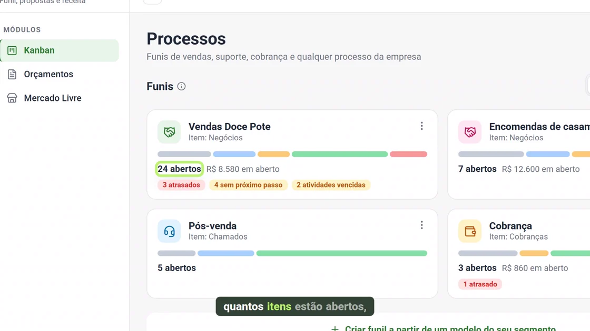
</Frame>

<Frame caption="When creating a funnel, check board access, process type, and item entry.">
  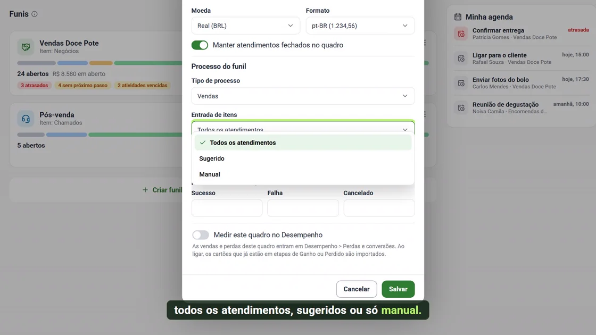
</Frame>

## Track a test order through to its outcome

1. On the board, select **New item** (**Novo item**). Enter **Marina's wedding cake** as the title or choose a test contact. Pick **New order**, assign an owner, set the value to **R$1,800**, and create the item.
2. Open the card. Review the deadline, value, priority, and owner. If you already have a test conversation, use the **Link** action in the item's conversations section to attach it.
3. Move the card to **Quote sent**. Create a follow-up call under **New activity** (**Nova atividade**), choose the owner, and set a date and time. Check that it appears in **Calendar** or **My agenda**.
4. After the follow-up, complete the activity, move the card to **Negotiation**, and check the **Timeline** for the change.
5. Once the deposit is confirmed in the example, select **Won** on the item or move it to **Order closed**, the designated won stage.
6. Run a second test with a declined quote. Move the card to **Lost**, choose **Price** if it's available, and confirm. **Skip** moves the card without a reason. **Cancel** undoes the move.

<Frame caption="An item includes deal details, the next step, activities, and a timeline.">
  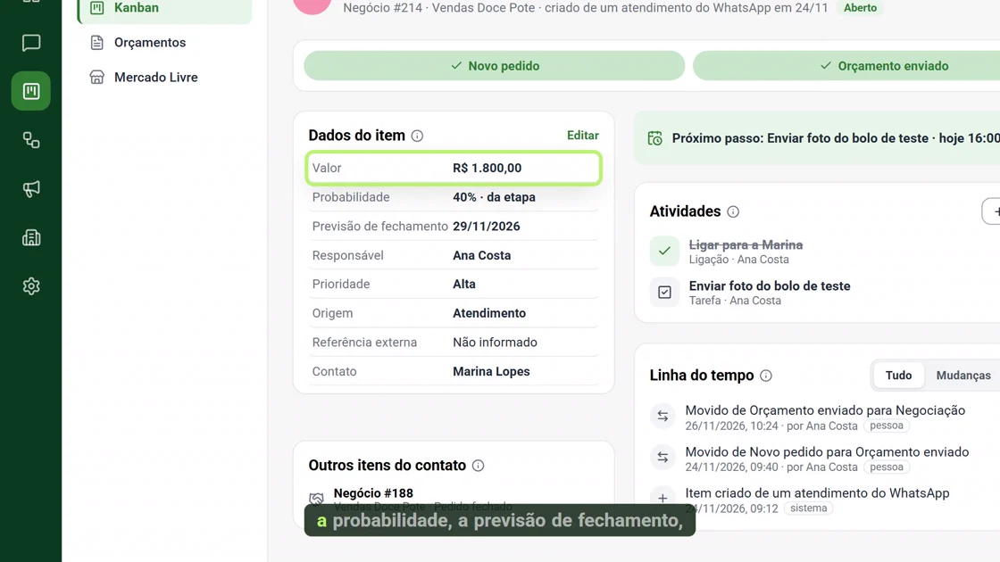
</Frame>

<Frame caption="Record a reason when a card moves to a lost stage.">
  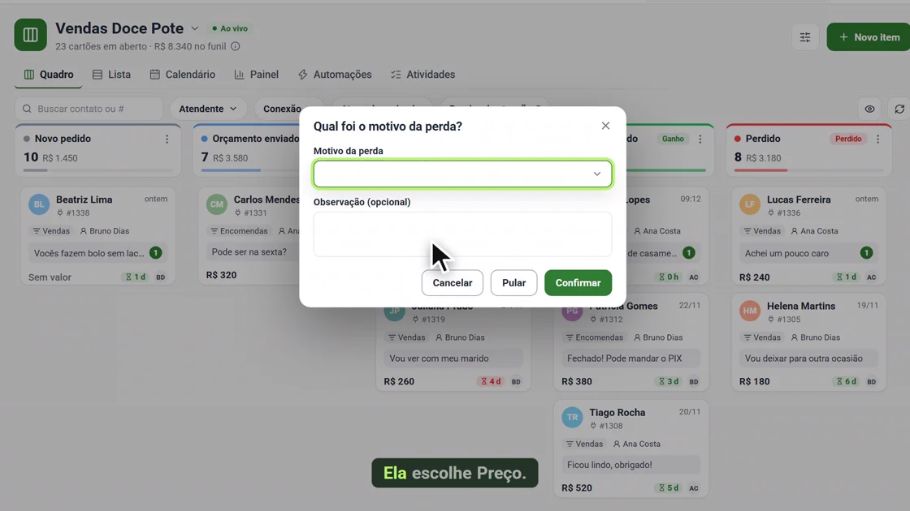
</Frame>

## Choose how cards enter the board

Open **Edit funnel** (**Editar funil**) from the funnel menu and review **Item entry** (**Entrada de itens**).

| Mode | How items enter |
| --- | --- |
| **Manual** | Your team uses **New item** and can link a conversation to the card. |
| **Suggested** (**Sugerido**) | When a suggestion is available, the team reviews the board and details before creating the item. |
| **All conversations** (**Todos os atendimentos**) | Eligible new conversations from the linked connection create items automatically. |

To test automatic entry, choose **All conversations**. Under **Administração e Sistema → Conexões**, edit the test connection, find **Kanban** under **Options** (**Opções**), and select the board. Save, start a new conversation, and check for the card in the first stage. Verify that the conversation's department is within the board's access scope.

<Frame caption="The Kanban field links the connection to the board that receives new conversations.">
  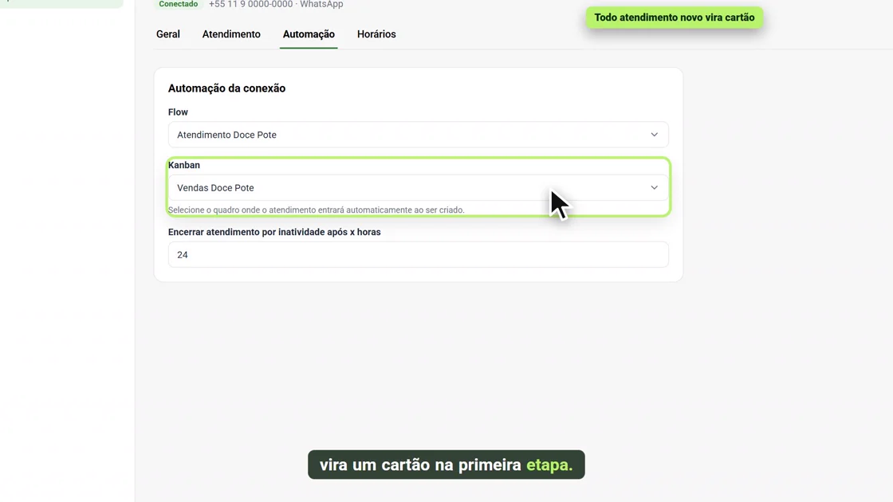
</Frame>

## Find items and manage next steps

On the **Board**, each column holds cards in one stage. A card can show the contact, channel, queue, agent, unread messages, value, and time in stage. Use search, filter by agent or connection, or put overdue items first. **Needs attention** flags items with no next step, an overdue activity, or too much time in the stage.

<Frame caption="The board shows where cards are, who owns them, and their values.">
  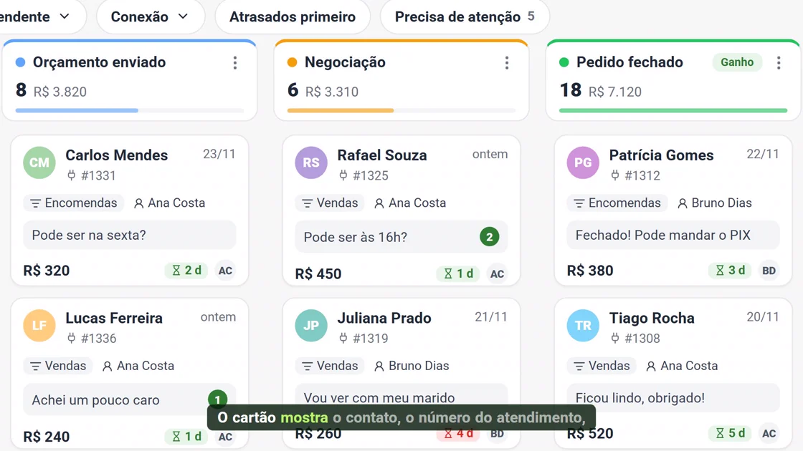
</Frame>

<Frame caption="Needs attention explains why each item was flagged.">
  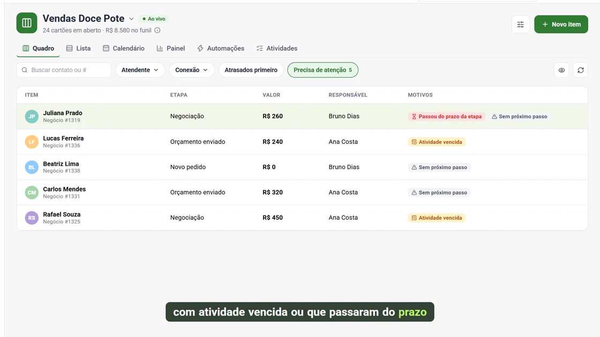
</Frame>

| Tab | When to use it |
| --- | --- |
| **List** | View items in a table. Select cards to move, assign, or archive in bulk if your role allows it. Review the selection before confirming. |
| **Calendar** | See due activities and expected closing dates. |
| **Activities** | Review overdue, today's, upcoming, and undated activities. Mark each one complete when finished. |
| **Dashboard** (**Painel**) | Review funnel results and identify stages where items wait longest. |
| **Automations** | Set up and monitor rules by stage. |

<Frame caption="Calendar shows scheduled activities and expected closing dates.">
  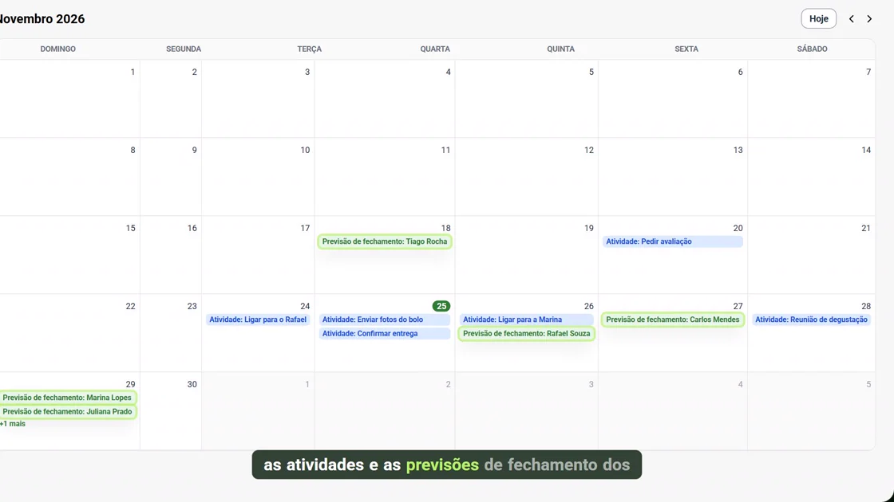
</Frame>

## Read the dashboard and include results in Performance

In **Dashboard**, choose a date range and review the funnel metrics.

- **Monthly forecast** adds the value of open deals expected to close this month, weighted by stage probability.
- **Won this month** shows value won and compares it with the configured goal.
- **Overall conversion** divides wins by the sum of wins and losses. **Average cycle** shows how long it takes on average to win a deal.
- The stage conversion and bottleneck table helps identify stages with items over the time or item limit. Review the monthly forecast, owner results, and loss reasons.

<Frame caption="The dashboard shows forecast, won value, conversion, and bottlenecks.">
  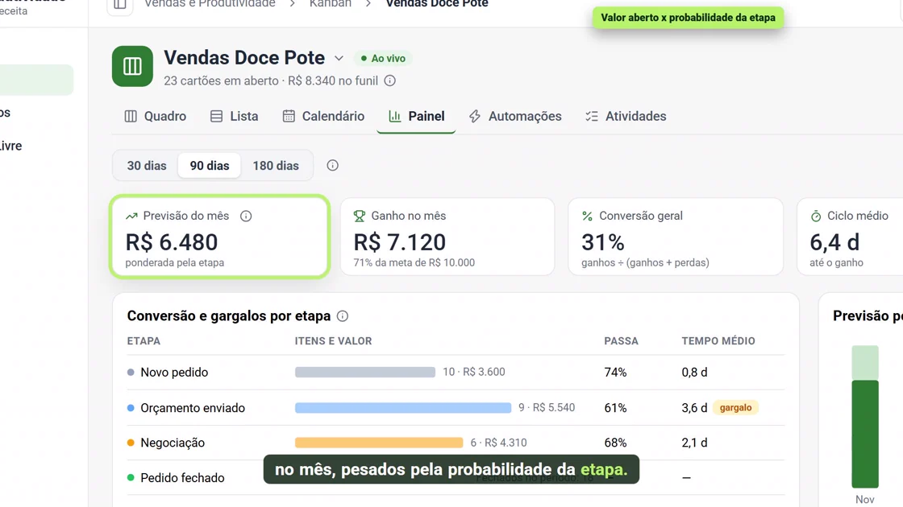
</Frame>

To include the board in [Performance](/en/desempenho), edit the funnel and enable **Measure this board in Performance** (**Medir este quadro no Desempenho**). Check the **Won** and **Lost** stages. Choose the deal value field if prompted. Enabling measurement also processes cards already in won or lost stages. Use a test board first if you want to see how it works.

Under **Performance → Losses and conversions**, select the measured board to see the funnel and time to loss. Check the period, board, and outcome source when comparing it with the Kanban dashboard. Review and confirm suggested AI outcomes before counting them as sales or losses.

<Frame caption="Select a measured board in Losses and conversions to see the funnel and time to loss.">
  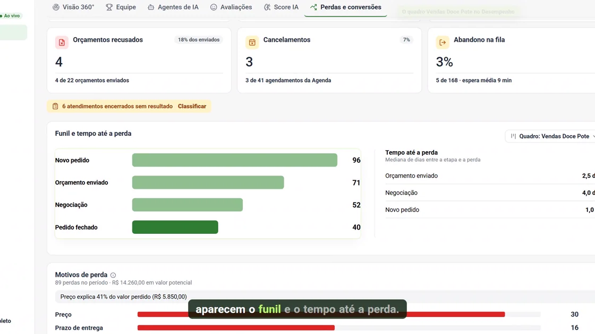
</Frame>

## Create a stage automation

1. Open **Automations**, select **Quote sent**, and choose **New rule** (**Nova regra**).
2. In **When**, choose a time-in-stage trigger. For example, set it to **48 hours** in **Quote sent**.
3. In **If**, set the conditions. To send a message over the Official WhatsApp API, check the open-window condition and the channel's messaging rules.
4. In **Then**, add an action, such as creating an activity for the owner. Start with this internal action on a test board. Add a message action afterward if needed.
5. Save, enable the rule, and check its execution history. For a timed test, choose a duration you can wait through to verify that it runs.

Available actions depend on the trigger and configured resources. They can include moving a card, creating an activity, assigning an owner, sending a message, starting a flow, or creating an item in another funnel.

<Frame caption="An automation combines a trigger, conditions, and actions.">
  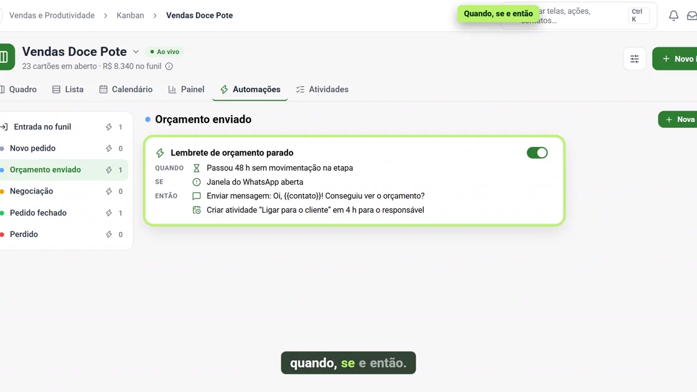
</Frame>

## Connect Kanban with Flow Builder and AI agents

### Move an item from a flow

1. In [Flow Builder](/en/flow-builder), add a **Kanban** block after the **Orders** option in a test menu.
2. Choose an action such as **Move to stage**, select **Doce Pote Sales**, and pick **New order**. Test with a contact who does not have an item yet. Configure a create action if the flow should create that item.
3. If you enable an error output, connect **Failed** to a next step, such as guiding the customer or handing off to Sales. Save, validate, and simulate. Then use a test connection to check that the card moved.

<Frame caption="Choose what the Kanban block should do and define what happens if it fails.">
  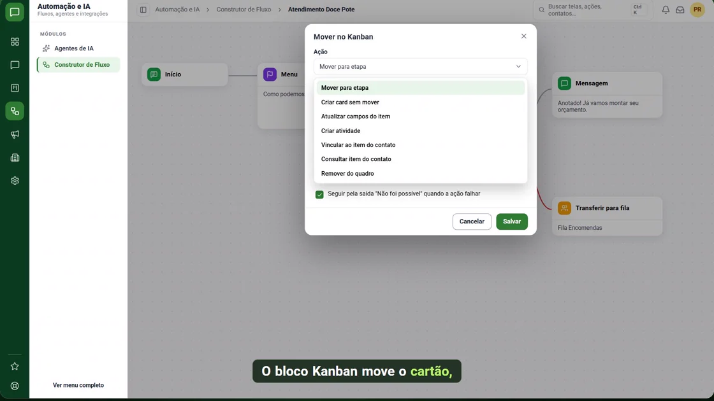
</Frame>

### Review AI suggestions

When the **Assistant** is configured in the AI Vault and available to your team, review the conversation summary and suggestions for the next action, stage, risk, or reply. If a conversation has a suggested opportunity, check the funnel and details before selecting **Create item**. See how to allow actions in the knowledge base of an [AI agent team](/en/agentes-de-ia).

<Frame caption="The item assistant shows suggestions for the team to review.">
  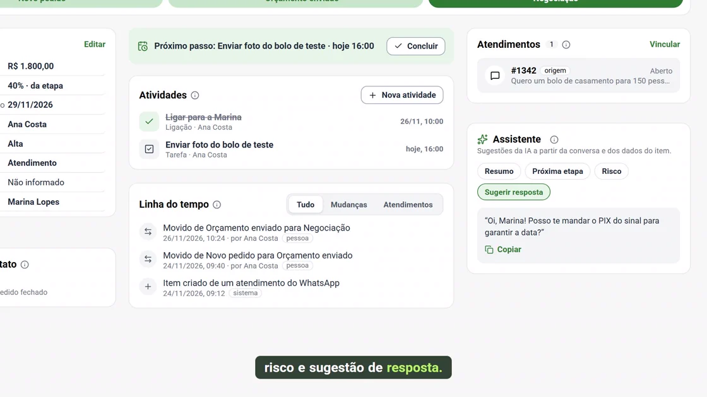
</Frame>

## Troubleshoot common problems

| If this happens | Where to check |
| --- | --- |
| A new conversation did not create a card | Check **All conversations**, the connection's **Kanban** field, and whether the department is within the board's scope. |
| A card will not move | Check permissions and required fields. If another person changed the item at the same time, review the updated item before moving it. |
| The win or loss is missing from Performance | Check measurement, stage outcome, the value field, the selected dates, and whether the outcome was confirmed. |
| An automation did not run as expected | Check that the rule is enabled, the trigger fired, and the conditions matched. Read the execution history before retrying. |
| **Dashboard** or **Automations** is missing | Check whether your role can manage the board and whether the feature is available to the company. |

<PageFeedback title="Build a funnel and track deals in Kanban" path="en/kanban" language="en" />
