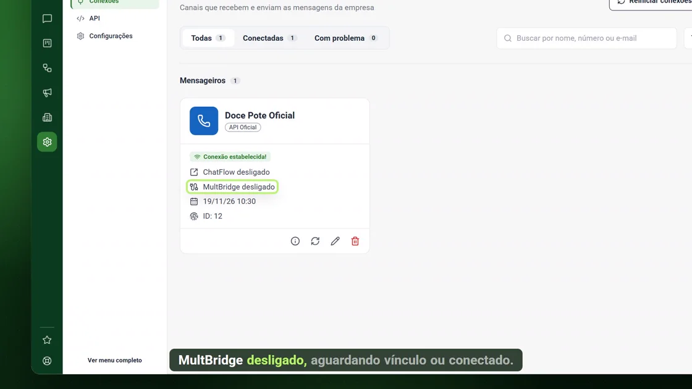
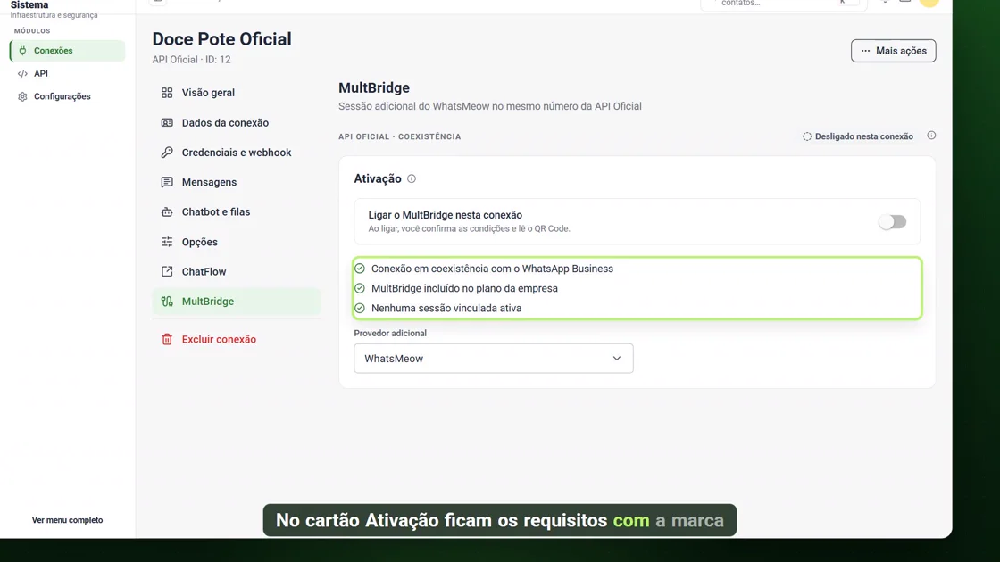
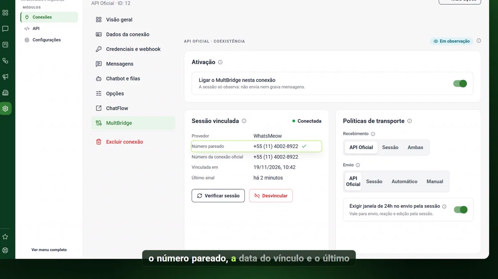
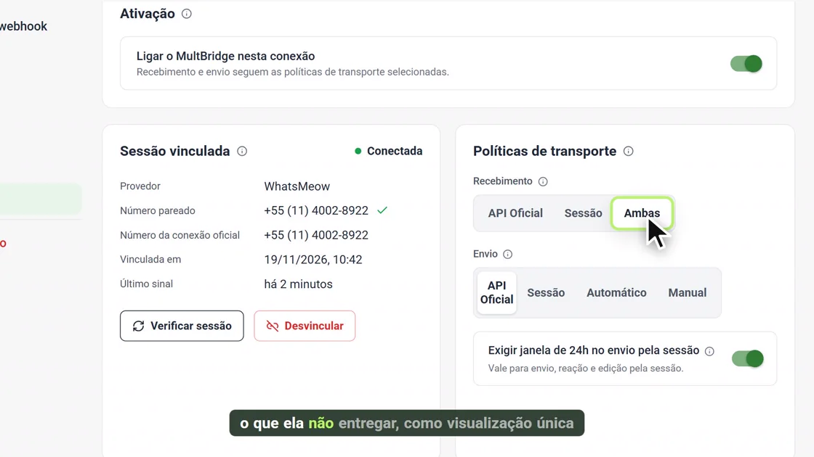
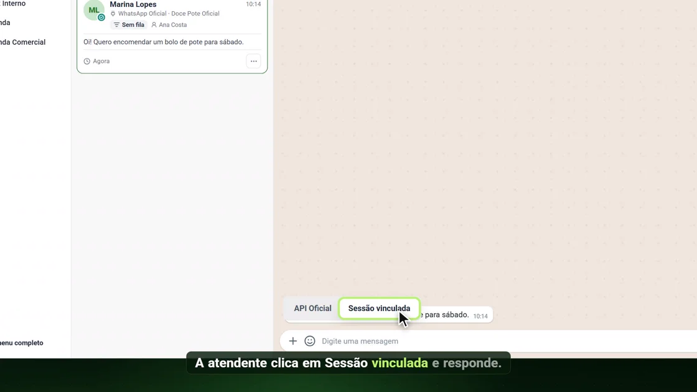
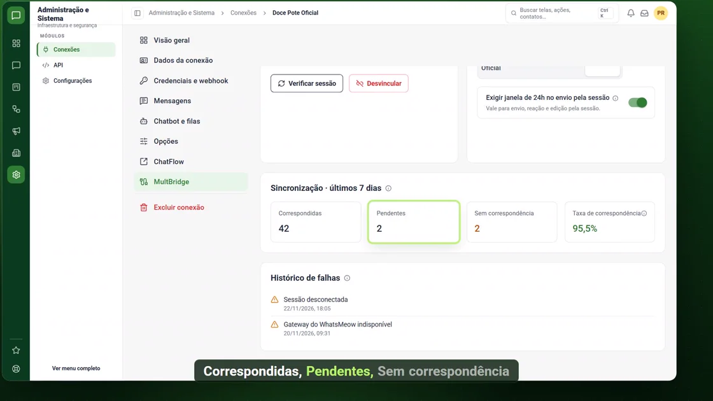

import { PageFeedback } from "/snippets/page-feedback.jsx";

**MultBridge** links an additional **WhatsMeow** session to the same number as an **Official WhatsApp API** connection in coexistence mode. The Official API remains the primary connection. The session appears inside that connection, and transport policies determine how messages enter and leave the same conversation. Screenshots show the fictional **Doce Pote Confeitaria** from the Portuguese training video.

## Before you activate

- Confirm your plan includes **MultBridge** and the feature is available to your company.
- Use an **Official API** connection in coexistence with the **WhatsApp Business** app. Have the phone that uses that number ready.
- Use an account allowed to edit connections. In **Activation** (**Ativação**), confirm that the connection number is known and the WhatsMeow gateway is available.
- Check whether the same number is already used by an active standalone WhatsMeow connection. That blocks linking. Review conversations using the standalone connection before deciding to disconnect it.

<Warning>
  The linked session uses an unofficial WhatsApp client. MultChat shows the activation terms, including the risk that Meta may restrict or block the number. Read the terms before confirming.
</Warning>

<Frame caption="The connection list shows whether MultBridge is off, waiting to be linked, or connected.">
  
</Frame>

## Activate and link the number

1. Open **Connections** (**Conexões**) under **Administração e Sistema**. Open the Official API connection and select **MultBridge**.
2. In **Activation**, check the requirements and the additional provider, **WhatsMeow**. Turn on **Ligar o MultBridge nesta conexão**.
3. Read the dialog, accept the terms if you agree, and select **Ativar e gerar QR Code**.
4. On the phone that uses the same number, open **WhatsApp Business → Linked devices → Link a device** and scan the code shown in MultChat. Keep the dialog open while linking. The code refreshes if it expires.
5. In **Linked session** (**Sessão vinculada**), confirm that the status is **Connected** and compare the paired number to the Official API connection number. MultChat unlinks mismatched sessions. Use **Verify session** (**Verificar sessão**) to check again.

<Frame caption="Check the requirements on the Activation card before enabling the add-on.">
  
</Frame>

<Frame caption="The session card shows the paired number, link date, and last signal.">
  
</Frame>

New configurations start with **Official API** selected for inbound and outbound messages. After linking, the **Observing** (**Em observação**) badge means the session monitors the connection while the Official API continues handling messages. When a policy routes messages through the linked session, the badge changes to **Routing active** (**Roteamento ativo**).

## Choose the transport policies

Make changes under **Transport policies** (**Políticas de transporte**). Inbound and outbound policies are independent. Check both selections after changing either one.

| Inbound | How messages arrive |
| --- | --- |
| **Official API** (**API Oficial**) | The conversation records messages from the Official API. The linked session observes. |
| **Session** (**Sessão**) | The linked session takes priority. The Official API acts as a backup if the session becomes unavailable. |
| **Both** (**Ambas**) | The Official API takes priority. The session adds supported one-to-one messages the API doesn't deliver or marks as unsupported. |

MultChat matches messages received over both paths to avoid duplicate entries in the same conversation. Group conversations are outside the linked session.

| Outbound | How agents reply |
| --- | --- |
| **Official API** | Uses the official connection. |
| **Session** | Uses the linked session for supported sends. If it is unavailable, sending may fail. Check the session status before retrying. |
| **Automatic** (**Automático**) | Prioritizes the Official API. It can use the linked session if the Official API connection is already disconnected before sending. A failure after dispatch does not trigger a retry over the other route. |
| **Manual** | Shows **Official API** and **Linked session** in the conversation when available. **Official API** is the initial selection. |

Chatbot replies, flows, campaigns, and templates use the Official API. Keep **Require a 24-hour window for sending through the session** enabled for your initial test. That setting applies the window to sends, reactions, and edits through the session. Official API sends follow Meta's messaging rules. When [ChatFlow](/en/chatflow) is active for the conversation, the web conversation takes priority.

<Frame caption="Inbound and outbound messages have separate settings on the same connection.">
  
</Frame>

## Test in a conversation

1. In your test connection, set the outbound policy to **Manual** and the inbound policy to **Both**.
2. Send a text from a second number, such as “I'd like to order a cake jar.” Open the conversation in MultChat and check that the message appears once.
3. Check that **Official API** is initially selected near the reply box. Choose **Linked session** and send a test confirmation.
4. Check that the confirmation arrives on the test phone and remains in the same MultChat conversation. If it fails, review **Failure history**.
5. To return to observing, select **Official API** for inbound and outbound messages.

<Frame caption="Manual mode shows the route selector next to the message field.">
  
</Frame>

## Monitor the session and troubleshoot

| What you see | What to check |
| --- | --- |
| **Matched** | The Official API and linked session both observed these messages during the period shown. |
| **Pending** | The messages are still being correlated. |
| **Unmatched** | Only one route recorded the message. Compare the message type and session status. |
| **Match rate** | Percentage of matched messages among those with a known outcome. It stays blank until there are resolved results. |

<Frame caption="Synchronization and Failure history help you monitor the session.">
  
</Frame>

- **The tab is missing.** Check your company's MultBridge access and confirm you opened an Official API connection in coexistence mode.
- **Waiting to link or number mismatch.** Open **Show QR code** or **Link again** and scan with the WhatsApp Business app for the Official API number.
- **Disconnected.** Review **Failure history**. Check the phone's linked devices and use **Verify session** or **Link again**. The Official API still receives messages while it remains connected.
- **Linked session is unavailable in the reply box.** Check the sending policy, session status, and messaging window. In **Manual** mode, choose the Official API if it is available and appropriate for the conversation.

## Unlink the session or turn off MultBridge

Select **Unlink** (**Desvincular**) on the linked session card to remove the current device. To turn off the entire add-on, turn off the switch in **Activation** and confirm **Desligar**. This also unlinks the session. The Official API connection remains available.

<PageFeedback title="Link and configure MultBridge" path="en/multbridge" language="en" />
