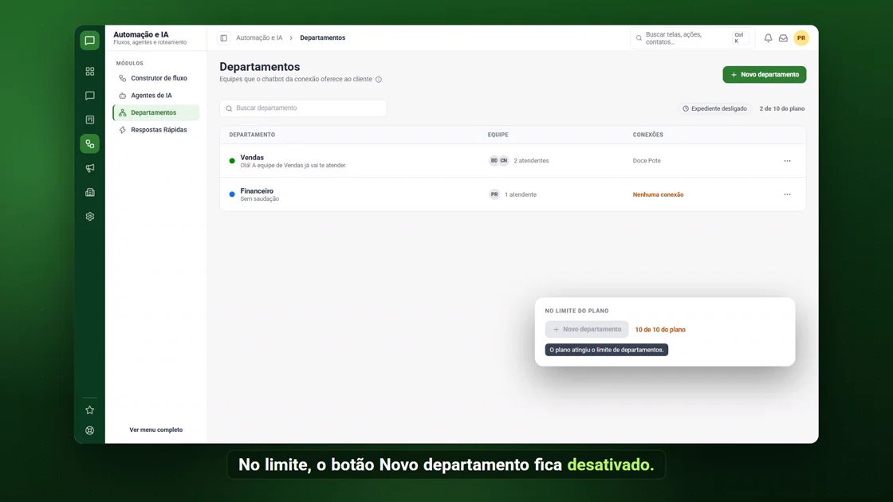
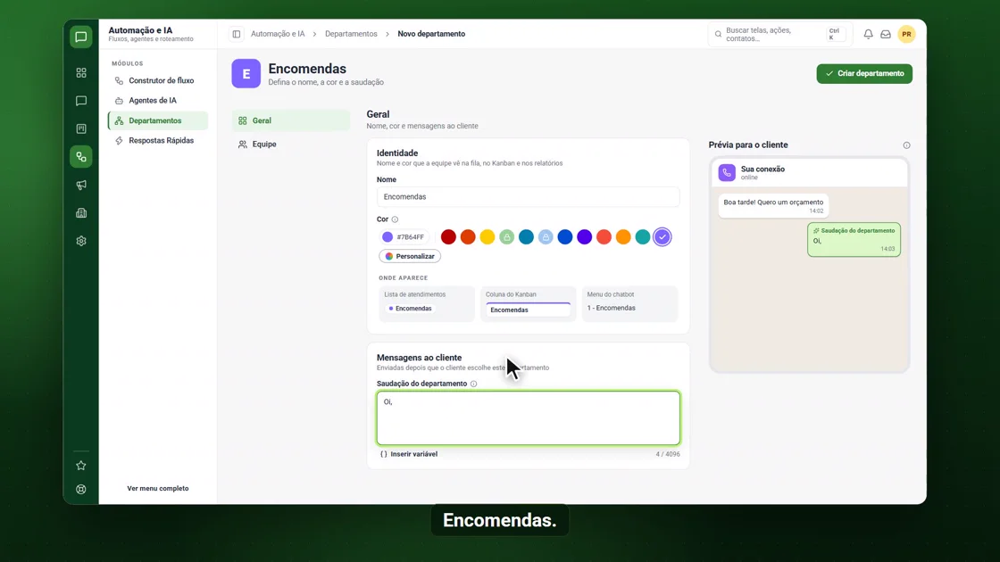
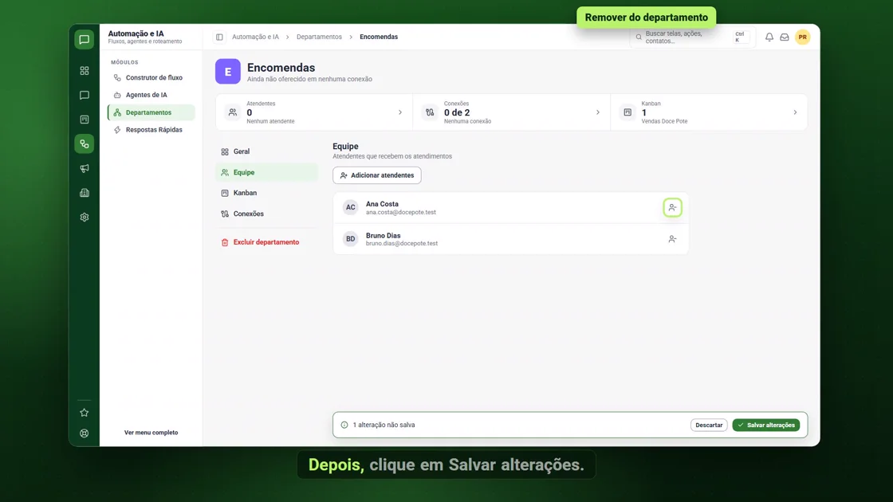
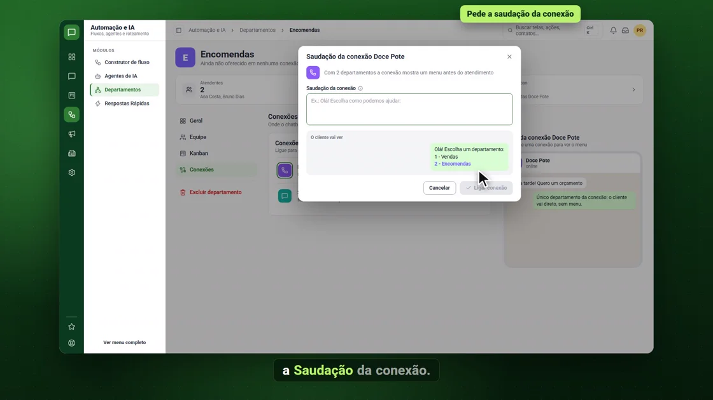
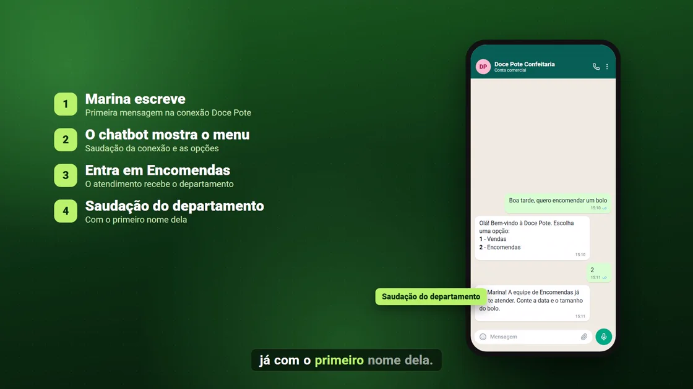
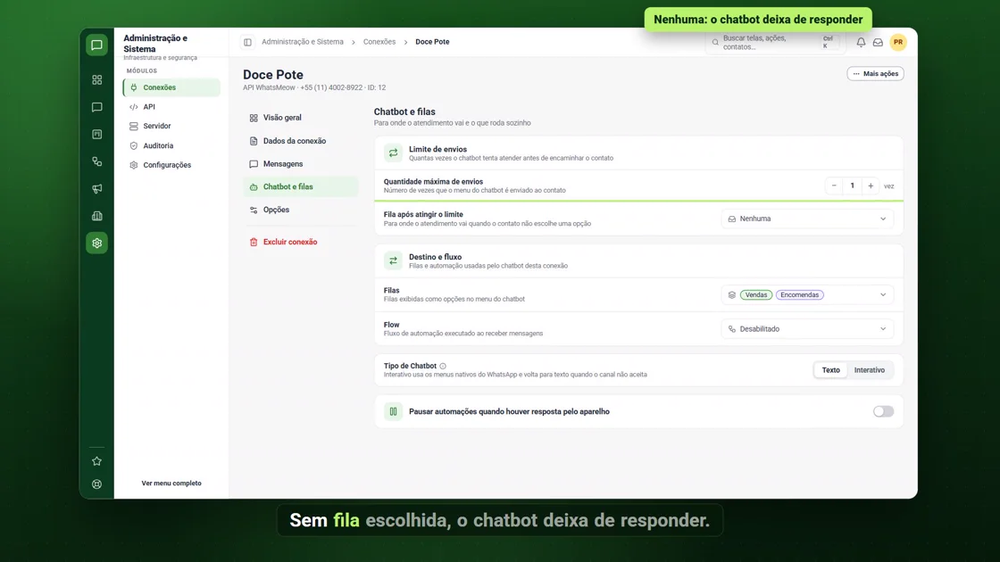
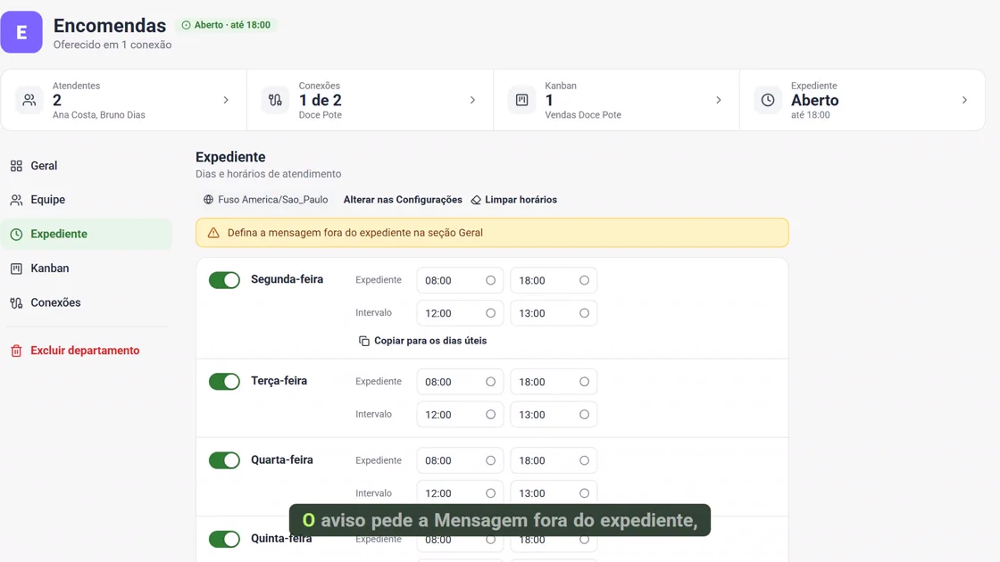
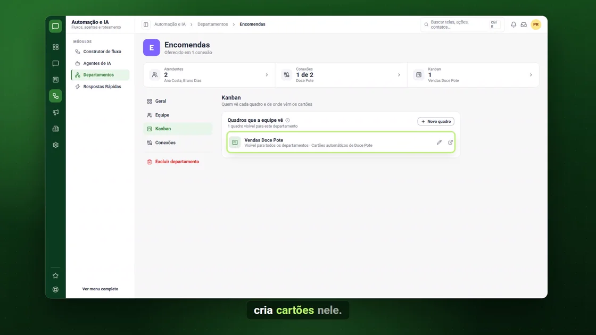
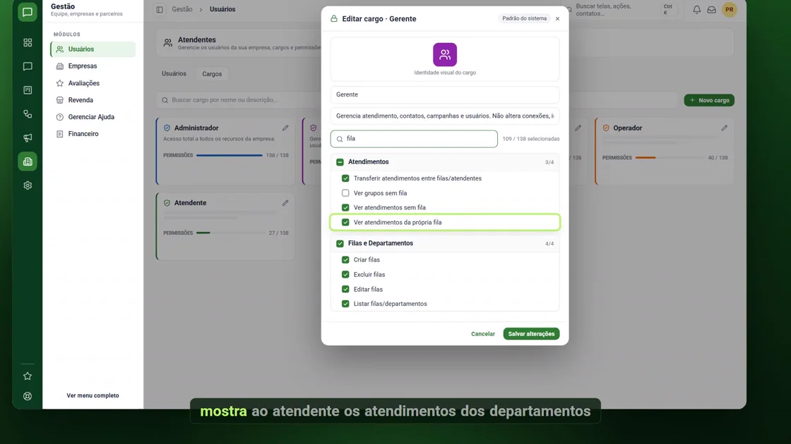

import { PageFeedback } from "/snippets/page-feedback.jsx";

A department is a support queue. Here you will create **Encomendas** (Orders) so that cake requests reach the right team. The illustrations come from the training video for **Doce Pote Confeitaria**, a fictional bakery. The walkthrough preserves the Portuguese labels you see in that video.

## Before you begin

- Have an [active WhatsApp connection](/en/primeiros-passos#connect-whatsapp), a second number for testing, and the agents already registered under **Usuários**.
- Use a role that can list, create, and edit departments. Linking a connection also requires permission to list and edit connections. See [role permissions](#set-role-permissions).
- To match the example, start with **Vendas** (Sales) already linked to the **Doce Pote** connection. Review any active **Flow** first. A flow can guide the conversation in place of the default department menu.

## Open the department list

Under **Automação e IA**, open **Departamentos**. Use **Buscar departamento** to find a department. The list shows each department's name, color, greeting, team, and linked connections.

The top of the page displays the business-hours mode and, where your plan has a limit, your department count. **Novo departamento** is disabled at the limit. The help icon explains how the connection chatbot uses departments.

<Frame caption="Department list with team and connection information.">
  
</Frame>

## Create the Orders department

1. Select **Novo departamento**. Under **Geral**, open **Identidade**.
2. Enter **Encomendas** in **Nome**. Pick an available **Cor** or use **Personalizar**. A lock indicates a color already used by another department.
3. Review **Onde aparece** to see how the department will look in the conversation list, in Kanban, and in the chatbot menu.
4. Under **Mensagens ao cliente**, enter **Saudação do departamento**. To greet contacts by their first name, select **Inserir variável → Primeiro nome**.
5. Review the sample in **Prévia para o cliente** and select **Criar departamento**.

```text
Hi, {{firstName}}! You're in Orders. We can help you choose a cake.
```

You can also insert the full name, time-of-day greeting, protocol number, date, or time.

<Frame caption="Department name, color, greeting, and customer preview.">
  
</Frame>

## Add agents

1. Open **Encomendas → Equipe** and select **Adicionar atendentes**.
2. Search for and select the people who handle the queue. In the example, they are **Ana Costa** and **Bruno Dias**.
3. Select **Confirmar**, then **Salvar alterações**.

To remove an agent, use **Remover do departamento** and save. You can also review each agent's queues in their user record under **Usuários → Configuração → Filas e departamentos**.

<Frame caption="The Orders team with the two agents in the example.">
  
</Frame>

## Link Orders to the connection

The connection chatbot presents the menu. The connection greeting introduces it. The department greeting is sent after the customer selects a queue or is routed to the only department on the connection.

| Linked departments | Result for a new conversation in the example |
| --- | --- |
| **Vendas** only | The conversation goes straight to Sales and the customer receives its configured greeting. |
| **Vendas** and **Encomendas** | The connection sends its greeting and menu. The customer selects a department and receives that department's greeting. |

1. In **Encomendas**, open **Conexões**.
2. Find **Doce Pote** and enable the switch to offer Encomendas.
3. If **Saudação da conexão** appears, enter the message, check **O cliente vai ver**, and select **Ligar conexão**. This dialog appears if the connection will have two or more departments and has no greeting yet.
4. Check the confirmation and the position of Encomendas in the preview. If the connection already has a greeting, the switch saves the link directly.

With read-only access, the section shows only connections already linked to the department.

```text
Hello! Welcome to Doce Pote. Choose how we can help you.
```

<Frame caption="The connection greeting dialog that introduces the department menu.">
  
</Frame>

## Test the customer journey

1. Start a new test conversation from the second number and send Doce Pote a message asking to order a cake.
2. Check the connection greeting and both menu options. Select **Encomendas** using the displayed number or interactive option. The video uses option **2**.
3. Check that WhatsApp receives the Orders greeting. With the first-name variable and a contact named Marina Lopes, the reply begins with “Hi, Marina!”
4. Sign in as an assigned agent, open **Atendimentos → Aguardando**, and check the **Encomendas** tag before accepting the conversation.

<Frame caption="Test conversation after selecting Orders.">
  
</Frame>

## Configure the connection chatbot

Open **Conexões → Doce Pote → Chatbot e filas**.

- Under **Filas**, check that **Vendas** and **Encomendas** are selected.
- Use **Quantidade máxima de envios** to set how many times the chatbot can send the menu. Test a finite limit by entering a positive value and sending invalid replies until it is reached.
- Under **Fila após atingir o limite**, choose a fallback queue. When **Nenhuma** is selected, the menu stops responding after the limit.
- Under **Tipo de Chatbot**, **Texto** sends a numbered menu and **Interativo** can use buttons or a list, depending on the channel and number of options.

To update the connection greeting, open **Mensagens** on the same connection. Save and test with a new conversation.

<Frame caption="Menu limits, fallback queue, and routing options.">
  
</Frame>

## Set business hours for Orders

1. Open **Configurações → Expediente → Horário de expediente** and choose **Por Fila/Setor**. Check the company time zone.
2. Return to **Departamentos → Encomendas → Expediente** and select **Definir horários**. The initial schedule is Monday through Friday, **08:00 to 18:00**.
3. Adjust working days, start and end times, and any break. Enter both break times within working hours. Use **Copiar para os dias úteis** to copy a daily schedule to the other weekdays.
4. Under **Geral**, fill in **Mensagem fora do expediente**. Review the schedule and select **Salvar alterações**.

On mobile, tap a day to edit it. Enable **Atende neste dia** if needed and select **Aplicar** before saving the department.

The department sends its out-of-hours message when a customer selects it outside working hours. If the message is blank, the conversation continues normally. In the department list, **Agora** shows open, on break, closed, or no schedule. A department with no schedule is always open.

<Frame caption="Department business hours with the company time zone and breaks.">
  
</Frame>

## Control access to Kanban boards

With the Kanban module active and a role that can view it, open **Encomendas → Kanban**. The list shows boards the team can see and the connections that automatically create cards in them. Use a role with board management permission to create or edit boards.

1. Select **Novo quadro** to create a board visible to Orders.
2. For an existing board, use the pencil action **Editar quem vê**.
3. Under **Quem vê este quadro**, choose **Todos os departamentos** or **Departamentos escolhidos**. Select the appropriate departments and save.

Board visibility and the connection that creates cards are separate settings. Check the connection shown in the board list if automatic cards do not appear.

<Frame caption="Kanban boards visible to the Orders team.">
  
</Frame>

## Set role permissions

Open **Usuários → Cargos**. Edit the role and save after checking the relevant permissions.

| Task | Permission to check |
| --- | --- |
| View the department list | **Listar filas/departamentos** in **Filas e Departamentos**. |
| Create, edit, or delete a department | **Criar filas**, **Editar filas**, or **Excluir filas**, respectively. |
| View a department's connection links | **Listar conexões**. |
| Link or unlink a department | **Editar filas** and **Editar conexões**, plus access to the section. |
| View conversations in an agent's assigned queues | **Ver atendimentos da própria fila** under **Atendimentos**, and queue assignments in **Usuários**. |

In the default roles, **Gerente** can create and edit departments, and **Supervisor** can list them. Review the actual role permissions for each user.

<Frame caption="Queue and conversation permissions for a role.">
  
</Frame>

## Troubleshoot common issues

<AccordionGroup>
  <Accordion title="The new department button is unavailable">
    Check the **Criar filas** permission and the department count against the plan limit.
  </Accordion>
  <Accordion title="The WhatsApp menu does not appear">
    Check that at least two departments are linked and a connection greeting is set. Check for an active **Flow** and retry in a new conversation.
  </Accordion>
  <Accordion title="The agent cannot find the conversation">
    Check the queue tag, the agent's team assignment, **Ver atendimentos da própria fila**, and the **Aguardando** filters.
  </Accordion>
  <Accordion title="The business-hours section is missing">
    Verify that **Horário de expediente** is set to **Por Fila/Setor**. If a schedule is already set, check the time zone and the out-of-hours message.
  </Accordion>
  <Accordion title="I want to delete a department or reuse its color">
    Each department needs a distinct color. If you decide to delete a department, select **Excluir departamento** and review the confirmation. Conversations remain without the department, and agents, connections, and boards lose the link.
  </Accordion>
</AccordionGroup>

<PageFeedback title="Departments" path="en/organizar-equipe" language="en" />
