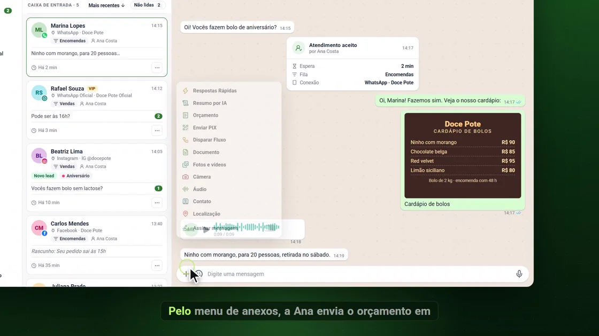

import { PageFeedback } from "/snippets/page-feedback.jsx";

When several agents use the same number, each conversation needs a clear owner and destination. MultChat lets you organize WhatsApp support in queues, see who took a conversation, and hand it off while keeping the conversation history available to the team.

**Evaluating MultChat?** Tell us how many agents you have and where customers contact you. [Contact sales on WhatsApp](https://wa.me/5569981028003?text=Hi!%20I%20came%20from%20the%20MultChat%20manual%20and%20would%20like%20to%20learn%20about%20team%20support%20on%20WhatsApp.).

## Set up a test workflow

Start with a simple example. **Doce Pote Confeitaria**, the fictional bakery from the tutorials, receives quote and delivery questions. The team creates **Sales** and **Support** queues and runs this test.

1. **Decide who handles each topic.** Create the [Sales and Support departments](/en/organizar-equipe) and add agents to their queues.
2. **Connect a number and test an incoming message.** Follow [First steps](/en/primeiros-passos). Send a message from a second number and check where it appears.
3. **Accept, reply, and hand it off.** In [Conversations](/en/atender-conversas), accept the conversation, send a quote, and hand it off to **Support** when the customer asks about delivery. Check the queue, owner, and history.
4. **Close the conversation and review the outcome.** Resolve the conversation and record its outcome when classification is available. Then review the metrics in [Performance](/en/desempenho).

<Frame caption="In the demo, the team accepts the conversation and sends a menu in the same thread.">
  
</Frame>

## Choose what to set up next

<Columns cols={2}>
  <Card title="Route conversations by topic" icon="workflow" href="/en/flow-builder">
    Build a menu for sales and support, collect a reply, and route it to the right queue.
  </Card>
  <Card title="Test an AI agent" icon="bot" href="/en/agentes-de-ia">
    Use your menu and business rules, simulate replies, and verify the human handoff.
  </Card>
  <Card title="Track orders and sales" icon="columns-3" href="/en/kanban">
    Use a pipeline to track quotes, next actions, wins, and losses.
  </Card>
  <Card title="Continue on the web" icon="messages-square" href="/en/chatflow">
    With the Official API, invite customers to use the browser while keeping the same conversation.
  </Card>
</Columns>

## Common questions

### Can multiple agents use the same number?

Your team can handle conversations from a shared connection in the dashboard. Each agent's access depends on their role and queues. See [Departments](/en/organizar-equipe) to set up routing.

### Can I start with a menu and add AI later?

Yes. Start with a [test flow](/en/flow-builder) that greets customers and routes them to the team. Then configure [AI agents](/en/agentes-de-ia), simulate replies, and define when a person should take over.

### Which connection should I use?

The available options depend on your company and the features you need. If you use the Official API, check the [WhatsApp messaging window and approved template rules](/en/atender-conversas#check-the-channel-rules).

## Talk to sales

Tell us what channels you use, how many agents you have, and what you want to automate. [Contact sales on WhatsApp](https://wa.me/5569981028003?text=Hi!%20I%20came%20from%20the%20MultChat%20manual%20and%20would%20like%20to%20learn%20about%20team%20support%20on%20WhatsApp.) · [Visit the MultChat website](https://www.multchat.net/).

<PageFeedback title="How to set up team support on WhatsApp" path="en/whatsapp-em-equipe" language="en" />
