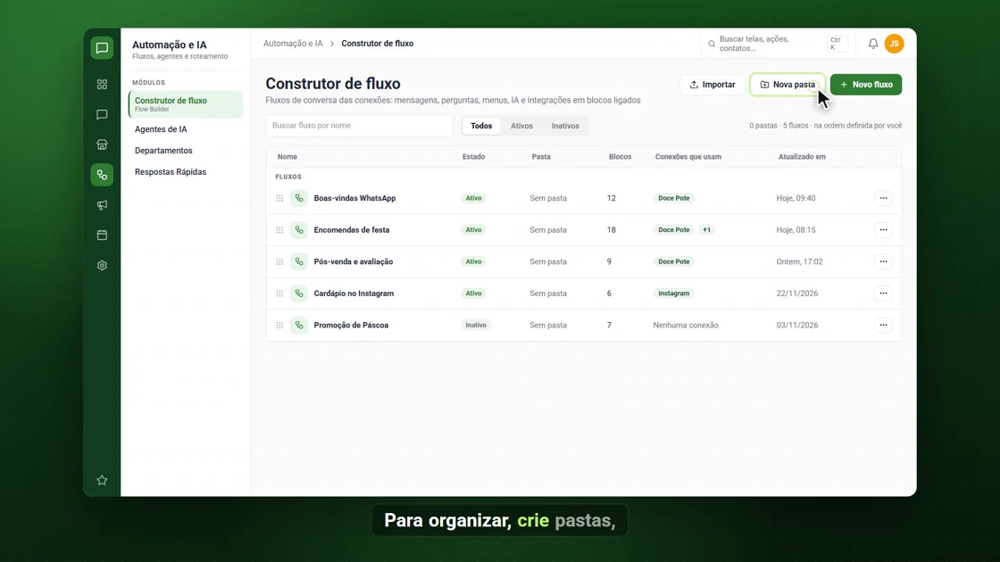
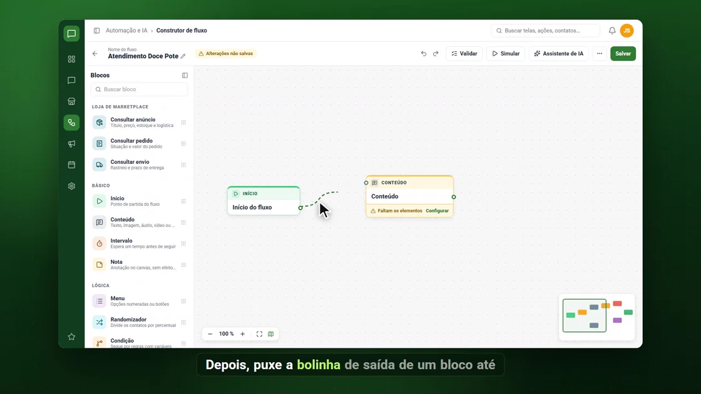
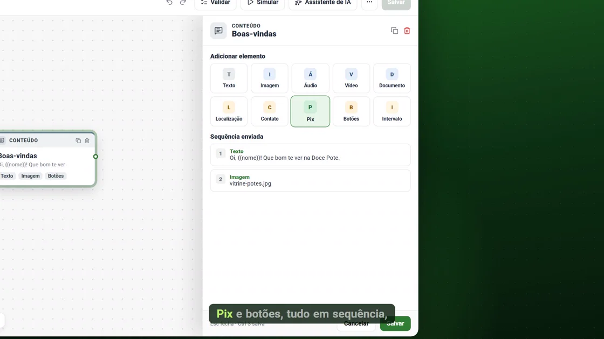
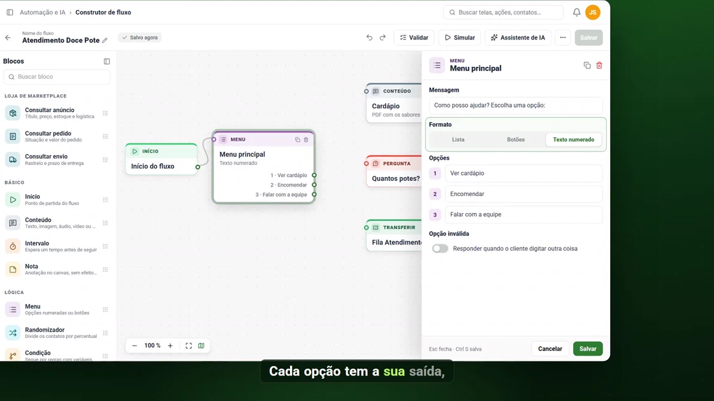
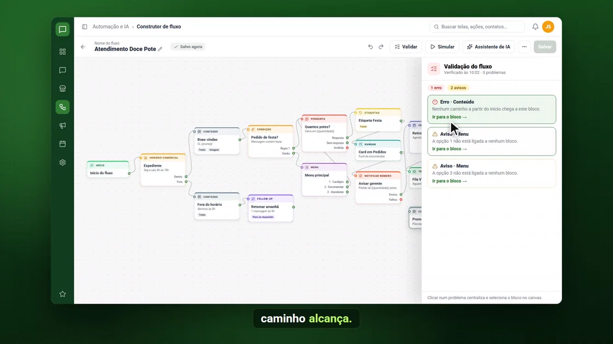
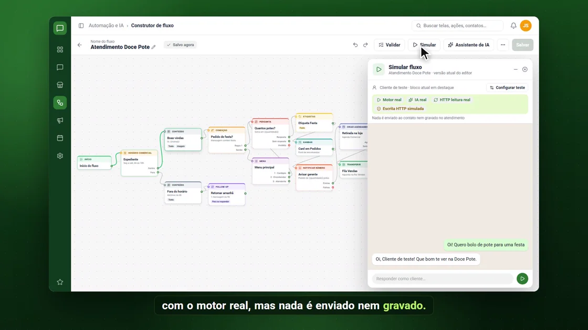
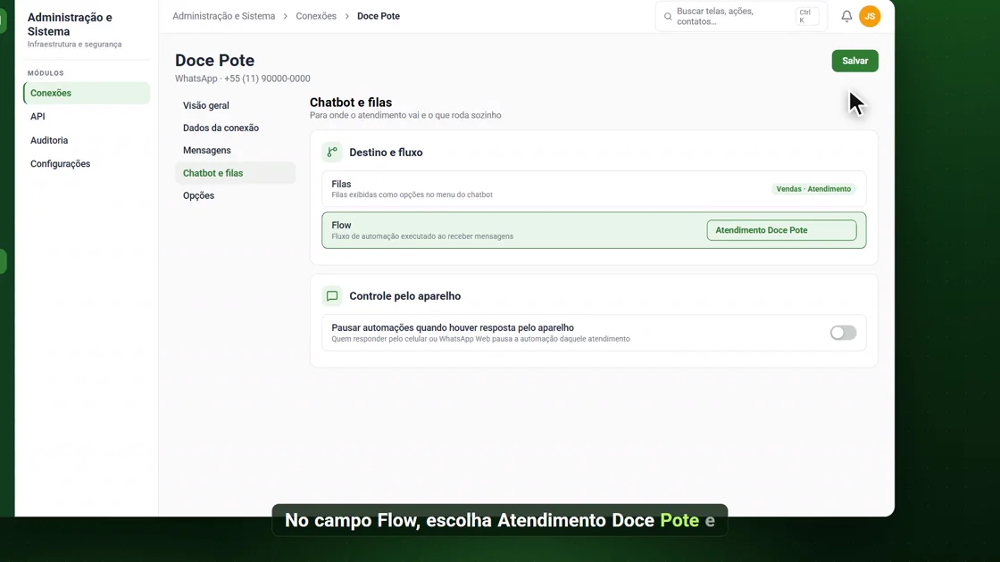
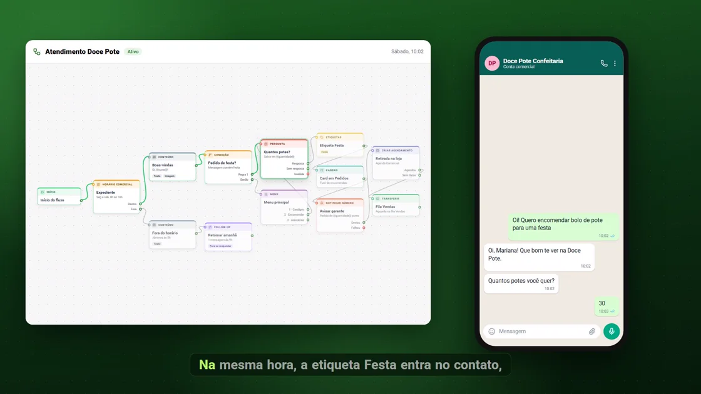
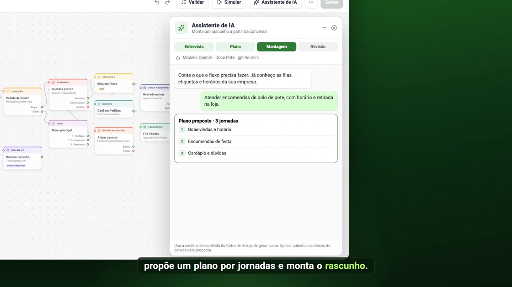

import { PageFeedback } from "/snippets/page-feedback.jsx";

O **Construtor de fluxo** automatiza parte da conversa. Neste tutorial, você vai montar um menu que mostra o cardápio ou encaminha uma encomenda para **Vendas** com a quantidade informada pelo contato. As imagens vêm do vídeo de treinamento da **Doce Pote Confeitaria**, uma empresa fictícia. Algumas mostram a versão ampliada do fluxo.

## Antes de começar

- Use um computador para adicionar e conectar blocos. Em telas pequenas, você pode consultar o fluxo, editar blocos existentes e simular.
- Use um perfil com acesso para criar e editar fluxos. Para a última etapa, você também precisa poder editar a conexão.
- Separe uma [conexão de teste](/primeiros-passos#conecte-o-whatsapp), outro número para enviar mensagens e um [departamento](/organizar-equipe) com atendentes, como **Vendas**.

## Crie o fluxo

1. Abra **Automação e IA → Construtor de fluxo**. A lista mostra o estado de cada fluxo e as conexões que o usam.
2. Clique em **Novo fluxo**, digite **Atendimento Doce Pote** e confirme. Abra o fluxo na lista se o editor ainda não estiver aberto.
3. Localize **Início** na área de montagem, a lista **Blocos** à esquerda e os botões **Validar**, **Simular** e **Salvar** no topo. Use **Buscar bloco** para localizar as peças do tutorial.

<Frame caption="Lista de fluxos com busca, filtros, pastas e conexões que usam cada fluxo.">
  
</Frame>

Para ligar dois blocos, arraste a bolinha de saída do primeiro até a entrada do segundo. Se o primeiro bloco tiver várias saídas, como **Menu**, ligue cada opção ao destino correspondente. Para editar um bloco, abra-o na área de montagem e use **Salvar** no painel do bloco. Use **Salvar** na barra superior para persistir o fluxo inteiro e confira o estado **Salvo** antes de sair.

<Frame caption="Como iniciar uma ligação entre Início e Conteúdo.">
  
</Frame>

## Monte a conversa

### Cumprimente e ofereça as opções

1. Adicione **Conteúdo**. Nomeie o bloco **Boas-vindas** e, na sequência de elementos, adicione um texto como “Olá! Você está falando com a Doce Pote.” Salve o bloco e ligue **Início → Boas-vindas**.
2. Adicione **Menu**. Escreva “Como podemos ajudar?” e cadastre **Ver cardápio**, **Encomendar** e **Falar com a equipe**. Para este teste, use opções de texto numeradas. Salve e ligue **Boas-vindas → Menu**.
3. Adicione um segundo **Conteúdo** com o texto do cardápio e ligue a saída **Ver cardápio** a ele. Se esse caminho deve voltar ao menu ou encaminhar para a equipe, ligue a saída de **Conteúdo** ao próximo bloco.

<Frame caption="O bloco Conteúdo envia seus elementos na ordem em que aparecem na sequência.">
  
</Frame>

<Frame caption="Cada opção do menu tem uma saída própria na área de montagem.">
  
</Frame>

### Pergunte a quantidade e encaminhe para Vendas

1. Adicione **Pergunta** no modo **Perguntar**. Digite “Quantos potes você quer?” e preencha **Variável** com `quantidade`.
2. Em **Validação da resposta**, aceite **Texto** e use a expressão regular opcional `^[0-9]+$` para aceitar uma resposta formada só por algarismos, como `30`. Habilite as novas tentativas, defina **Máximo de tentativas** como `2` e escreva uma orientação como “Envie apenas a quantidade, por exemplo 30.”
3. Em **Tempo de espera**, habilite o tratamento da falta de resposta e configure um prazo. Ligue **Encomendar → Pergunta**. Ligue **Inválida** e **Sem resposta** a um bloco **Conteúdo** com a orientação desejada, por exemplo “Vou encaminhar você para nossa equipe.” Essas saídas podem aparecer com os nomes completos **Resposta inválida** e **Sem resposta no prazo** nas configurações.
4. Adicione **Transferir** e selecione a fila **Vendas**. Ligue a saída **Resposta** da **Pergunta**, a saída **Falar com a equipe** do **Menu** e a saída do bloco de orientação ao **Transferir**.
5. Salve os blocos que editou e clique em **Salvar** na barra superior.

## Valide e simule

1. Clique em **Validar**. Abra os apontamentos do painel e corrija campos obrigatórios, destinos ausentes e blocos que deveriam estar acessíveis a partir de **Início**. Rode a validação outra vez.
2. Abra **Simular**. O painel usa a versão atual do editor. Em **Configurar teste**, selecione o **Canal do teste**, confira se **Simular requisições de escrita** está ligado e clique em **Aplicar e reiniciar**.
3. Digite as respostas como cliente. Abra **Variáveis da simulação** para verificar o valor capturado. Reinicie a simulação entre os cenários.

<Warning>
  O simulador usa o motor real sem enviar mensagens ao contato nem gravá-las no atendimento. Chamadas de IA e leituras HTTP podem acontecer de verdade. Com **Simular requisições de escrita** ligado, POST, PUT, PATCH e DELETE recebem respostas simuladas. Desligar a opção permite que essas requisições alterem dados no sistema externo.
</Warning>

| Cenário | Confira na simulação |
| --- | --- |
| **Ver cardápio** | O contato recebe o conteúdo configurado para essa opção. |
| **Encomendar** e responder `30` | A variável `quantidade` recebe `30` e a conversa chega à transferência para **Vendas**. |
| **Encomendar** e responder “trinta” | O fluxo pede a resposta novamente. Depois do limite de tentativas, segue pela saída **Inválida**. |
| **Encomendar** e ficar sem responder | Use o botão para **Avançar** o relógio simulado e confira a saída **Sem resposta**. |
| **Falar com a equipe** | O fluxo encaminha para **Vendas** sem perguntar a quantidade. |

<Frame caption="O painel de validação identifica problemas e ajuda a localizar os blocos.">
  
</Frame>

<Frame caption="Simule respostas do cliente antes de usar o fluxo em uma conexão.">
  
</Frame>

## Vincule à conexão e teste no WhatsApp

1. Depois de validar e simular, clique em **Salvar** no editor e confira a confirmação.
2. Abra **Administração e Sistema → Conexões**, edite a conexão de teste e entre em **Chatbot e filas**.
3. Veja o valor atual de **Flow** antes de alterá-lo. Escolha **Atendimento Doce Pote** e clique em **Salvar** na conexão. O fluxo passa a ser o destino de automação dessa conexão.
4. De outro número, inicie uma conversa de teste e escolha **Encomendar**. Responda `30`. No MultChat, confira as mensagens e a chegada do atendimento à fila **Vendas**. Repita os outros caminhos que simulou.
5. Se precisar remover o fluxo da conexão, volte a **Chatbot e filas**, selecione **Desabilitado** no campo **Flow** e salve. Se estiver substituindo outro fluxo, selecione o anterior para restaurar o vínculo.

<Frame caption="O campo Flow vincula a automação à conexão selecionada.">
  
</Frame>

Se sua equipe também responde pelo WhatsApp Business, WhatsApp Web ou outro aparelho vinculado, revise a opção **Pausar automações quando houver resposta pelo aparelho**. Quando habilitada, ela segue as regras configuradas na conexão para pausar a automação daquele atendimento até uma retomada.

## Amplie o fluxo

No vídeo, a Doce Pote usa **Horário comercial** para separar o atendimento dentro e fora do expediente. Uma **Condição** verifica se o cliente mencionou “festa”. Depois de recolher a quantidade, o fluxo pode aplicar a etiqueta **Festa**, criar um item no **Kanban** e transferir para **Vendas**. Ao reproduzir o exemplo, confirme de onde vem a variável lida pela condição e teste também o caminho em que a regra falha.

<Frame caption="Fluxo ampliado e conversa de exemplo com a cliente fictícia Mariana.">
  
</Frame>

| Categoria | Blocos e quando usar |
| --- | --- |
| **Básico** | **Conteúdo** envia mensagens e mídias em sequência. **Intervalo** espera um tempo antes de seguir. **Nota** deixa uma anotação na área de montagem. |
| **Lógica** | **Menu** separa opções. **Condição** compara dados que o fluxo já tem. **Horário comercial** separa dentro e fora do expediente. **Randomizador** distribui entre caminhos cujos percentuais somam 100%. **Definir variável** guarda um valor para uso posterior. **Trocar de fluxo** continua em outro fluxo. |
| **Interação** | **Pergunta** pede ou captura uma resposta em uma variável. **Atualizar contato** altera o cadastro. **Transferir** passa para uma fila ou atendente. **Fechar atendimento** encerra o atendimento. **Follow-up** agenda uma retomada. |
| **Automação** | **IA** usa um modelo e instruções dentro da conversa. **Etiquetas**, **Kanban** e **Criar agendamento** atuam sobre recursos do MultChat. **Requisição HTTP**, **Notificar número**, **Template do WhatsApp**, **Enviar e-mail** e **Convite ChatFlow** dependem dos canais e recursos configurados para a ação. |
| **Marketplace** | **Consultar anúncio**, **Consultar pedido** e **Consultar envio** usam os dados da integração do Mercado Livre. |

### Use o Assistente de IA do editor

Clique em **Assistente de IA** e descreva o objetivo, as mensagens, os caminhos e o encaminhamento desejado. Revise o plano e o rascunho antes de aplicar. Confira as filas, as agendas e as outras referências usadas, valide, simule e salve. O assistente ajuda a montar o fluxo. Já o bloco **IA** é executado como parte da conversa.

<Frame caption="O Assistente de IA propõe um plano e um rascunho para revisão.">
  
</Frame>

## Organize, importe e restaure fluxos

- Na lista, use **Nova pasta**, a busca e os filtros **Todos**, **Ativos** e **Inativos**. Use **Mover para pasta** no menu da linha ou arraste o fluxo pela alça de ordenação. Confira **Conexões que usam** antes de alterar um fluxo existente.
- Para experimentar com um fluxo em uso, escolha **Duplicar** e verifique se a cópia está sendo editada antes de salvar.
- Para levar um fluxo a outra empresa, use **Exportar** e, no destino, **Importar**. Selecione o arquivo `.zip` ou um `.json` antigo e decida se vai criar um fluxo ou substituir o atual. No editor, essas ações ficam em **Mais ações**.
- Na importação, mapeie as filas, etiquetas, agendas, quadros e outros recursos para os equivalentes da empresa de destino. Referências deixadas sem recurso são removidas dos blocos. Revise os avisos sobre mídias e credenciais, valide e simule antes de vincular.
- A importação que substitui um fluxo cria um ponto de restauração antes da troca. Para recuperar uma versão disponível, acesse **Mais ações → Pontos de restauração**, escolha o ponto e revise o resultado. Se o fluxo já estiver vinculado a uma conexão, considere o impacto antes de restaurar.

## Resolva os problemas mais comuns

| Se acontecer | Onde conferir |
| --- | --- |
| Um bloco ficou fora da conversa | Siga as ligações a partir de **Início**. Em um menu, confira a saída da opção escolhida. Use **Validar** para localizar o bloco. |
| O fluxo responde no simulador e fica em silêncio no WhatsApp | Confira o salvamento do fluxo, o campo **Flow** na conexão certa, o estado dessa conexão e se o atendimento já está com a automação pausada. Faça um teste com uma conversa nova. |
| A transferência chega ao destino errado | Abra o bloco **Transferir** e confira a fila ou o atendente. Se o fluxo veio de outra empresa, revise o mapeamento feito na importação. |
| Um bloco ou botão está indisponível | Confira o tamanho da janela, as permissões do perfil e a disponibilidade do recurso para o plano e o canal. |

<PageFeedback title="Crie e teste seu primeiro fluxo" path="flow-builder" />
