import { PageFeedback } from "/snippets/page-feedback.jsx";

O **Kanban** organiza vendas, suporte, cobranças e outros processos em etapas. Neste guia, você vai montar o quadro **Vendas Doce Pote** e acompanhar um pedido de teste até o ganho. As imagens vêm do vídeo de treinamento da **Doce Pote Confeitaria**, uma empresa fictícia.

## Abra Processos e crie um funil

1. Em **Vendas e Produtividade → Kanban**, abra **Processos**. Os cartões dos funis mostram etapas, itens em aberto, valores e alertas. **Minha agenda** reúne suas próximas atividades.
2. Clique em **Novo funil**. Defina o nome **Vendas Doce Pote**, uma cor e a moeda **BRL**. Em **Quem vê este quadro**, escolha **Todos os departamentos** ou **Departamentos escolhidos** e indique quais podem usar o quadro.
3. Em **Processo do funil**, escolha **Vendas** e comece com **Manual** em **Entrada de itens**. Faça o primeiro teste com esse modo. Ajuste os nomes dos itens e os **Rótulos de resultado** se quiser adaptar a linguagem ao seu processo.
4. Abra o quadro e crie, ou renomeie, as etapas **Novo pedido**, **Orçamento enviado**, **Negociação**, **Pedido fechado** e **Perdido**. Use **Nova etapa** quando precisar adicionar uma coluna.
5. Abra o menu **⋯** da etapa **Pedido fechado**, escolha **Resultado da etapa → Ganho**. Em **Perdido**, escolha **Resultado da etapa → Perdido**. Deixe as etapas intermediárias como **Em andamento**.

Para criar um funil, editar etapas e configurar automações ou o painel, use um perfil autorizado a gerenciar o quadro. A participação no quadro e as ações sobre itens também seguem as permissões e os [departamentos](/organizar-equipe) do perfil.

<Frame caption="Processos mostra os funis, os alertas e a agenda do atendente.">
  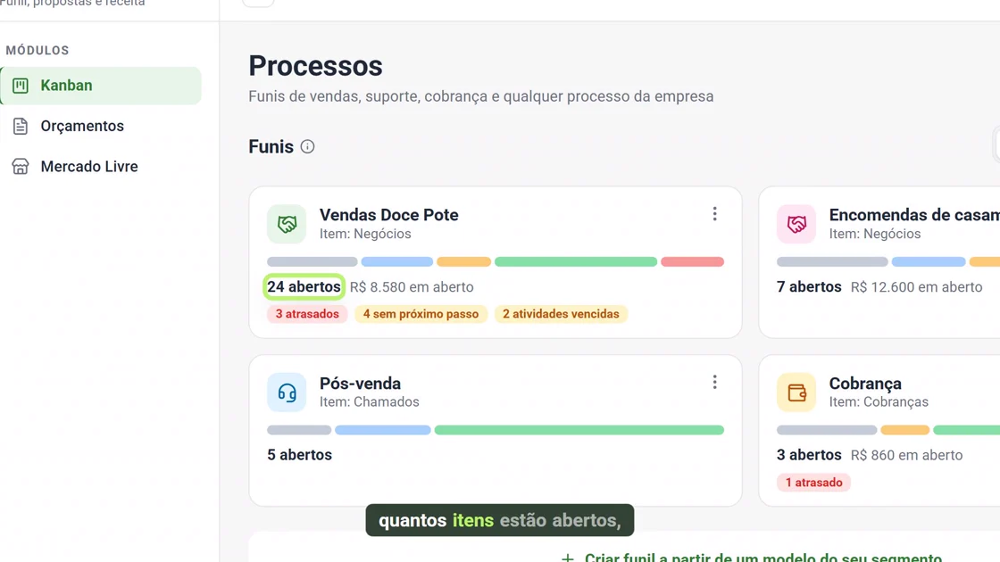
</Frame>

<Frame caption="Na criação, confira quem vê o quadro, o tipo de processo e como os itens entram.">
  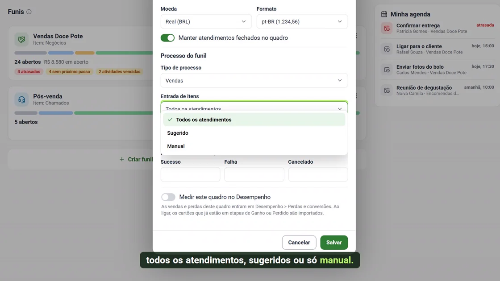
</Frame>

## Acompanhe um pedido de teste até o resultado

1. No quadro, clique em **Novo item**. Preencha **Bolo de casamento da Marina** como título ou selecione um contato de teste. Escolha **Novo pedido**, atribua o responsável e preencha **R$ 1.800** como valor. Clique em **Criar item**.
2. Abra o cartão. Revise os **Dados do item**, como prazo, valor, prioridade e responsável. Se você já tiver uma conversa de teste, use **Vincular** em **Atendimentos** para relacioná-la ao cartão.
3. Mova o cartão para **Orçamento enviado**. Em **Nova atividade**, registre uma ligação de retorno, escolha o responsável e preencha data e hora. Confira se aparece no **Calendário** ou em **Minha agenda**.
4. Depois do retorno, conclua a atividade, mova o cartão para **Negociação** e confira a **Linha do tempo**. Ela registra as mudanças no item.
5. Quando o pagamento do sinal for confirmado no exemplo, selecione **Ganho** no item ou mova o cartão para **Pedido fechado**, a etapa marcada como ganho.
6. Faça um segundo teste com um orçamento recusado. Mova esse cartão para **Perdido**, escolha o motivo **Preço**, se disponível, e confirme. **Pular** conclui o movimento sem registrar motivo. **Cancelar** desfaz o movimento.

<Frame caption="O item reúne os dados do negócio, o próximo passo, as atividades e a linha do tempo.">
  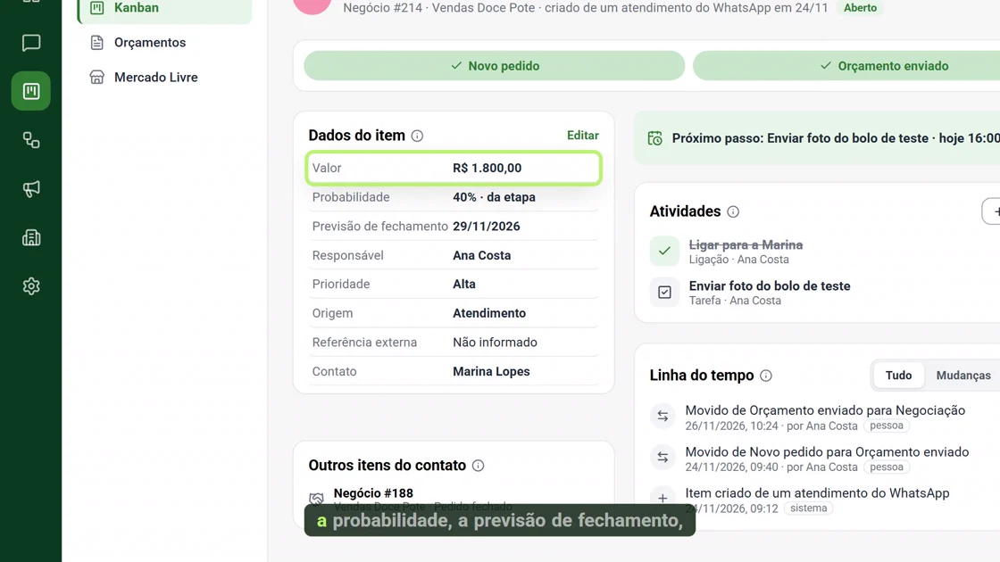
</Frame>

<Frame caption="Informe o motivo ao mover um cartão para uma etapa de perda.">
  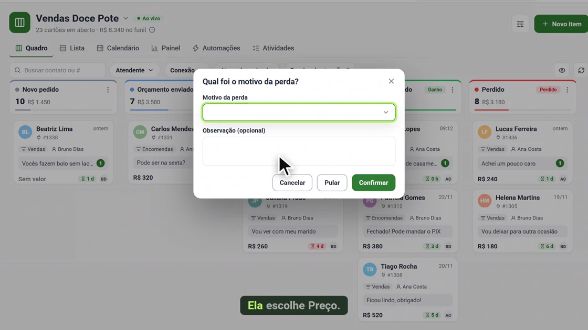
</Frame>

## Escolha como os cartões entram no quadro

No menu do funil, abra **Editar funil** e revise **Entrada de itens**.

| Modo | Como o item entra |
| --- | --- |
| **Manual** | A equipe usa **Novo item** e pode vincular um atendimento ao cartão. |
| **Sugerido** | Quando houver uma sugestão disponível, a equipe revisa o quadro e os dados antes de criar o item. |
| **Todos os atendimentos** | Novos atendimentos elegíveis da conexão vinculada criam itens automaticamente. |

Para testar a entrada automática, escolha **Todos os atendimentos**. Em **Administração e Sistema → Conexões**, edite a conexão de teste, localize o campo **Kanban** em **Opções** e selecione o quadro. Salve a conexão, inicie um novo atendimento e confira o cartão na primeira etapa. Verifique se o departamento desse atendimento está no escopo do quadro.

<Frame caption="O campo Kanban vincula a conexão ao quadro que recebe os novos atendimentos.">
  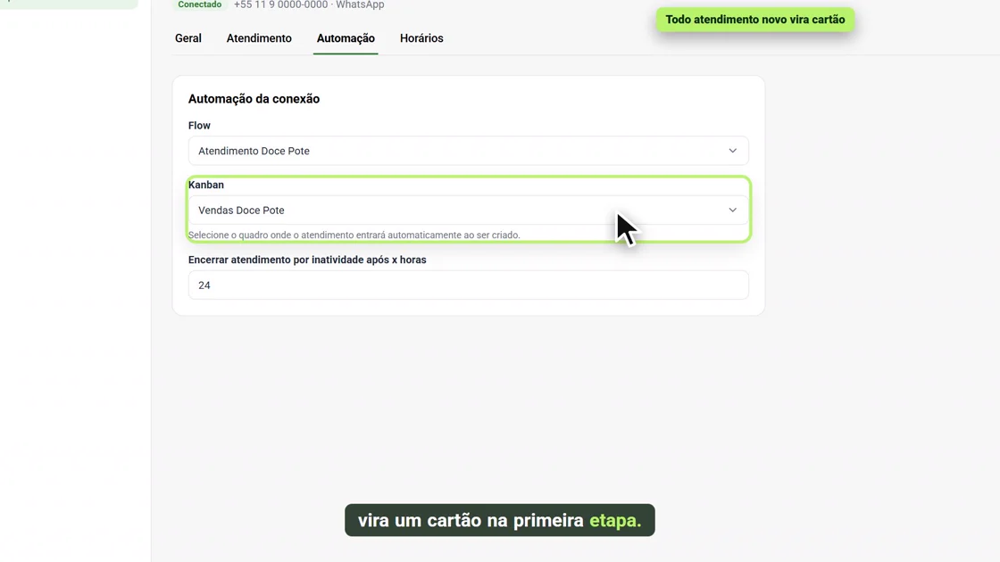
</Frame>

## Encontre itens e controle as próximas ações

No **Quadro**, cada coluna reúne os cartões de uma etapa. O cartão pode mostrar contato, canal, fila, atendente, não lidas, valor e tempo na etapa. Use a busca, os filtros de atendente e conexão ou **Atrasados primeiro**. **Precisa de atenção** destaca itens sem próximo passo, com atividade vencida ou que passaram do prazo da etapa.

<Frame caption="O quadro mostra o andamento dos cartões, seus responsáveis e valores.">
  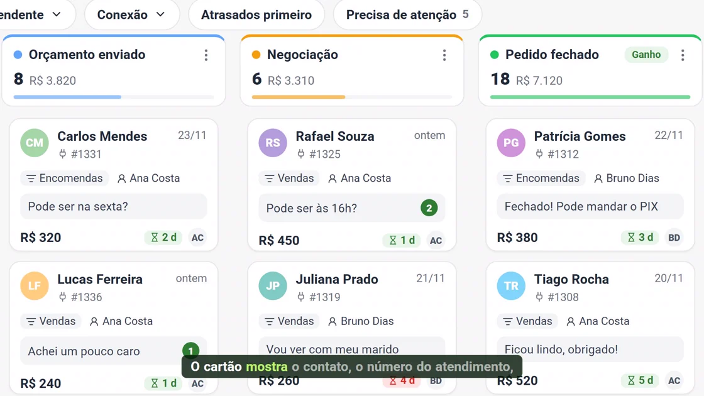
</Frame>

<Frame caption="Precisa de atenção explica por que cada item entrou na lista.">
  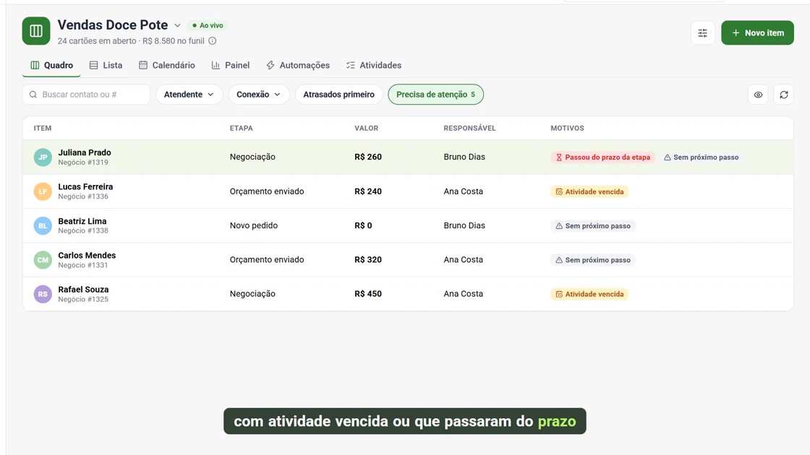
</Frame>

| Aba | Quando usar |
| --- | --- |
| **Lista** | Consulte os itens em tabela. Selecione cartões para mover, atribuir ou arquivar em lote, conforme suas permissões. Revise a seleção antes de confirmar. |
| **Calendário** | Veja atividades com prazo e previsões de fechamento nas respectivas datas. |
| **Atividades** | Acompanhe **Vencidas**, **Hoje**, **Próximas** e **Sem prazo**. Use **Concluir** ao terminar uma atividade. |
| **Painel** | Analise os resultados do quadro e onde os itens ficam mais tempo. |
| **Automações** | Configure e acompanhe regras por etapa. |

<Frame caption="O Calendário mostra as atividades e as datas previstas de fechamento.">
  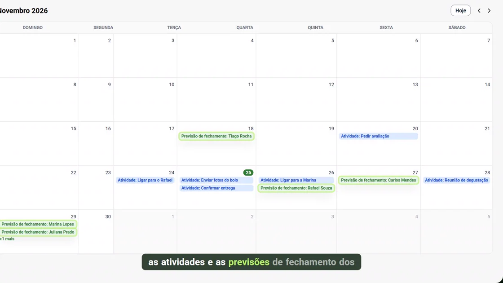
</Frame>

## Leia o Painel e leve os resultados ao Desempenho

No **Painel**, escolha o período oferecido na tela. Confira os indicadores do funil.

- **Previsão do mês** considera o valor dos negócios abertos com fechamento previsto no mês, ponderado pela probabilidade da etapa.
- **Ganho no mês** reúne o valor ganho no mês e permite comparar com a meta configurada.
- **Conversão geral** divide ganhos pela soma de ganhos e perdas. **Ciclo médio** mostra o tempo médio para ganhar um negócio.
- **Conversão e gargalos** ajuda a localizar etapas com itens acima do prazo ou do limite. Consulte também a previsão por mês, os resultados por responsável e os motivos de perda.

<Frame caption="O Painel reúne previsão, ganhos, conversão e gargalos do funil.">
  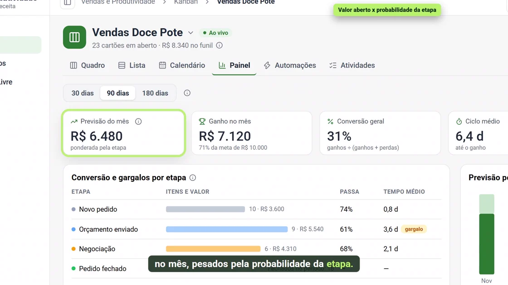
</Frame>

Para incluir o quadro no [Desempenho](/desempenho), edite o funil e ligue **Medir este quadro no Desempenho**. Confira as etapas de **Ganho** e **Perdido**. Se o formulário pedir, selecione o **Campo de valor da oportunidade** para registrar os valores. Ao habilitar a medição, o MultChat também processa os cartões que já estão em etapas de ganho ou perda. Escolha primeiro um quadro de teste se quiser conhecer esse efeito.

Em **Desempenho → Perdas e conversões**, selecione o quadro medido no funil e compare as etapas e o tempo até a perda. Revise período, quadro e origem antes de comparar com o **Painel** do Kanban. Em resultados sugeridos pela IA, revise a conversa e confirme o desfecho antes de contar como venda ou perda.

<Frame caption="Em Perdas e conversões, selecione o quadro medido para acompanhar o funil e o tempo até a perda.">
  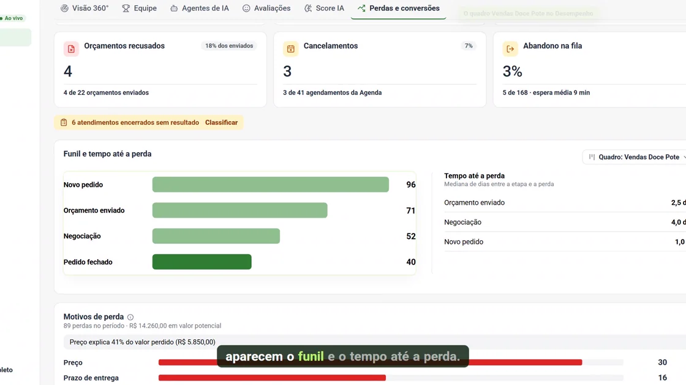
</Frame>

## Crie uma automação de etapa

1. Abra **Automações**, selecione **Orçamento enviado** e clique em **Nova regra**.
2. Em **Quando**, escolha o disparo por tempo na etapa e configure, por exemplo, **48 horas** parado em **Orçamento enviado**.
3. Em **Se**, escolha as condições necessárias. Para enviar mensagem pelo WhatsApp Oficial, confira a condição de janela aberta e as regras do canal.
4. Em **Então**, adicione uma ação, como criar uma atividade para o responsável. Comece com essa ação interna num quadro de teste. Depois, se necessário, adicione o envio de mensagem.
5. Salve, ative e confira o histórico de execuções. Em uma regra de teste por tempo, escolha um prazo que você possa aguardar para confirmar a execução.

As ações disponíveis variam conforme o disparo e os recursos configurados. Entre elas podem estar mover de etapa, criar atividade, atribuir responsável, enviar mensagem, iniciar fluxo ou criar um item em outro funil.

<Frame caption="Uma automação liga um disparo, condições e ações.">
  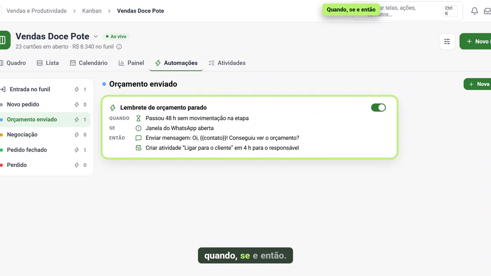
</Frame>

## Conecte o Kanban ao FlowBuilder e aos Agentes de IA

### Mova um item pelo fluxo

1. No [Construtor de fluxo](/flow-builder), adicione o bloco **Kanban** após a opção **Encomendas** do menu de teste.
2. Selecione a ação, por exemplo **Mover para etapa**, o quadro **Vendas Doce Pote** e a etapa **Novo pedido**. Teste também com um contato que ainda não tenha item. Configure a ação de criação se esse for o comportamento desejado.
3. Se habilitar a saída de erro, ligue **Falhou** a um próximo passo, como orientar o cliente ou encaminhar para Vendas. Salve, valide e simule. Depois, confira a movimentação no quadro com uma conexão de teste.

<Frame caption="Escolha a ação que o bloco Kanban deve executar e prepare um caminho para falhas.">
  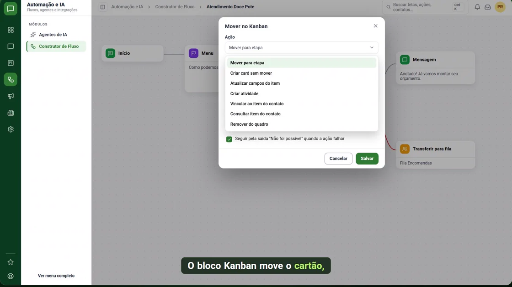
</Frame>

### Revise sugestões de IA

Quando o **Assistente** estiver configurado no Cofre de IA e disponível para sua equipe, consulte no item o resumo da conversa e as sugestões de ação, etapa, risco ou resposta. Se surgir uma oportunidade sugerida no atendimento, confira o funil e os dados antes de selecionar **Criar item**. Veja também como permitir ações na base de uma equipe de [Agentes de IA](/agentes-de-ia).

<Frame caption="O Assistente do item reúne sugestões para a equipe revisar.">
  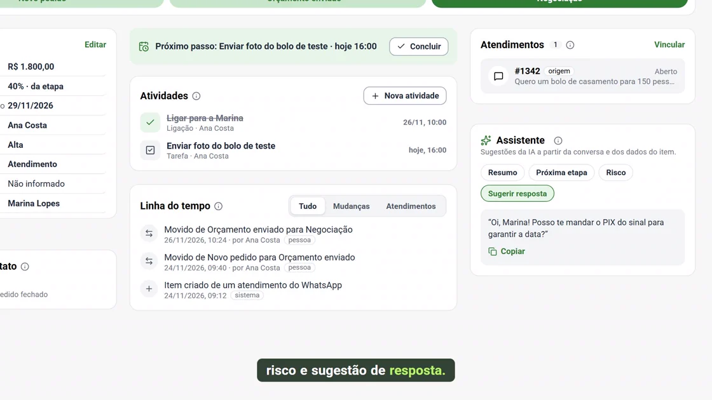
</Frame>

## Resolva problemas comuns

| Se acontecer | Onde conferir |
| --- | --- |
| Uma conversa nova não virou cartão | Confira o modo **Todos os atendimentos**, o campo **Kanban** da conexão e se o departamento está no escopo do quadro. |
| O cartão não muda de etapa | Verifique a permissão e se a etapa exige campos obrigatórios. Se alguém editou o item ao mesmo tempo, confira o estado atualizado antes de mover. |
| O ganho ou a perda não aparece no Desempenho | Confira a medição, o resultado da etapa, o campo de valor, o período e se o resultado já foi confirmado. |
| A automação não fez o esperado | Veja se a regra está ativa, se o disparo ocorreu e se as condições foram atendidas. Consulte o histórico antes de tentar de novo. |
| **Painel** ou **Automações** não aparece | Confira se seu perfil pode gerenciar o quadro e se o recurso está disponível para a empresa. |

<PageFeedback title="Crie um funil e acompanhe negócios no Kanban" path="kanban" />
