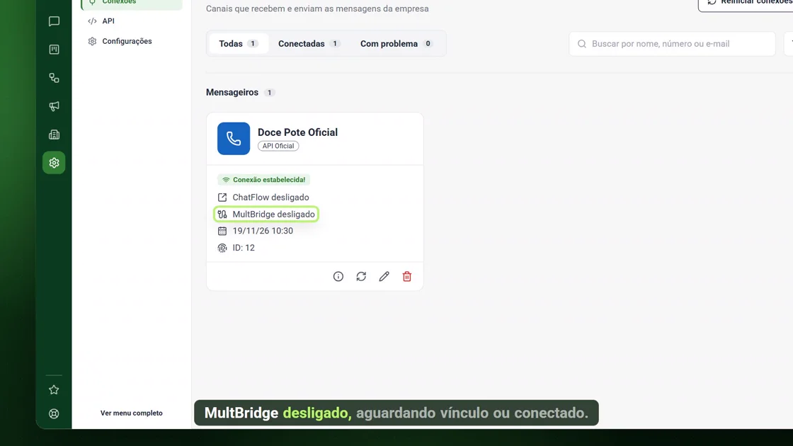
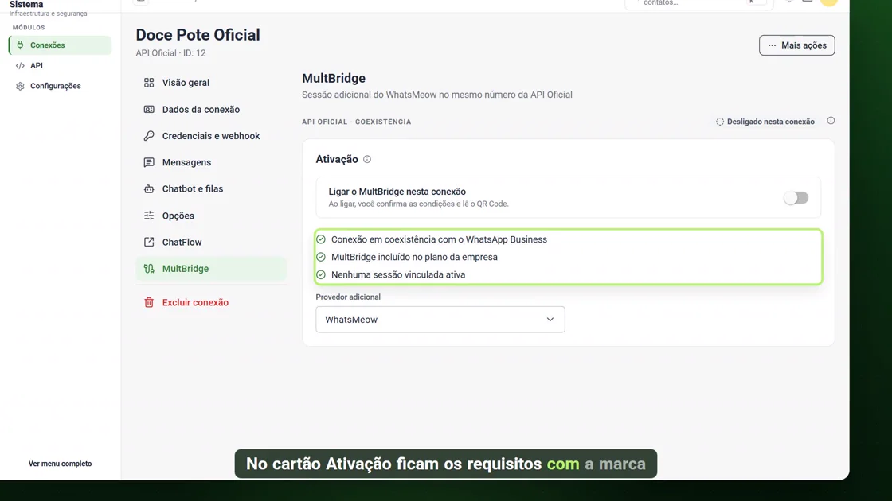
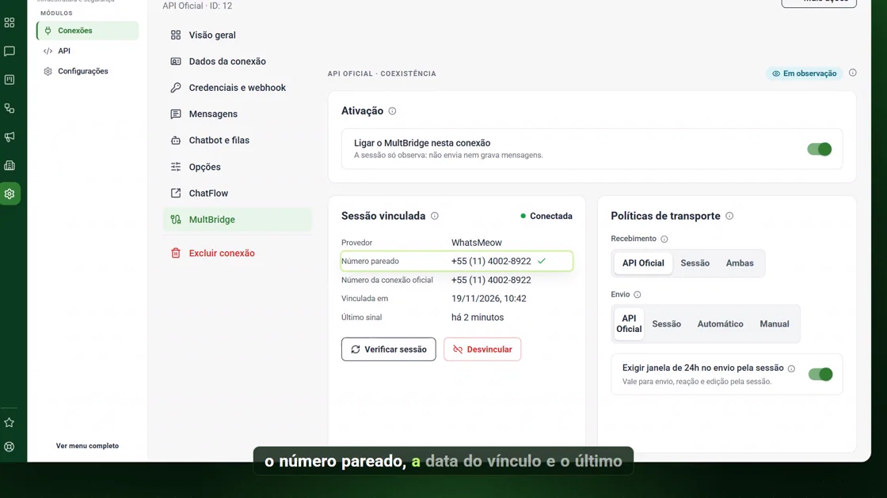
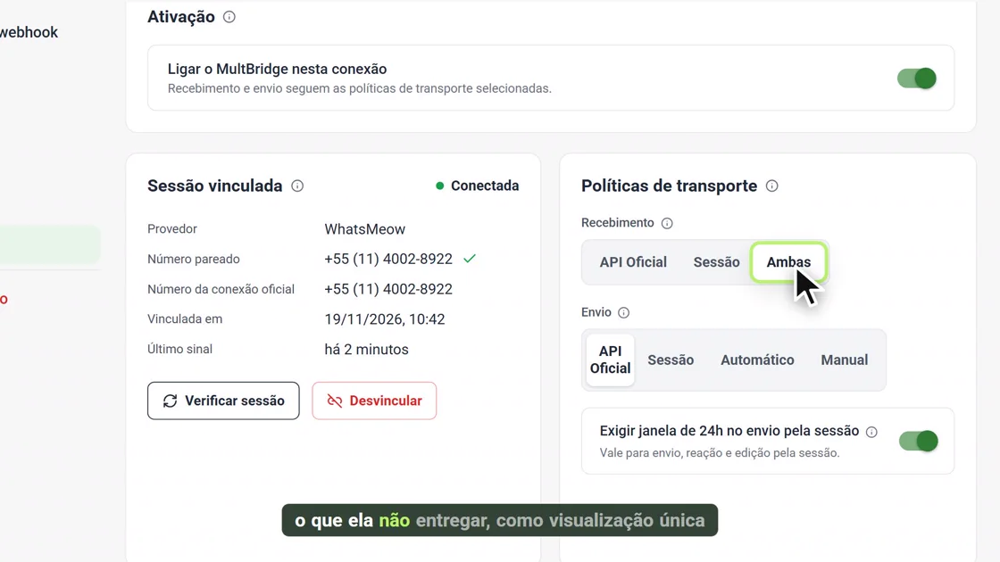
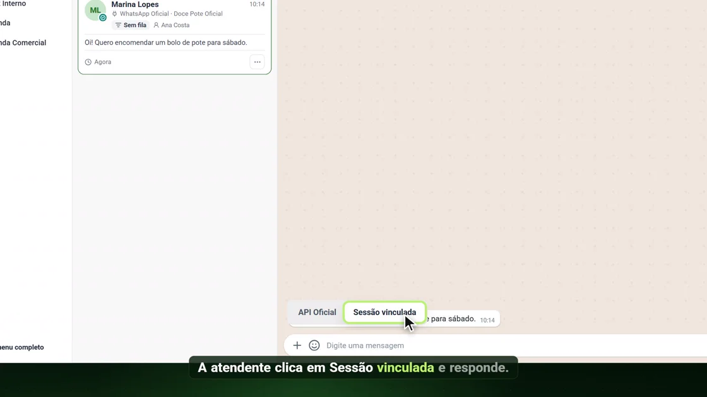
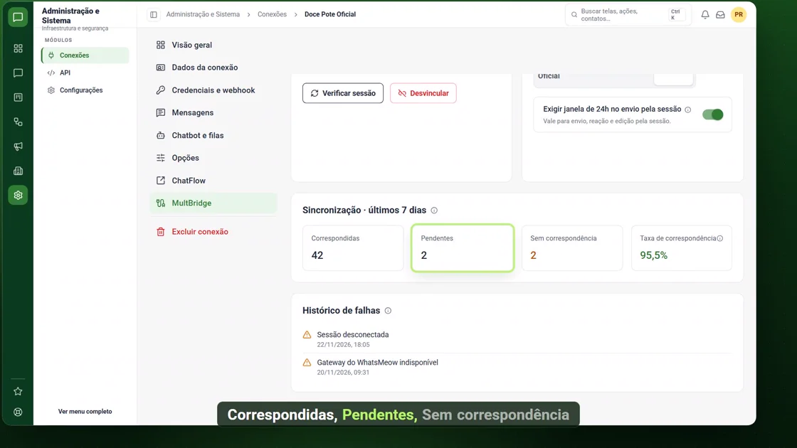

import { PageFeedback } from "/snippets/page-feedback.jsx";

O **MultBridge** vincula uma sessão adicional do **WhatsMeow** ao mesmo número de uma conexão da **API Oficial do WhatsApp** em coexistência. A conexão oficial continua sendo a principal. A sessão aparece dentro da própria conexão, e as políticas de transporte definem como as mensagens entram e saem do mesmo atendimento. As imagens são do vídeo de treinamento da **Doce Pote Confeitaria**, uma empresa fictícia.

## Antes de ativar

- Confira se o plano inclui **MultBridge** e se o recurso está disponível para a empresa.
- Use uma conexão da **API Oficial** em coexistência com o aplicativo **WhatsApp Business**. Tenha à mão o celular que usa esse número.
- Use um perfil com permissão para editar conexões. Em **Ativação**, confirme que o número da conexão foi identificado e que o gateway do **WhatsMeow** está disponível.
- Confira se o mesmo número já está em uma conexão WhatsMeow comum ativa. Nesse caso, o vínculo fica bloqueado. Revise os atendimentos que usam a conexão comum antes de decidir desconectá-la.

<Warning>
  O vínculo usa uma sessão de um cliente não oficial do WhatsApp. O MultChat mostra as condições de ativação, incluindo o risco de restrição ou bloqueio do número pela Meta. Leia as condições antes de confirmar.
</Warning>

<Frame caption="A lista de conexões mostra se o MultBridge está desligado, aguardando vínculo ou conectado.">
  
</Frame>

## Ative e vincule o número

1. Abra **Administração e Sistema → Conexões**. Entre na conexão oficial e abra **MultBridge**.
2. No cartão **Ativação**, confira os requisitos e o **Provedor adicional**, **WhatsMeow**. Ligue **Ligar o MultBridge nesta conexão**.
3. Leia o diálogo, marque **Li e aceito as condições do MultBridge** se estiver de acordo e clique em **Ativar e gerar QR Code**.
4. No celular do mesmo número, abra o **WhatsApp Business → Dispositivos conectados → Conectar dispositivo** e leia o código mostrado no MultChat. Mantenha a janela aberta enquanto vincula. O código é renovado se expirar.
5. No cartão **Sessão vinculada**, confirme o estado **Conectada** e compare **Número pareado** com **Número da conexão oficial**. Se os números forem diferentes, o MultChat desvincula a sessão. Use **Verificar sessão** para atualizar a verificação.

<Frame caption="Confira os requisitos no cartão Ativação antes de ligar o complemento.">
  
</Frame>

<Frame caption="O cartão da sessão mostra o número pareado, a data do vínculo e o último sinal.">
  
</Frame>

Em uma configuração nova, **Recebimento** e **Envio** começam em **API Oficial**. Quando o vínculo estiver pronto, o selo **Em observação** indica que a sessão acompanha a conexão enquanto as mensagens continuam pela API Oficial. Ao escolher uma política que usa a sessão para encaminhar mensagens, o selo passa a **Roteamento ativo**.

## Escolha as políticas de transporte

Faça os ajustes no cartão **Políticas de transporte** da conexão. Confira as duas seleções depois de mudar uma delas, pois **Recebimento** e **Envio** são configurados separadamente.

| Recebimento | Como as mensagens chegam |
| --- | --- |
| **API Oficial** | O atendimento registra as mensagens recebidas pela API Oficial. A sessão vinculada observa. |
| **Sessão** | A sessão tem prioridade. A API Oficial serve de reserva quando a sessão fica indisponível. |
| **Ambas** | A API Oficial tem prioridade. A sessão complementa com mensagens individuais compatíveis que a API não entrega ou marca como não suportadas. |

O MultChat correlaciona as mensagens dos dois caminhos para evitar registros duplicados no mesmo atendimento. Grupos ficam fora da sessão vinculada.

| Envio | Como o atendente responde |
| --- | --- |
| **API Oficial** | Usa a conexão oficial. |
| **Sessão** | Usa a sessão vinculada nos envios compatíveis. Quando ela estiver indisponível, o envio pode falhar. Confira o estado da sessão antes de repetir. |
| **Automático** | Prioriza a API Oficial. Pode usar a sessão se a conexão oficial já estiver desconectada antes de disparar o envio. Uma falha depois do disparo não aciona uma nova tentativa pelo outro caminho. |
| **Manual** | Mostra no atendimento a escolha entre **API Oficial** e **Sessão vinculada** quando aplicável. A seleção inicial é **API Oficial**. |

**Chatbot**, **fluxos**, **campanhas** e **templates** seguem pela API Oficial. Mantenha **Exigir janela de 24h no envio pela sessão** ligado no teste inicial. A opção aplica a janela a envios, reações e edições pela sessão. O envio pela API Oficial continua sujeito às regras da Meta. Se o atendimento já estiver com o [ChatFlow](/chatflow) ativo, a conversa na página tem prioridade.

<Frame caption="Recebimento e Envio têm seleções independentes na mesma conexão.">
  
</Frame>

## Teste em um atendimento

1. Na conexão de teste, escolha **Manual** no **Envio** e **Ambas** em **Recebimento**.
2. De um segundo número, mande uma mensagem de texto para a conexão oficial, como “Quero encomendar um bolo de pote”. Abra o atendimento e confira se a mensagem aparece uma vez.
3. No campo de resposta, confira a seleção inicial **API Oficial**. Selecione **Sessão vinculada** e envie uma confirmação de teste.
4. Confira a chegada da resposta no celular de teste e veja se ela ficou no mesmo atendimento do MultChat. Confira também o **Histórico de falhas** se o envio não sair.
5. Para voltar à configuração de observação, selecione **API Oficial** em **Recebimento** e **Envio**.

<Frame caption="A política Manual mostra o seletor de caminho junto ao campo de mensagem.">
  
</Frame>

## Acompanhe a sessão e resolva falhas

| O que você vê | O que conferir |
| --- | --- |
| **Correspondidas** | Mensagens que a API Oficial e a sessão observaram no período. |
| **Pendentes** | A correlação ainda está em andamento. |
| **Sem correspondência** | Só um caminho registrou a mensagem considerada. Compare com o tipo de mensagem e o estado da sessão. |
| **Taxa de correspondência** | Percentual de correspondidas entre as mensagens já decididas. O campo fica vazio enquanto não houver correspondências decididas. |

<Frame caption="Sincronização e Histórico de falhas ajudam a acompanhar a sessão.">
  
</Frame>

- **A aba não aparece.** Confira o acesso da empresa ao MultBridge e se abriu uma conexão da API Oficial em coexistência.
- **Aguardando vínculo ou número diferente.** Abra **Mostrar QR Code** ou **Vincular novamente** e leia o código no WhatsApp Business do número da conexão oficial.
- **Desconectada.** Abra **Histórico de falhas**. Confira se o dispositivo ainda está vinculado no celular e use **Verificar sessão** ou **Vincular novamente**. A API Oficial continua recebendo quando está conectada.
- **Sessão vinculada indisponível no campo de resposta.** Confira a política de envio, o estado da sessão e a janela de atendimento. Quando a política for **Manual** e a API Oficial estiver disponível, selecione o caminho oficial se for adequado à conversa.

## Desvincule a sessão ou desligue o MultBridge

Use **Desvincular** no cartão **Sessão vinculada** para retirar o aparelho atual. Para desligar todo o complemento, desligue o controle **Ligar o MultBridge nesta conexão** no cartão **Ativação** e confirme **Desligar**. Isso também desvincula a sessão. A conexão da API Oficial continua disponível.

<PageFeedback title="Vincule e configure o MultBridge" path="multbridge" />
