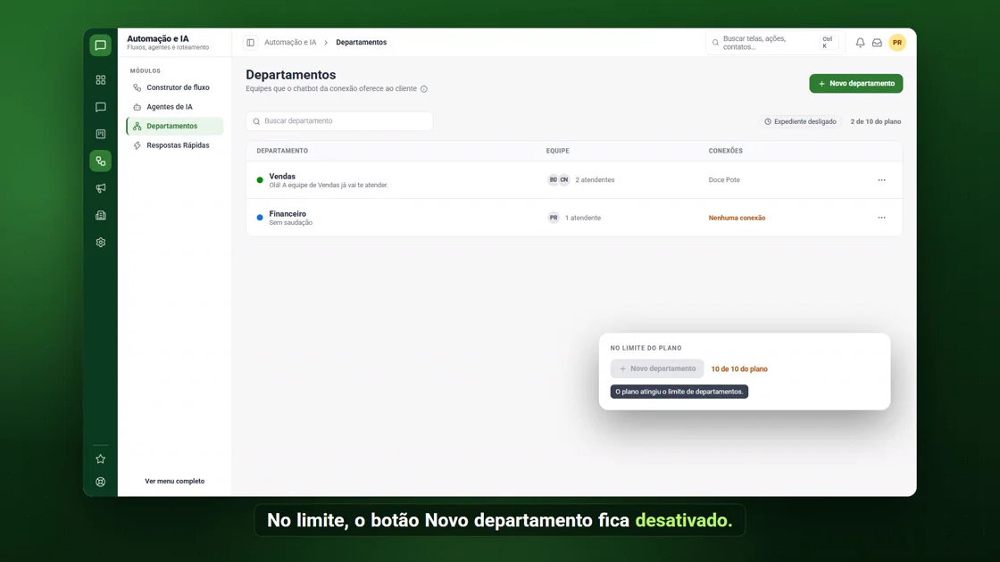
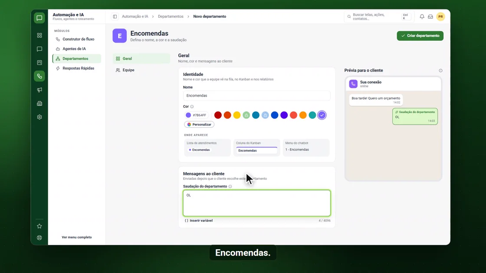
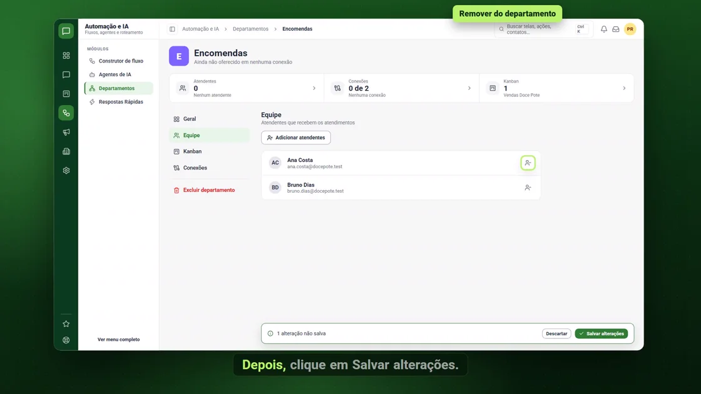
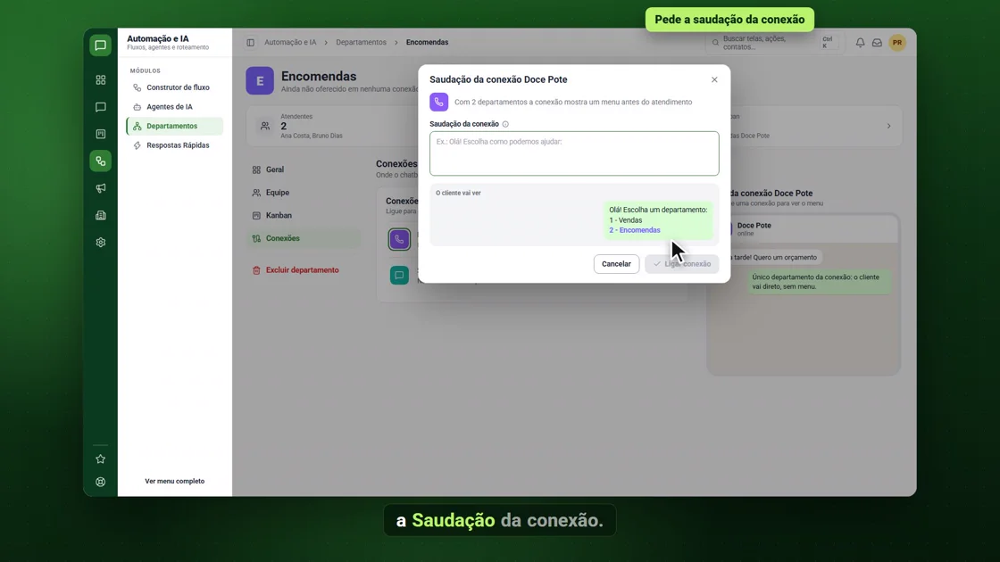
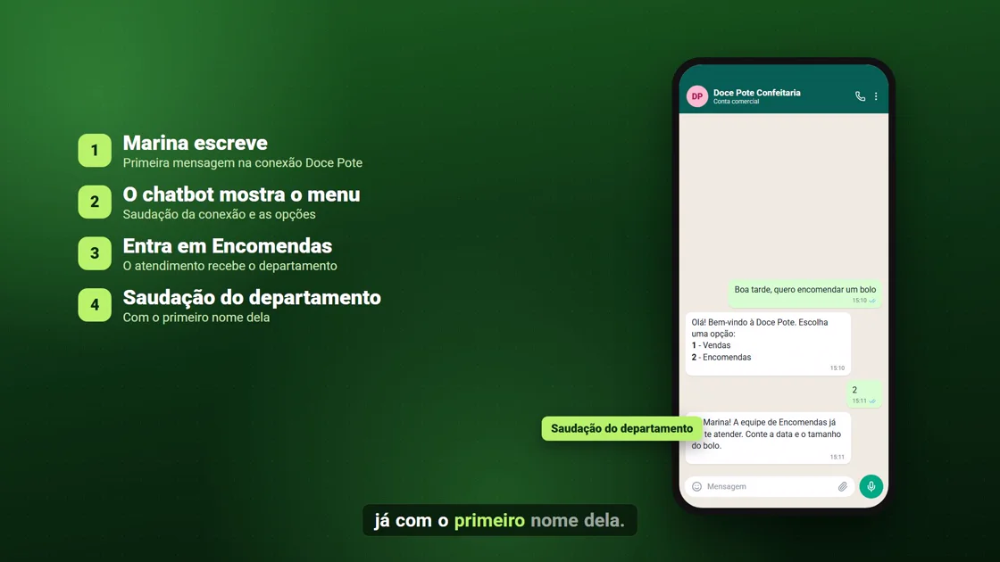
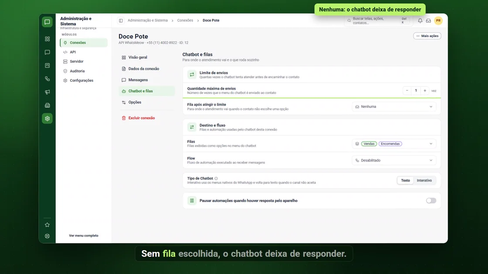
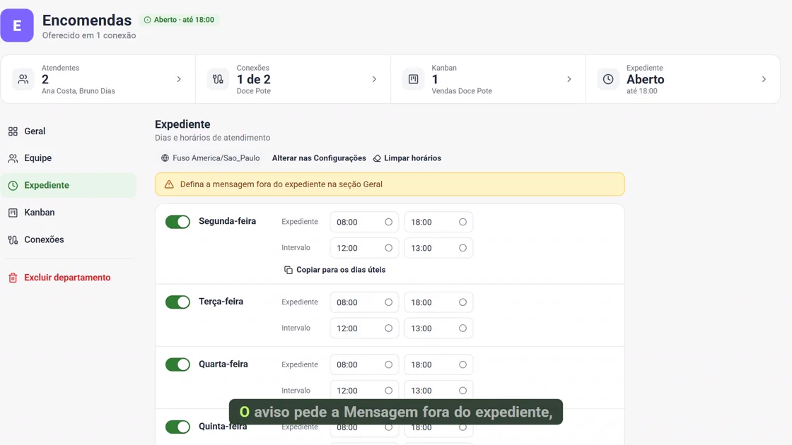
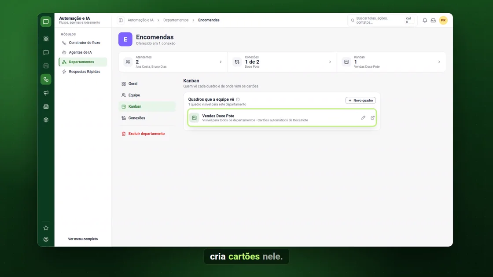
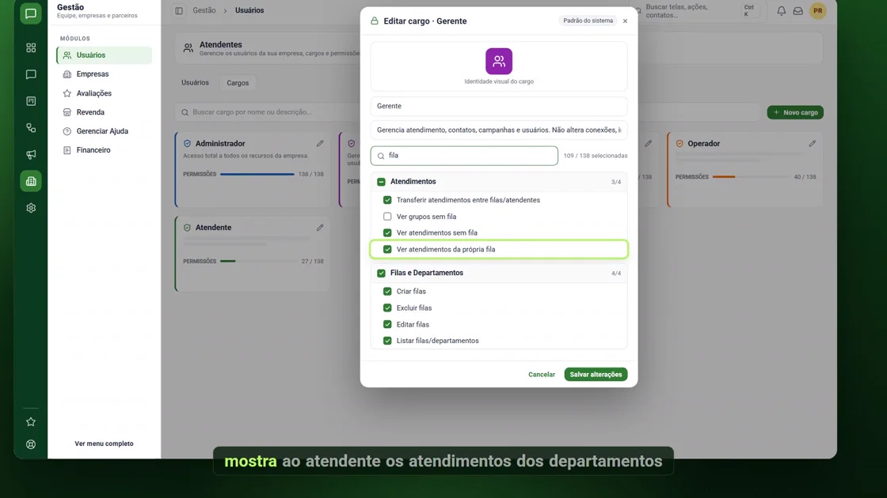

import { PageFeedback } from "/snippets/page-feedback.jsx";

Um departamento é uma fila de atendimento. Neste tutorial, você vai criar **Encomendas** e fazer com que as mensagens sobre bolos cheguem à equipe certa. As imagens são cenas ilustradas do vídeo de treinamento da **Doce Pote Confeitaria**, uma empresa fictícia.

## Antes de começar

- Tenha uma [conexão de WhatsApp ativa](/primeiros-passos#conecte-o-whatsapp), um segundo número para testar e os atendentes já cadastrados em **Usuários**.
- Use um cargo que possa listar, criar e editar departamentos. Para vincular a conexão, também precisa poder listar e editar conexões. Veja as [permissões por tarefa](#defina-as-permissões-dos-cargos).
- Para reproduzir o menu do exemplo, comece com **Vendas** já ligado à conexão **Doce Pote**. Em uma conexão com um **Flow** ativo, confira o fluxo antes de testar, pois ele pode conduzir a conversa no lugar do menu padrão.

## Abra a lista de departamentos

No menu **Automação e IA**, abra **Departamentos**. Use **Buscar departamento** para localizar um cadastro. Cada linha mostra o nome, a cor, a saudação, a equipe e as conexões que oferecem aquele departamento.

No topo, veja o modo de expediente e, quando o plano tem limite, quantos departamentos já foram usados. Ao atingir o limite, **Novo departamento** fica desativado. O ícone de ajuda explica como as filas aparecem no chatbot.

<Frame caption="Lista de departamentos, vínculos e exemplo de limite do plano.">
  
</Frame>

## Crie o departamento Encomendas

1. Selecione **Novo departamento**. Na seção **Geral**, abra **Identidade**.
2. Em **Nome**, digite **Encomendas**. Escolha uma **Cor** disponível ou use **Personalizar**. O cadeado identifica uma cor já usada por outro departamento.
3. Confira **Onde aparece** para ver como o nome e a cor serão identificados na lista de atendimentos, no Kanban e no menu do chatbot.
4. Em **Mensagens ao cliente**, preencha **Saudação do departamento**. Para citar o contato pelo primeiro nome, selecione **Inserir variável → Primeiro nome**.
5. Confira o resultado na **Prévia para o cliente**, que usa dados de exemplo. Selecione **Criar departamento**.

Uma saudação possível para Encomendas é a seguinte.

```text
Olá, {{firstName}}! Você está em Encomendas. Vamos ajudar você a escolher o bolo.
```

O seletor também permite inserir nome completo, saudação, protocolo, data e hora.

<Frame caption="Seção Geral com nome, cor, saudação e prévia para o cliente.">
  
</Frame>

## Adicione os atendentes

1. Abra **Encomendas → Equipe** e selecione **Adicionar atendentes**.
2. Busque e marque as pessoas que vão cuidar da fila. No exemplo, são **Ana Costa** e **Bruno Dias**.
3. Selecione **Confirmar** e depois **Salvar alterações**.

Para retirar alguém, use **Remover do departamento** e salve. Você também pode conferir o vínculo em **Usuários → Configuração → Filas e departamentos**, dentro do cadastro do atendente.

<Frame caption="Equipe de Encomendas com os dois atendentes do exemplo.">
  
</Frame>

## Ligue Encomendas à conexão

Quem apresenta as opções ao cliente é o **chatbot da conexão**. A saudação da conexão abre o menu. A saudação do departamento é enviada quando o cliente escolhe a fila ou é encaminhado direto para o único departamento vinculado.

| Departamentos ligados | O que acontece com uma nova conversa no exemplo |
| --- | --- |
| Apenas **Vendas** | A conversa vai direto para Vendas, com a saudação configurada para esse departamento. |
| **Vendas** e **Encomendas** | A conexão envia sua saudação e o menu. O cliente escolhe o departamento e recebe a saudação da fila selecionada. |

1. Em **Encomendas**, abra **Conexões**.
2. Encontre **Doce Pote** e ative a chave para oferecer **Encomendas** nessa conexão.
3. Se abrir **Saudação da conexão**, preencha a mensagem, revise **O cliente vai ver** e selecione **Ligar conexão**. O diálogo aparece quando a conexão passa a ter dois ou mais departamentos e ainda está sem saudação.
4. Confira a confirmação e a posição de Encomendas na prévia do menu. Se a conexão já tiver uma saudação, a chave salva o vínculo diretamente.

Com acesso somente para consulta, a seção mostra apenas as conexões já vinculadas.

Uma saudação possível para a conexão é a seguinte.

```text
Olá! Boas-vindas à Doce Pote. Escolha como podemos ajudar.
```

<Frame caption="Diálogo para cadastrar a saudação que abre o menu da conexão.">
  
</Frame>

## Teste o caminho do cliente

1. Em uma conversa de teste nova, envie “Boa tarde, quero encomendar um bolo” do segundo número para a conexão **Doce Pote**.
2. Confira se a resposta traz a saudação da conexão e as duas opções. Escolha **Encomendas** usando o número indicado ou a opção interativa. No vídeo, é a opção **2**.
3. Confira se o WhatsApp recebe a saudação de **Encomendas**. Se usou a variável de primeiro nome e o contato se chama Marina Lopes, a mensagem começa com “Olá, Marina!”.
4. Entre com um atendente da equipe e abra **Atendimentos → Aguardando**. Localize a conversa e confira a etiqueta **Encomendas** antes de aceitar.

<Frame caption="Conversa de teste após a escolha de Encomendas.">
  
</Frame>

## Ajuste o chatbot da conexão

No menu principal, abra **Conexões → Doce Pote → Chatbot e filas**.

- Em **Filas**, confira se **Vendas** e **Encomendas** estão selecionadas.
- Em **Quantidade máxima de envios**, ajuste quantas vezes o menu pode ser enviado. Uma resposta fora das opções pode fazer o menu ser reenviado. Para testar o limite, use um valor positivo e mande respostas inválidas até o limite ser atingido.
- Em **Fila após atingir o limite**, escolha para onde mandar a conversa quando o cliente não selecionar uma opção válida. Com **Nenhuma**, o menu deixa de responder ao atingir o limite.
- Em **Tipo de Chatbot**, use **Texto** para o menu numerado ou **Interativo** para botões ou lista, conforme o canal e a quantidade de opções.

Para editar a **Saudação da conexão**, abra **Mensagens** na mesma conexão. Salve e repita o teste em uma conversa nova.

<Frame caption="Ajustes de reenvio, destino após o limite e filas na conexão.">
  
</Frame>

## Defina o expediente de Encomendas

1. Abra **Configurações → Expediente → Horário de expediente** e selecione **Por Fila/Setor**. Confira também o fuso horário da empresa.
2. Volte a **Departamentos → Encomendas → Expediente** e selecione **Definir horários**. O painel começa com segunda a sexta, das **08:00 às 18:00**.
3. Ajuste os dias, o início e o fim do expediente. Para incluir almoço, preencha os dois horários do intervalo, ambos dentro do expediente. Use **Copiar para os dias úteis** para repetir o horário de um dia nos outros.
4. Em **Geral**, preencha **Mensagem fora do expediente**. Volte a **Expediente** para revisar os horários e selecione **Salvar alterações**.

No celular, toque no dia para editar, ligue **Atende neste dia** se necessário e confirme com **Aplicar** antes de salvar o departamento.

Com a mensagem preenchida, um cliente que escolhe Encomendas fora do horário recebe o aviso do departamento. Com o campo vazio, o atendimento segue normalmente. Na lista de Departamentos, a coluna **Agora** mostra **Aberto**, **Intervalo**, **Fechado** ou **Sem horário**. Um departamento sem horário definido fica sempre aberto.

<Frame caption="Expediente por departamento com fuso, horários e intervalos.">
  
</Frame>

## Controle quem vê os quadros do Kanban

Se o módulo **Kanban** estiver ativo e seu cargo tiver acesso, abra **Encomendas → Kanban**. A lista mostra **Quadros que a equipe vê** e identifica as conexões que criam cartões automaticamente em cada quadro. Para criar ou editar um quadro, use um cargo com permissão para gerenciá-lo.

1. Para criar um quadro que comece visível para **Encomendas**, selecione **Novo quadro**.
2. Para mudar um quadro existente, use o lápis **Editar quem vê**.
3. Em **Quem vê este quadro**, mantenha **Todos os departamentos** ou selecione **Departamentos escolhidos** e marque quem deve ver o quadro. Salve.

A visibilidade do quadro e a conexão que cria cartões nele são configurações distintas. Confira a conexão indicada na lista se os cartões automáticos não aparecerem.

<Frame caption="Quadros do Kanban visíveis para Encomendas.">
  
</Frame>

## Defina as permissões dos cargos

Abra **Usuários → Cargos**, edite o cargo desejado e salve após conferir as permissões.

| Tarefa no painel | Permissões a conferir |
| --- | --- |
| Abrir a lista e consultar um departamento | **Listar filas/departamentos**, no grupo **Filas e Departamentos**. |
| Criar, alterar ou excluir departamentos | **Criar filas**, **Editar filas** ou **Excluir filas**, conforme a tarefa. |
| Ver os vínculos na seção **Conexões** do departamento | **Listar conexões**. |
| Ligar ou desligar um departamento na conexão | **Editar filas** e **Editar conexões**, além de acesso à seção. |
| Ver as conversas das filas atribuídas ao atendente | **Ver atendimentos da própria fila**, no grupo **Atendimentos**, e vínculo com as filas em **Usuários**. |

Nos cargos padrão, **Gerente** pode criar e editar departamentos e **Supervisor** pode listá-los. Confira sempre as permissões atuais do cargo que a pessoa usa.

<Frame caption="Permissões de fila e atendimento no cadastro de um cargo.">
  
</Frame>

## Resolva problemas comuns

<AccordionGroup>
  <Accordion title="O botão Novo departamento não está disponível">
    Confira se o cargo permite **Criar filas** e se a contagem exibida na lista atingiu o limite do plano.
  </Accordion>
  <Accordion title="O menu não aparece no WhatsApp">
    Confira se a conexão tem pelo menos dois departamentos e se a saudação da conexão está preenchida. Verifique também se há um **Flow** ativo na conexão e repita o teste em uma conversa nova.
  </Accordion>
  <Accordion title="O atendente não encontra a conversa">
    Confira a etiqueta da fila, o vínculo do atendente em **Equipe**, a permissão **Ver atendimentos da própria fila** e os filtros em **Aguardando**.
  </Accordion>
  <Accordion title="Expediente não aparece na página do departamento">
    Em **Configurações**, confira se **Horário de expediente** está em **Por Fila/Setor**. Se o horário estiver configurado, revise o fuso e a mensagem fora do expediente.
  </Accordion>
  <Accordion title="Quero excluir um departamento ou reutilizar sua cor">
    Cada departamento deve ter uma cor diferente. Se decidir excluir um departamento, use **Excluir departamento** e revise a confirmação. Os atendimentos são preservados sem o departamento, e a equipe, as conexões e os quadros perdem o vínculo.
  </Accordion>
</AccordionGroup>

<PageFeedback title="Departamentos" path="organizar-equipe" />
