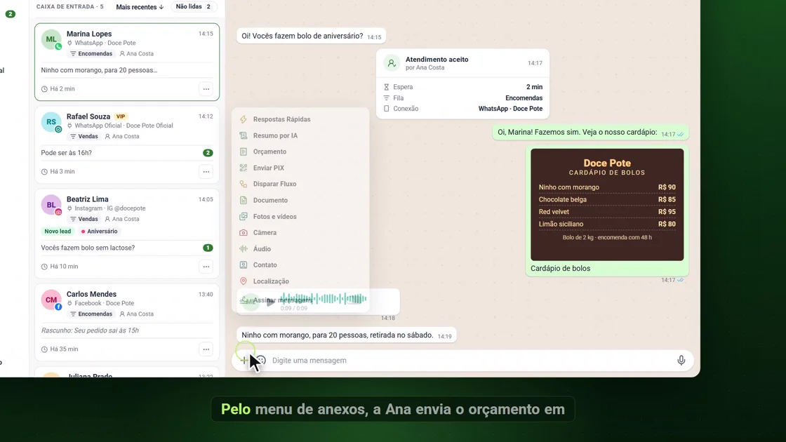
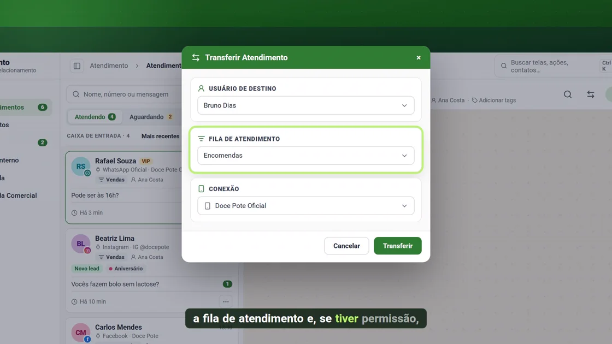

import { PageFeedback } from "/snippets/page-feedback.jsx";

No MultChat, várias pessoas podem atender pelo mesmo número de WhatsApp. Cada conversa pode ter uma fila e um responsável. Você pode transferir a conversa com o histórico e, com o recurso habilitado, converter uma mensagem de voz em texto no próprio atendimento.

[Transferir atendimento](#transfira-para-outra-pessoa-ou-fila) · [Transcrever áudio](#transcreva-uma-mensagem-de-áudio) · [Resolver atendimento](#resolva-e-consulte-o-resultado)

## Prepare a equipe e conecte o número

No exemplo dos tutoriais, a **Doce Pote Confeitaria** tem duas filas. **Vendas** responde sobre cardápio e preços. **Encomendas** cuida dos pedidos e da retirada.

1. Abra **Automação e IA → Departamentos → Novo departamento**. Crie as filas que sua empresa usa.
2. Abra cada departamento, selecione **Equipe → Adicionar atendentes**, escolha as pessoas e salve as alterações.
3. Abra **Conexões → Nova conexão** e conecte o número por **QR Code** ou **API Oficial**, conforme a opção habilitada para a empresa. [Veja como conectar o número](/primeiros-passos#conecte-o-whatsapp).
4. Na aba **Conexões** de cada departamento, vincule a fila ao número. Se o painel pedir a **Saudação da conexão**, preencha e confira a prévia do menu.
5. Em **Usuários → Cargos**, confira quem pode ver os atendimentos da própria fila e quem pode transferir. Confira também se cada pessoa está vinculada ao departamento que deve atender.

Com o chatbot padrão e um único departamento vinculado, o cliente segue direto para essa fila. Com mais de um, ele pode escolher no menu. Se a conexão usa um fluxo ativo, confira para qual fila cada opção encaminha. [Veja como configurar o menu e as permissões](/organizar-equipe).

## Receba e responda à primeira conversa

1. Envie uma mensagem de outro número para o WhatsApp conectado. Se o menu aparecer, escolha **Encomendas**.
2. Abra **Atendimento → Atendimentos → Aguardando**. Busque pelo nome ou número, confira a fila no cartão e clique em **Aceitar**.
3. Abra a conversa em **Atendendo**. Leia o histórico, escreva sua resposta e envie. Para enviar o cardápio da Doce Pote, por exemplo, use **+ → Fotos e vídeos**.
4. Confira no segundo número se a mensagem chegou. Se estiver usando o **WhatsApp Oficial**, veja o contador no cabeçalho. Quando a janela de 24 horas estiver encerrada e o campo bloquear texto livre, use um [modelo aprovado](/templates-whatsapp) para retomar o contato.

<Frame caption="Na demonstração, a equipe aceita a conversa e envia o cardápio no mesmo atendimento.">
  
</Frame>

## Transfira para outra pessoa ou fila

Use a transferência quando a conversa precisar seguir com outro atendente ou departamento. Por exemplo, depois de enviar o cardápio, **Vendas** pode passar um pedido para **Encomendas**.

1. Abra a conversa em **Atendendo** e clique no ícone de duas setas no cabeçalho, **Transferir Atendimento**.
2. Em **Usuário de Destino**, escolha quem vai continuar a conversa. Em **Fila de Atendimento**, selecione a fila de destino se precisar mudar de departamento. Para deixar alguém da fila assumir depois, escolha **Sem atendente** e selecione a fila.
3. Se estiver mudando também o número de atendimento, use **Conexão** quando a sua permissão e as conexões disponíveis permitirem essa transferência.
4. Clique em **Transferir**. Quando você escolhe uma pessoa, o atendimento segue para ela. Quando escolhe apenas a fila, a conversa volta a **Aguardando** nessa fila para que alguém com acesso possa aceitá-la.
5. Confirme a transferência pelo cartão **Atendimento transferido** no histórico. A pessoa que recebe a conversa pode consultar as mensagens anteriores conforme seu acesso.

<Frame caption="Escolha o atendente, a fila e, quando disponível, a conexão de destino.">
  
</Frame>

Se o painel pedir para desafixar a conversa, remova a fixação e tente de novo. Para devolver a conversa à espera da própria fila, use **⋯ → Devolver à fila** no cabeçalho. [Veja mais ações do atendimento](/atender-conversas#use-as-ações-do-cabeçalho).

## Transcreva uma mensagem de áudio

1. Abra a conversa e localize a mensagem de voz. No computador, passe o mouse sobre o áudio e clique na seta para baixo que abre **as opções da mensagem**. No celular, toque e segure a mensagem.
2. Selecione **Transcrever** e aguarde. O painel mostra o texto junto do áudio. Se a mensagem já tiver sido transcrita, clique em **Transcrição** para abrir ou recolher o texto.
3. Use o texto para localizar o que o cliente pediu. Ouça o trecho original para confirmar informações como endereço, quantidade, horário ou valor antes de responder.

A transcrição fica no histórico do atendimento. Para responder ao cliente, escreva e envie uma mensagem pelo campo de resposta.

**Se a opção não aparecer**, verifique se você abriu o menu de uma mensagem de áudio e peça a um administrador para conferir **Transcrição de áudio** na seção **Recursos de IA**. O recurso precisa estar ativo e ter uma opção de processamento configurada. Se aparecer **Não foi possível transcrever**, confirme se o áudio está disponível, se há fala audível e use **Tentar de novo**. [Veja como configurar a transcrição](/atender-conversas#configure-a-transcrição-de-áudio).

## Resolva e consulte o resultado

1. Quando terminar, clique em **Resolver** no cabeçalho.
2. Se a conexão pedir uma classificação, escolha o resultado, como **Venda realizada** ou **Aguardando pagamento**. Informe o valor quando for aplicável.
3. Revise em **Ao finalizar** se há mensagem de despedida ou pesquisa de satisfação e clique em **Finalizar**.
4. Use **⋯ → Resolvidos** na lista para localizar a conversa depois. Os resultados registrados aparecem em [Desempenho → Perdas e conversões](/desempenho).

## Encontre uma conversa que saiu da lista

Confira **Atendendo** e **Aguardando** e limpe os filtros de fila, atendente ou etiquetas. Uma transferência pode mudar a fila, o responsável e quem consegue ver a conversa. Use **Busca geral** ou **Resolvidos**, conforme seu acesso. Se ela nunca apareceu, verifique se a mensagem chegou ao número conectado e confirme seu vínculo com a fila que recebe as mensagens.

## Escolha o próximo passo

<Columns cols={2}>
  <Card title="Distribua conversas por assunto" icon="workflow" href="/flow-builder">
    Crie um menu para vendas e suporte, colete uma resposta e encaminhe para a fila certa.
  </Card>
  <Card title="Teste um agente de IA" icon="bot" href="/agentes-de-ia">
    Use o cardápio e as regras da empresa como base. Simule as respostas e confirme a transferência humana.
  </Card>
  <Card title="Acompanhe pedidos e vendas" icon="columns-3" href="/kanban">
    Use um funil para registrar orçamentos, próximos passos, ganhos e perdas.
  </Card>
  <Card title="Continue a conversa pela web" icon="messages-square" href="/chatflow">
    Na API Oficial, veja como convidar clientes para conversar no navegador dentro do mesmo atendimento.
  </Card>
</Columns>

## Perguntas comuns

### Vários atendentes podem usar o mesmo número?

A equipe pode atender as conversas de uma conexão compartilhada no painel. O acesso de cada pessoa depende do perfil e das filas configuradas. Use o [guia de Departamentos](/organizar-equipe) para organizar a distribuição do atendimento.

### Posso começar com um menu e ligar a IA depois?

Sim. Comece com um [fluxo de teste](/flow-builder) que recebe o cliente e encaminha para a equipe. Depois, configure [Agentes de IA](/agentes-de-ia), simule a conversa e defina quando uma pessoa deve assumir.

### Qual tipo de conexão devo usar?

As opções dependem dos canais disponíveis para sua empresa e dos recursos que você precisa. Se a equipe usa a API Oficial, por exemplo, confira as regras de [janela do WhatsApp e modelos aprovados](/atender-conversas#confira-as-regras-do-canal).

## Converse com vendas

Para avaliar a configuração da sua empresa, informe quais canais usa, quantas pessoas atendem e o que deseja automatizar. [Fale com vendas no WhatsApp](https://wa.me/5569981028003?text=Ol%C3%A1!%20Vim%20pelo%20manual%20do%20MultChat%20e%20quero%20conhecer%20o%20atendimento%20em%20equipe%20pelo%20WhatsApp.) · [Conheça o site do MultChat](https://www.multchat.net/).

<PageFeedback title="Atendimento pelo WhatsApp em equipe" path="whatsapp-em-equipe" />
